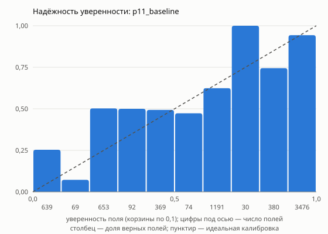
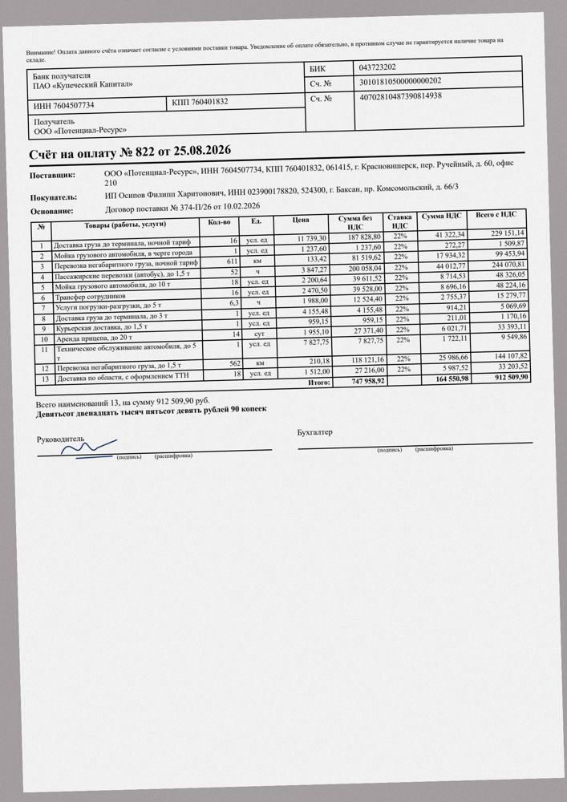
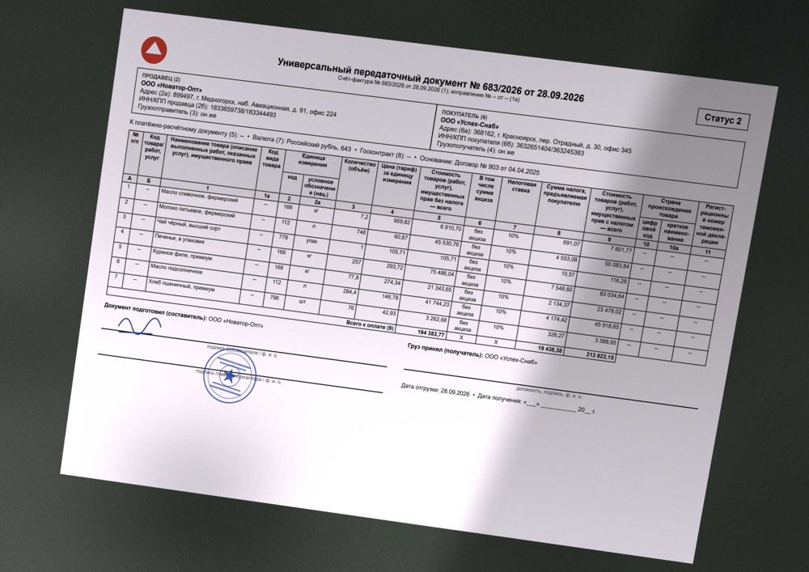
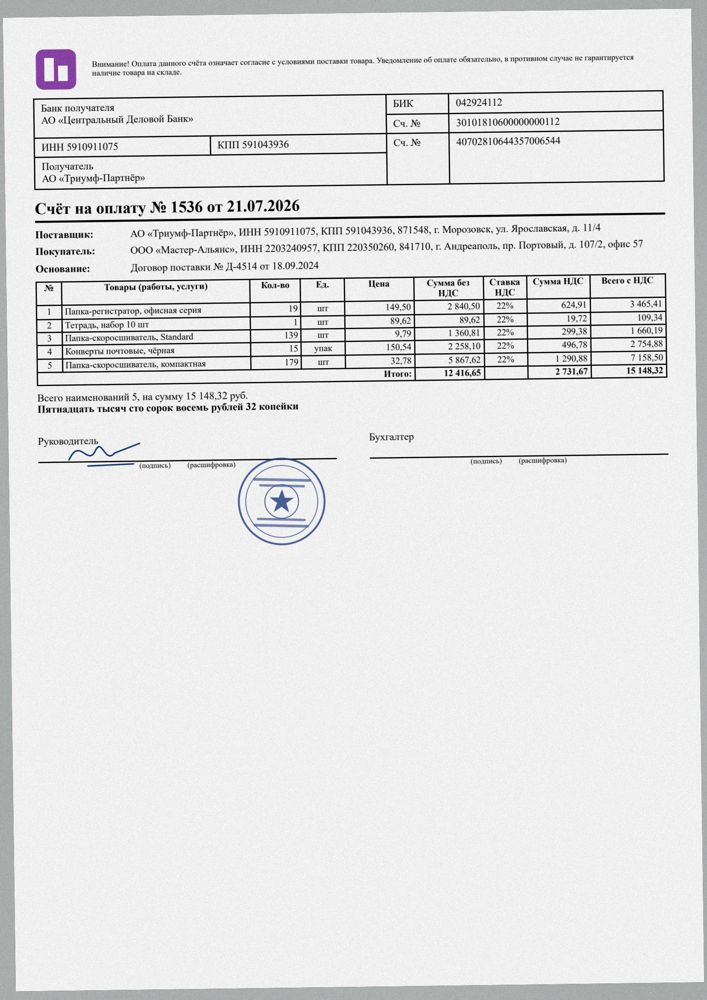
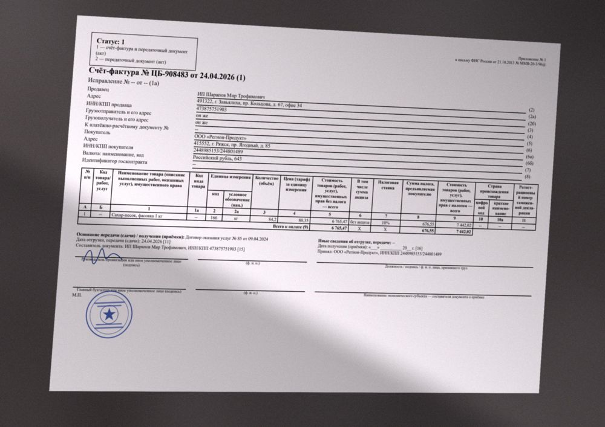
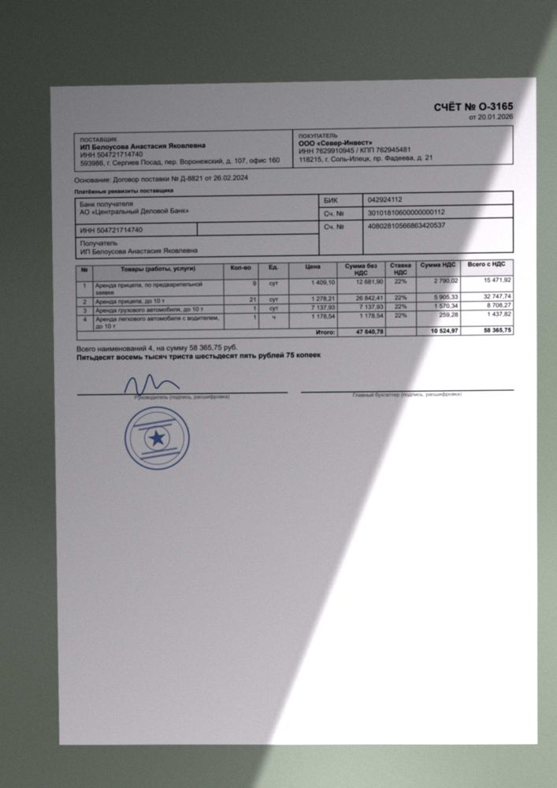

# Оценка: p11_baseline

Базовая линия: Qwen3.5-2B Q8_0, путь auto (чистый PDF → текстовый слой, скан и фото → vision), промпты text_v1 и vision_v1, постобработка P10 с константами D42. 100 документов сплита test, стратифицированы по типу, каждый документ — на одном уровне качества (по кругу).

Запуск: `uv run docai eval --config configs/eval/p11_baseline.yaml` (копия — `config.yaml`). docai 0.1.0.

| Параметр | Значение |
|---|---|
| Модель | `qwen3.5:2b-q8_0` |
| Путь извлечения | `auto` |
| Промпты | `text_v1`, `vision_v1` |
| Выборка | 100 прогонов, 100 документов, сплит `test`, уровни clean, scan, photo (rotate) |
| Seed | 2026 |
| Интервалы | бутстреп по документам, 2000 повторов, 95% |

## Главное

В скобках — 95-процентный доверительный интервал (бутстреп по документам, D45).

| Метрика | Значение |
|---|---|
| Документов без ошибок в обязательных полях (можно загружать без правок) | 2,0% [0,0; 5,0] |
| Тип документа верен | 86,0% [79,0; 92,0] |
| Документ собран (валидный JSON) | 100,0% [100,0; 100,0] |
| Поля шапки: accuracy | 66,7% [63,4; 69,9] |
| Обязательные поля шапки: accuracy | 71,8% [68,5; 75,0] |
| Выдумки: значение при пустом эталоне | 19,1% [11,6; 28,8] |
| Текстовые поля: ANLS | 82,9% [78,1; 87,4] |
| Текстовые поля: accuracy | 74,1% [68,5; 79,2] |
| Строки: precision (найдена пара) | 83,2% [76,1; 89,9] |
| Строки: recall (найдена пара) | 87,1% [80,0; 93,7] |
| Строки: F1 (найдена пара) | 85,1% [78,3; 91,5] |
| Строки: F1 (строка верна целиком) | 37,9% [27,2; 48,6] |
| Ячейки: precision | 75,6% [68,2; 82,4] |
| Ячейки: recall | 77,6% [70,5; 84,3] |
| Ячейки: F1 | 76,6% [69,5; 83,2] |
| Статус «можно загружать» | 4,0% [1,0; 8,0] |
| Среди «можно загружать» — действительно без ошибок | 0,0% [0,0; 0,0] |
| Молча загружен с ошибкой (доля всех документов) | 4,0% [1,0; 8,0] |
| Документ с ошибкой отправлен на проверку или отклонён | 95,9% [91,8; 99,0] |
| Доля верных среди полей с уверенностью | 73,0% [67,1; 78,4] |
| Средняя уверенность поля | 69,9% [64,9; 74,7] |
| ECE (10 корзин) | 0,073 [0,056; 0,100] |
| MCE (10 корзин) | 0,271 [0,244; 0,386] |
| Brier | 0,150 [0,126; 0,174] |
| Секунд на страницу | 103,2 [92,1; 115,6] |

## Ответ модели до и после постобработки (P10)

Одни и те же документы: парный бутстреп разности «после − до», p — приближённое двустороннее по бутстрепу; для доли документов без правок — ещё тест Макнемара.

| Метрика | До | После | Разность [95% ДИ] | p |
|---|---|---|---|---|
| Документов без ошибок в обязательных полях (можно загружать без правок) | 2,0% | 2,0% | 0,0 п.п. [0,0; 0,0] | 1,000 |
| Поля шапки: accuracy | 65,3% | 66,7% | 1,5 п.п. [0,8; 2,3] | 0,000 |
| Обязательные поля шапки: accuracy | 70,7% | 71,8% | 1,1 п.п. [0,5; 1,8] | 0,000 |
| Текстовые поля: ANLS | 82,9% | 82,9% | 0,0 п.п. [0,0; 0,0] | 1,000 |
| Строки: F1 (найдена пара) | 85,1% | 85,1% | 0,0 п.п. [0,0; 0,0] | 1,000 |
| Ячейки: F1 | 76,3% | 76,6% | 0,3 п.п. [0,1; 0,5] | 0,000 |

Макнемар (без правок): только до — 0, только после — 0, p = 1,000 (нет расхождений).

## По группам: тип документа

| Значение | Документов | Без правок | Тип верен | Шапка acc | ANLS | Строки F1 | Ячейки F1 | Молча с ошибкой | ECE | с/стр |
|---|---|---|---|---|---|---|---|---|---|---|
| act | 12 | 8,3% [0,0; 25,0] | 100,0% [100,0; 100,0] | 79,0% [70,6; 86,6] | 86,4% [71,4; 97,0] | 85,6% [62,6; 100,0] | 70,3% [49,1; 85,1] | 0,0% [0,0; 0,0] | 0,140 [0,112; 0,204] | 135,4 [95,3; 182,3] |
| bill | 21 | 4,8% [0,0; 14,3] | 100,0% [100,0; 100,0] | 69,7% [64,5; 74,6] | 73,4% [59,4; 86,3] | 69,3% [45,8; 91,4] | 58,5% [38,3; 78,7] | 0,0% [0,0; 0,0] | 0,085 [0,054; 0,135] | 90,2 [70,7; 111,1] |
| torg12 | 21 | 0,0% [0,0; 0,0] | 100,0% [100,0; 100,0] | 58,2% [50,4; 65,8] | 88,6% [84,2; 92,0] | 94,4% [88,0; 100,0] | 92,1% [88,4; 95,1] | 0,0% [0,0; 0,0] | 0,100 [0,071; 0,155] | 126,3 [103,5; 148,2] |
| upd | 32 | 0,0% [0,0; 0,0] | 62,5% [46,9; 78,1] | 66,6% [62,0; 71,1] | 82,9% [75,8; 88,5] | 86,4% [76,2; 94,5] | 80,0% [68,5; 88,9] | 12,5% [3,1; 25,0] | 0,097 [0,067; 0,149] | 97,0 [76,5; 121,4] |
| vat_invoice | 14 | 0,0% [0,0; 0,0] | 85,7% [64,3; 100,0] | 65,6% [55,6; 76,0] | 84,4% [72,7; 96,0] | 87,0% [74,6; 98,8] | 75,9% [61,7; 92,3] | 0,0% [0,0; 0,0] | 0,129 [0,074; 0,191] | 79,3 [62,8; 96,4] |

## По группам: уровень качества

| Значение | Документов | Без правок | Тип верен | Шапка acc | ANLS | Строки F1 | Ячейки F1 | Молча с ошибкой | ECE | с/стр |
|---|---|---|---|---|---|---|---|---|---|---|
| clean | 34 | 5,9% [0,0; 14,7] | 70,6% [55,9; 85,3] | 76,5% [72,9; 80,0] | 93,3% [90,0; 96,0] | 98,9% [97,0; 100,0] | 91,5% [88,3; 95,0] | 11,8% [2,9; 23,5] | 0,051 [0,026; 0,080] | 84,9 [66,9; 104,6] |
| photo | 33 | 0,0% [0,0; 0,0] | 90,9% [78,8; 100,0] | 57,5% [51,5; 63,3] | 77,7% [69,9; 84,9] | 79,8% [67,2; 91,2] | 66,1% [53,6; 77,9] | 0,0% [0,0; 0,0] | 0,116 [0,075; 0,170] | 112,7 [92,7; 134,9] |
| scan | 33 | 0,0% [0,0; 0,0] | 97,0% [90,9; 100,0] | 66,2% [60,9; 71,2] | 75,8% [66,1; 84,5] | 73,8% [59,8; 86,7] | 68,4% [53,2; 81,7] | 0,0% [0,0; 0,0] | 0,098 [0,065; 0,159] | 113,7 [96,2; 131,7] |

## По группам: путь извлечения

| Значение | Документов | Без правок | Тип верен | Шапка acc | ANLS | Строки F1 | Ячейки F1 | Молча с ошибкой | ECE | с/стр |
|---|---|---|---|---|---|---|---|---|---|---|
| text | 34 | 5,9% [0,0; 14,7] | 70,6% [55,9; 85,3] | 76,5% [72,9; 80,0] | 93,3% [90,0; 96,0] | 98,9% [97,0; 100,0] | 91,5% [88,3; 95,0] | 11,8% [2,9; 23,5] | 0,051 [0,026; 0,080] | 84,9 [66,9; 104,6] |
| vision | 66 | 0,0% [0,0; 0,0] | 93,9% [87,9; 98,5] | 61,8% [57,9; 65,6] | 76,7% [70,3; 82,8] | 76,6% [66,4; 85,7] | 67,3% [57,0; 76,9] | 0,0% [0,0; 0,0] | 0,094 [0,072; 0,131] | 113,2 [99,7; 127,6] |

Столбцы: «Без правок» — документ без ошибок в обязательных полях; «Шапка acc» — accuracy полей шапки; ANLS — текстовые поля; «Строки F1» — найдена пара строки; «Молча с ошибкой» — статус «можно загружать» у документа с ошибкой; с/стр — секунд на страницу.

## По полям

Accuracy — верных среди непустых эталонных значений (у полей строк ячейка несопоставленной строки считается неверной); precision — верных среди непустых ответов.

| Поле | Название | Эталонных значений | Accuracy | ANLS | Precision |
|---|---|---|---|---|---|
| `doc_type` | Тип документа | 100 | 86,0% [79,0; 92,0] | — | — |
| `number` | Номер документа | 100 | 85,0% [77,0; 91,0] | 92,5% [87,8; 96,5] | — |
| `date` | Дата документа | 100 | 16,0% [9,0; 23,0] | — | — |
| `upd_status` | Статус УПД | 32 | 62,5% [44,8; 78,6] | — | — |
| `seller.name` | Продавец: наименование | 100 | 87,0% [80,0; 93,0] | 94,3% [89,6; 98,2] | — |
| `seller.inn` | Продавец: ИНН | 100 | 75,0% [66,0; 83,0] | — | — |
| `seller.kpp` | Продавец: КПП | 74 | 75,7% [65,2; 85,1] | — | — |
| `seller.address` | Продавец: адрес | 100 | 51,0% [41,0; 61,0] | 87,9% [83,1; 91,9] | — |
| `buyer.name` | Покупатель: наименование | 100 | 92,0% [86,0; 97,0] | 95,0% [90,5; 98,7] | — |
| `buyer.inn` | Покупатель: ИНН | 100 | 81,0% [73,0; 88,0] | — | — |
| `buyer.kpp` | Покупатель: КПП | 81 | 75,3% [65,5; 84,4] | — | — |
| `buyer.address` | Покупатель: адрес | 100 | 53,0% [43,0; 63,0] | 89,7% [85,6; 93,3] | — |
| `seller_bank.bank_name` | Банк продавца | 39 | 59,0% [43,2; 74,3] | 80,7% [68,6; 90,9] | — |
| `seller_bank.bik` | БИК | 39 | 84,6% [72,7; 94,9] | — | — |
| `seller_bank.corr_account` | Корр. счёт | 39 | 53,8% [38,3; 68,8] | — | — |
| `seller_bank.account` | Расчётный счёт | 39 | 64,1% [48,8; 78,0] | — | — |
| `basis.name` | Основание: вид документа | 71 | 15,5% [7,6; 24,3] | 31,4% [21,9; 40,4] | — |
| `basis.number` | Основание: номер | 71 | 67,6% [56,2; 77,9] | 67,6% [56,2; 77,9] | — |
| `basis.date` | Основание: дата | 71 | 16,9% [9,0; 25,8] | — | — |
| `lines[].name` | Строка: наименование | 567 | 79,5% [72,1; 86,4] | 85,5% [77,9; 92,4] | 75,9% [68,3; 83,5] |
| `lines[].unit_name` | Строка: единица измерения | 567 | 78,3% [68,8; 86,8] | 80,9% [72,7; 88,9] | 76,3% [66,7; 85,2] |
| `lines[].unit_code` | Строка: код ОКЕИ | 567 | 53,6% [41,5; 65,3] | — | 55,1% [42,8; 66,8] |
| `lines[].quantity` | Строка: количество | 567 | 75,8% [66,5; 84,9] | — | 73,8% [64,7; 82,5] |
| `lines[].price` | Строка: цена | 567 | 84,1% [76,7; 91,2] | — | 81,8% [74,3; 88,8] |
| `lines[].amount_without_vat` | Строка: сумма без НДС | 567 | 83,2% [75,7; 90,0] | — | 80,8% [73,4; 87,7] |
| `lines[].vat_rate` | Строка: ставка НДС | 567 | 84,1% [76,3; 91,2] | — | 81,8% [73,6; 89,5] |
| `lines[].vat_amount` | Строка: сумма НДС | 507 | 77,7% [68,4; 85,7] | — | 74,5% [65,1; 83,2] |
| `lines[].amount_with_vat` | Строка: сумма с НДС | 567 | 81,8% [74,3; 88,8] | — | 79,5% [71,2; 86,9] |
| `totals.amount_without_vat` | Итого без НДС | 100 | 81,0% [73,0; 88,0] | — | — |
| `totals.vat_amount` | Итого НДС | 88 | 77,3% [67,8; 86,0] | — | — |
| `totals.amount_with_vat` | Всего с НДС | 100 | 79,0% [71,0; 87,0] | — | — |

## Калибровка уверенности

Полей с уверенностью: 6973. ECE 0,073 [0,056; 0,100], MCE 0,271 [0,244; 0,386], Brier 0,150 [0,126; 0,174], AUROC «уверенность отличает верное поле от неверного» 0,833 [0,799; 0,864]. Порог «нужна проверка» — 0,80.

| Уверенность | Полей | Средняя уверенность | Доля верных |
|---|---|---|---|
| 0,0–0,1 | 639 | 0,020 | 25,4% |
| 0,1–0,2 | 69 | 0,159 | 7,2% |
| 0,2–0,3 | 653 | 0,231 | 50,2% |
| 0,3–0,4 | 92 | 0,315 | 50,0% |
| 0,4–0,5 | 369 | 0,451 | 49,3% |
| 0,5–0,6 | 74 | 0,529 | 47,3% |
| 0,6–0,7 | 1191 | 0,630 | 62,4% |
| 0,7–0,8 | 30 | 0,749 | 100,0% |
| 0,8–0,9 | 380 | 0,836 | 74,5% |
| 0,9–1,0 | 3476 | 0,970 | 94,3% |

## Производительность

Секунд на страницу (сумма времени / сумма страниц): 103,2 [92,1; 115,6]; медиана по документам 94,5, 90-й процентиль 173,0, максимум 344,8. Документ в среднем 119,7 с, всего 3,32 ч на 116 страниц. Пиковая VRAM (nvidia-smi, весь GPU): максимум 2615 МиБ, медиана 1503 МиБ. Токены: 177924 → 125034.

## Наблюдения (написаны вручную после прогона)

**Главное.** Без правок можно загрузить 2 документа из 100 (2,0% [0,0; 5,0]). При этом документ почти всегда собран (100%), строки находятся хорошо (F1 85%), ячейки на текстовом пути верны на 91,5%. Документы проваливаются не на таблице, а на нескольких полях шапки.

**1. Дата — главная причина провала (неверна в 84 документах из 100).** На пути text верно 13 из 34, на vision — 3 из 66. Ошибка систематическая. В черновике у даты стоит JSON Schema `{"type": "string", "format": "date"}` (`src/docai/extract/draft.py`), Ollama превращает его в грамматику ГГГГ-ММ-ДД, а модель переписывает туда напечатанные цифры ДД.ММ.ГГГГ подряд: «05.02.2026» → `0502-02-20`, «04.05.2025» → `0405-04-20`, «30.10.2026» → `3010-10-20`. Так же ломается дата основания (верна в 16,9%). Если засчитать дату верной, документов без правок было бы 15 из 100 (грубая верхняя оценка: остальные ошибки те же). Исправление: дата строкой без `format` и разбор `parse_date` после ответа — новый промпт или схема черновика (D40), сравнить с этой базой парным тестом.

**2. Тип документа УПД.** На текстовом пути УПД читается как счёт-фактура (тип верен у 62,5% УПД). Все 4 документа со статусом «можно загружать» — именно такие УПД. Поэтому «молча загружен с ошибкой» = 4%, а среди «можно загружать» верных 0%. Это задача «тип документа без проверки» из P10.

**3. Основание.** `basis.name` верно в 15,5%: модель пишет в название номер и дату («договор поставки № 374-п/26 от 10.02.2026»). Это формат, а не чтение: ANLS 31%.

**4. Адреса.** Accuracy 51–53%, но ANLS 88–90%: модель опускает индекс или добавляет соседний текст (р/с). Код ОКЕИ верен на 53,6% — модель подставляет коды сама.

**5. Выдумки — 19,1%** значений при пустом эталоне (чаще всего КПП продавца — 13, итог НДС — 7, КПП покупателя — 7). **Утечка из примера в промпте:** в промптах `text_v1` и `vision_v1` есть пример «ИНН/КПП 7707083893/773601001», и модель вписывает эти значения в чужие документы — КПП `773601001` в 11 полях, ИНН `7707083893` в 5 полях, всего в 9 документах. Исправление — пример без настоящих чисел (например, «ИНН/КПП <ИНН>/<КПП>») в новой версии промпта.

**6. Постобработка (P10)** поднимает accuracy шапки на 1,5 п.п. [0,8; 2,3] (нормализация реквизитов) и F1 ячеек на 0,3 п.п. На долю документов без правок не влияет: исправляются суммы, а мешают дата и тип.

**7. Калибровка.** ECE 0,073, AUROC 0,83: уверенность различает верные и неверные поля, но в корзине 0,9–1,0 верных 94,3% при средней уверенности 0,97 — лёгкая переуверенность. Поля с уверенностью ниже 0,1 (639) — в основном суммы строк и итоги, названные в арифметической ошибке (×0,01, D42); верны из них 25%: ошибка в равенстве «количество × цена = сумма» указывает на строку, но не на то, какое из чисел неверно, и правильные числа той же строки тоже получают почти ноль. p₀ в D42 подбирались на 10 других документах (исключены из выборки) — это первая проверка калибровки на независимых данных.

**8. Скорость и память.** 103 с на страницу [92; 116], текстовый путь быстрее vision (85 против 113 с/стр). Пик VRAM 2615 МиБ (2,55 ГиБ) — в пределах 3,8 ГиБ. Медленнее всего — акт на 21 строку по текстовому пути (345 с на одну страницу): время растёт с числом строк, а не со страницами (корреляция числа строк и времени документа 0,71).

### Условия прогона и воспроизводимость

- Прогон шёл с 16.11 13:30 до 17.11 11:51 с перерывами. По журналу Windows (Kernel-Power, событие 105) часть документов считалась от батареи, а один — во время сна. Ответы, которые считались на батарее, переделаны на сети (19 документов; старые сохранены в `data/experiments/eval/p11_baseline_battery*`). Исключение — `02301_vat_invoice_photo_200dpi`: на батарее прошло 13 с из 255, ответ оставлен. Время повторов на сети в среднем вдвое меньше, чем на батарее, — без повтора метрика скорости была бы завышена.
- **Ответ модели не воспроизводится, хотя temperature 0 и seed 42.** Из 19 повторов 12 отличаются от первого ответа: средний модуль разности F1 документа — 4,1 п.п., максимум 22 п.п.; доля «без правок» ни у одного документа не изменилась. Вероятная причина — модель не помещается в GPU целиком (P9), и число слоёв на GPU и порядок вычислений меняются от запуска к запуску. Следствие для сравнений: разность конфигураций в несколько п.п. по F1 отдельного документа — в пределах шума повтора; сравнивать нужно на 100 документах парным бутстрепом, а для оценки шума — повторить один и тот же конфиг дважды.
- Кэш ответов модели: `data/experiments/eval/p11_baseline/` (не коммитится). Метрики пересчитываются командой из шапки отчёта без повторного прогона модели.

## Худшие примеры

5 документов с наименьшим F1 по всем значениям (шапка и ячейки). Обозначения: ∅ — пусто; `lines[i↔j]` — строка i эталона сопоставлена со строкой j ответа. Значения показаны после нормализации FIELD_SPEC.

### 00884_bill_scan_200dpi

Тип: bill (ответ: bill), уровень scan, путь vision, статус reject, F1 8,7%, строк 13 из 13.

| Поле | Эталон | Ответ |
|---|---|---|
| date | 2026-08-25 | 2025-08-28 |
| seller.address | 061415, г. красновишерск, пер. ручейный, д. 60, офис 210 | г. красновишерск, пер. ручейный, д. 60, офис 210 |
| buyer.address | 524300, г. баксан, пр. комсомольский, д. 66/3 | г. баксан, пр. комсомольский, д. 66/3 |
| basis.name | договор поставки | договор поставки № 374-п/26 от 10.02.2026 |
| basis.date | 2026-02-10 | 1002-02-26 |
| totals.amount_without_vat | 747958.92 | 747958.00 |
| totals.vat_amount | 164550.98 | 164550.00 |
| totals.amount_with_vat | 912509.90 | 912509.00 |
| buyer.kpp (в эталоне пусто) | ∅ | 524300 |
| lines[0] — строка не найдена | Доставка груза до терминала, ночной тариф | ∅ |
| lines[1] — строка не найдена | Мойка грузового автомобиля, в черте города | ∅ |
| lines[2] — строка не найдена | Перевозка негабаритного груза, ночной тариф | ∅ |
| lines[3] — строка не найдена | Пассажирские перевозки (автобус), до 1,5 т | ∅ |
| lines[4] — строка не найдена | Мойка грузового автомобиля, до 10 т | ∅ |
| lines[5] — строка не найдена | Трансфер сотрудников | ∅ |
| lines[6] — строка не найдена | Услуги погрузки-разгрузки, до 5 т | ∅ |
| lines[7] — строка не найдена | Доставка груза до терминала, до 3 т | ∅ |
| lines[8] — строка не найдена | Курьерская доставка, до 1,5 т | ∅ |
| lines[9] — строка не найдена | Аренда прицепа, до 20 т | ∅ |
| lines[10] — строка не найдена | Техническое обслуживание автомобиля, до 5 т | ∅ |
| lines[11] — строка не найдена | Перевозка негабаритного груза, до 1,5 т | ∅ |
| lines[12] — строка не найдена | Доставка по области, с оформлением ТТН | ∅ |
| lines[0] — лишняя строка | ∅ | Доставка груза до терминала, ночной тариф |
| lines[1] — лишняя строка | ∅ | Мойка грузового автомобиля, в черте города |
| lines[2] — лишняя строка | ∅ | Перевозка негабаритного груза, ночной тариф |
| lines[3] — лишняя строка | ∅ | Пассажирыские перевозки (автобус), до 1,5 т |
| lines[4] — лишняя строка | ∅ | Мойка грузового автомобиля, до 10 т |
| lines[5] — лишняя строка | ∅ | Трансфер сотрудников |
| lines[6] — лишняя строка | ∅ | Услуги погрузки-разгрузки, до 5 т |
| lines[7] — лишняя строка | ∅ | Доставка груза до терминала, до 3 т |
| … ещё 5 | | |

### 00574_upd_photo_200dpi

Тип: upd (ответ: upd), уровень photo, путь vision, статус reject, F1 12,3%, строк 7 из 7.

| Поле | Эталон | Ответ |
|---|---|---|
| date | 2026-09-28 | 2809-02-26 |
| seller.inn | 1833659738 | 7707083893 |
| seller.kpp | 183344493 | 773601001 |
| seller.address | 899497, г. медногорск, наб. авиационная, д. 91, офис 224 | г. медногорск, наб. авиационная, д. 91, офис 224 |
| buyer.inn | 3632651404 | 76362651404 |
| buyer.address | 368162, г. красноярск, пер. отрадный, д. 30, офис 345 | г. красноярск, пер. отрадный, д. 30, офис 345 |
| basis.name | договор | договор № 903 от 04.04.2025 |
| basis.date | 2025-04-04 | 0404-04-25 |
| lines[0] — строка не найдена | Масло сливочное, фермерский | ∅ |
| lines[1] — строка не найдена | Молоко питьевое, фермерский | ∅ |
| lines[2] — строка не найдена | Чай чёрный, высший сорт | ∅ |
| lines[3] — строка не найдена | Печенье, в упаковке | ∅ |
| lines[4] — строка не найдена | Куриное филе, премиум | ∅ |
| lines[5] — строка не найдена | Масло подсолнечное | ∅ |
| lines[6] — строка не найдена | Хлеб пшеничный, премиум | ∅ |
| lines[0] — лишняя строка | ∅ | Масло сливочное, фермерский |
| lines[1] — лишняя строка | ∅ | Молоко питьевое, фермерский |
| lines[2] — лишняя строка | ∅ | Чай чёрный, высший сорт |
| lines[3] — лишняя строка | ∅ | Леченье, в упаковке |
| lines[4] — лишняя строка | ∅ | Куриное филе, премиум |
| lines[5] — лишняя строка | ∅ | Масло подсолнечное |
| lines[6] — лишняя строка | ∅ | Хлеб пшеничный, премиум |

### 02842_bill_scan_200dpi

Тип: bill (ответ: bill), уровень scan, путь vision, статус reject, F1 18,2%, строк 5 из 5.

| Поле | Эталон | Ответ |
|---|---|---|
| date | 2026-07-21 | 2107-02-15 |
| seller.address | 871548, г. морозовск, ул. ярославская, д. 11/4 | г. морозовск, ул. ярославская, д. 11/4 |
| buyer.address | 841710, г. андреаполь, пр. портовый, д. 107/2, офис 57 | г. андреаполь, пр. портовый, д. 107/2, офис 57 |
| seller_bank.corr_account | 30101810600000000112 | 301018106000000000112 |
| basis.name | договор поставки | договор поставки № д-4514 от 18.09.2024 |
| basis.date | 2024-09-18 | 1809-09-18 |
| totals.amount_without_vat | 12416.65 | 12416.00 |
| totals.vat_amount | 2731.67 | 2731.00 |
| totals.amount_with_vat | 15148.32 | 15147.00 |
| lines[0] — строка не найдена | Папка-регистратор, офисная серия | ∅ |
| lines[1] — строка не найдена | Тетрадь, набор 10 шт | ∅ |
| lines[2] — строка не найдена | Папка-скоросшиватель, Standard | ∅ |
| lines[3] — строка не найдена | Конверты почтовые, чёрная | ∅ |
| lines[4] — строка не найдена | Папка-скоросшиватель, компактная | ∅ |
| lines[0] — лишняя строка | ∅ | Папка-регистратор, офисная серия |
| lines[1] — лишняя строка | ∅ | Тетрадь, набор 10 шт |
| lines[2] — лишняя строка | ∅ | Папка-скросшиватель, Standard |
| lines[3] — лишняя строка | ∅ | Конверты почтовые, чёрная |
| lines[4] — лишняя строка | ∅ | Папка-скросшиватель, компактная |

### 01285_upd_photo_200dpi

Тип: upd (ответ: bill), уровень photo, путь vision, статус review, F1 23,1%, строк 1 из 1.

| Поле | Эталон | Ответ |
|---|---|---|
| doc_type | upd | bill |
| date | 2026-04-24 | 2024-04-24 |
| upd_status | 1 | ∅ |
| seller.address | 491322, г. завьялиха, пр. кольцова, д. 67, офис 34 | 491322, г. завьялиха, пр. колымова, д. 67, офис 34 |
| buyer.kpp | 244801489 | 7707083893 |
| buyer.address | 415552, г. ряжск, пр. ягодный, д. 85 | 415552, г. рязань, пр. ягодный, д. 85 |
| basis.name | договор оказания услуг | договор оказания услуг № 85 от 09.04.2024 |
| basis.date | 2024-04-09 | 0904-04-24 |
| totals.amount_without_vat | 6765.47 | 14177.20 |
| totals.vat_amount | 676.55 | 0.00 |
| totals.amount_with_vat | 7442.02 | 14177.20 |
| seller.kpp (в эталоне пусто) | ∅ | 773601001 |
| lines[0] — строка не найдена | Сахар-песок, фасовка 1 кг | ∅ |
| lines[0] — лишняя строка | ∅ | Сухар-песок, фасовка 1 кг |

### 01950_bill_photo_200dpi

Тип: bill (ответ: bill), уровень photo, путь vision, статус reject, F1 25,5%, строк 4 из 4.

| Поле | Эталон | Ответ |
|---|---|---|
| date | 2026-01-20 | 2020-01-20 |
| buyer.kpp | 762945481 | 76294581 |
| seller_bank.corr_account | 30101810600000000112 | ∅ |
| seller_bank.account | 40802810566863420537 | ∅ |
| basis.name | договор поставки | договор поставки № д-8821 |
| basis.number | д-8821 | от26.02.2024 |
| lines[0] — строка не найдена | Аренда прицепа, по предварительной заявке | ∅ |
| lines[1] — строка не найдена | Аренда прицепа, до 10 т | ∅ |
| lines[2] — строка не найдена | Аренда грузового автомобиля, до 10 т | ∅ |
| lines[3] — строка не найдена | Аренда легкового автомобиля с водителем, до 10 т | ∅ |
| lines[0] — лишняя строка | ∅ | Аренда прицепа, по предварительной заявке |
| lines[1] — лишняя строка | ∅ | Аренда прицепа, до 10 т |
| lines[2] — лишняя строка | ∅ | Аренда грузового автомобиля, до 10 т |
| lines[3] — лишняя строка | ∅ | Аренда легкового автомобиля с водителем, до 10 т |

## Определения

Сравнение полей, сопоставление строк и «можно загружать без правок» — D44; интервалы, парное сравнение и калибровка — D45 (`docs/DECISIONS.md`). Все значения сравниваются после нормализации FIELD_SPEC.
