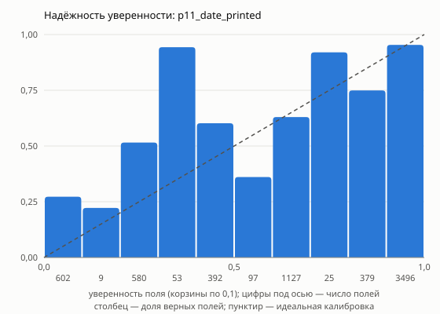
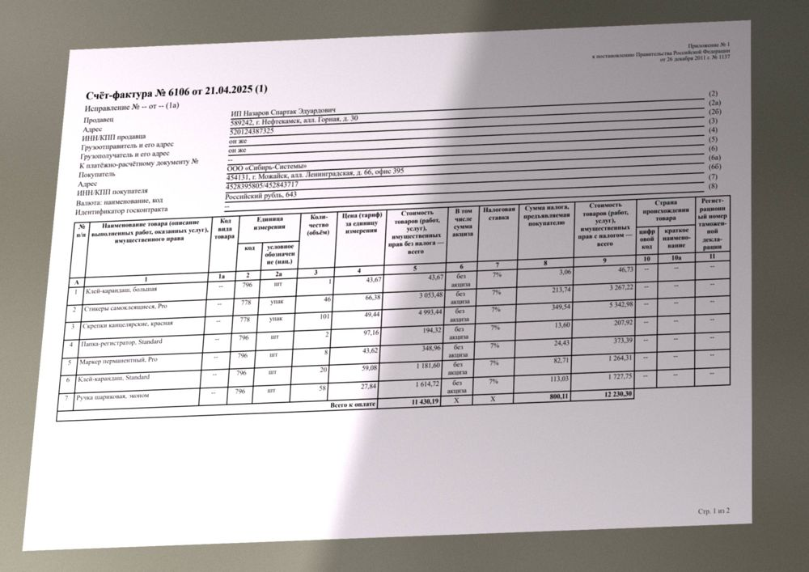
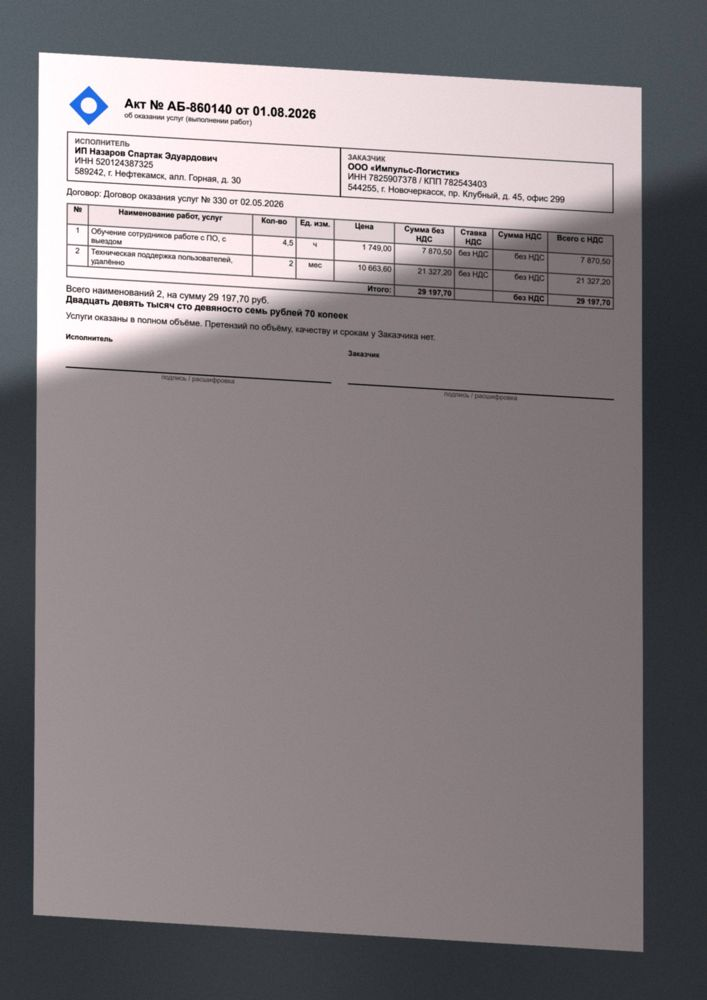
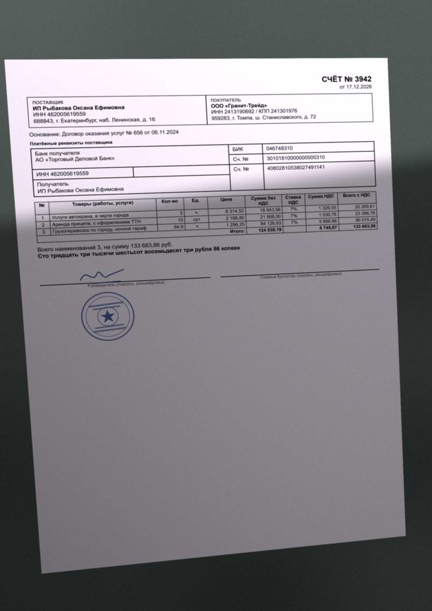
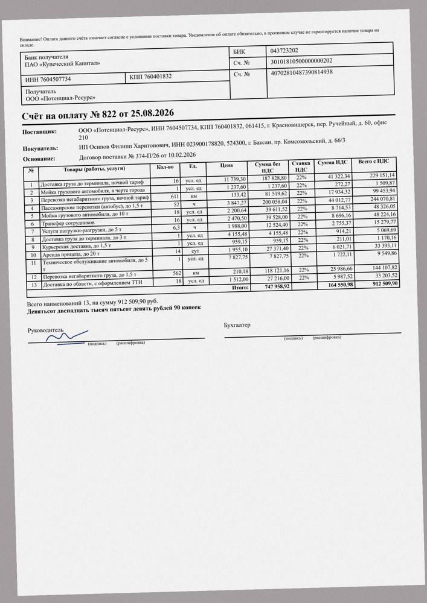
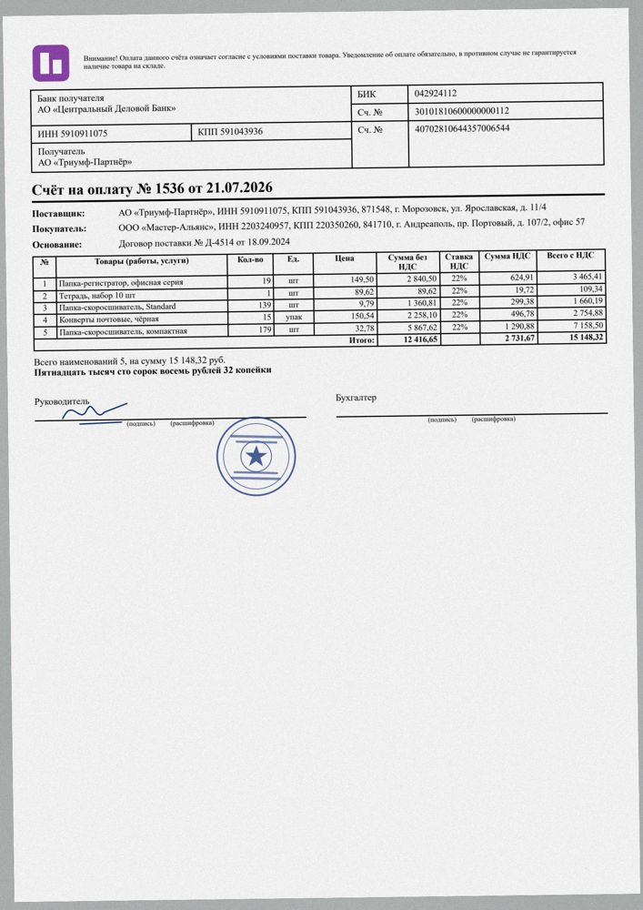

# Оценка: p11_date_printed

Даты как напечатаны: схема черновика без format date и промпты text_v2/vision_v2 (меняется только правило о датах). Остальное — как у p11_baseline: Qwen3.5-2B Q8_0, путь auto, те же 100 документов сплита test. Гипотеза: accuracy поля date вырастет с 16% до ≥ 80%, доля документов без правок — с 2% до ≥ 10%, остальные поля не изменятся.

Запуск: `uv run docai eval --config configs/eval/p11_date_printed.yaml` (копия — `config.yaml`). docai 0.1.0.

| Параметр | Значение |
|---|---|
| Модель | `qwen3.5:2b-q8_0` |
| Путь извлечения | `auto` |
| Промпты | `text_v2`, `vision_v2` |
| Выборка | 100 прогонов, 100 документов, сплит `test`, уровни clean, scan, photo (rotate) |
| Seed | 2026 |
| Интервалы | бутстреп по документам, 2000 повторов, 95% |

## Главное

В скобках — 95-процентный доверительный интервал (бутстреп по документам, D45).

| Метрика | Значение |
|---|---|
| Документов без ошибок в обязательных полях (можно загружать без правок) | 15,0% [8,0; 22,0] |
| Тип документа верен | 83,0% [75,0; 90,0] |
| Документ собран (валидный JSON) | 97,0% [93,0; 100,0] |
| Поля шапки: accuracy | 72,5% [68,5; 76,1] |
| Обязательные поля шапки: accuracy | 78,4% [74,2; 82,2] |
| Выдумки: значение при пустом эталоне | 16,0% [8,9; 25,1] |
| Текстовые поля: ANLS | 80,9% [75,4; 85,8] |
| Текстовые поля: accuracy | 72,8% [66,6; 78,3] |
| Строки: precision (найдена пара) | 83,7% [76,8; 90,6] |
| Строки: recall (найдена пара) | 85,0% [77,3; 91,8] |
| Строки: F1 (найдена пара) | 84,3% [77,3; 90,7] |
| Строки: F1 (строка верна целиком) | 39,2% [27,9; 50,2] |
| Ячейки: precision | 77,0% [69,4; 83,7] |
| Ячейки: recall | 76,5% [68,8; 83,3] |
| Ячейки: F1 | 76,7% [69,3; 83,4] |
| Статус «можно загружать» | 17,0% [10,0; 25,0] |
| Среди «можно загружать» — действительно без ошибок | 52,9% [28,6; 76,9] |
| Молча загружен с ошибкой (доля всех документов) | 8,0% [3,0; 14,0] |
| Документ с ошибкой отправлен на проверку или отклонён | 89,4% [82,1; 95,4] |
| Доля верных среди полей с уверенностью | 76,0% [70,4; 81,4] |
| Средняя уверенность поля | 71,4% [66,4; 76,4] |
| ECE (10 корзин) | 0,077 [0,060; 0,106] |
| MCE (10 корзин) | 0,638 [0,570; 0,815] |
| Brier | 0,147 [0,123; 0,171] |
| Секунд на страницу | 53,4 [47,1; 60,6] |

## Ответ модели до и после постобработки (P10)

Одни и те же документы: парный бутстреп разности «после − до», p — приближённое двустороннее по бутстрепу; для доли документов без правок — ещё тест Макнемара.

| Метрика | До | После | Разность [95% ДИ] | p |
|---|---|---|---|---|
| Документов без ошибок в обязательных полях (можно загружать без правок) | 15,0% | 15,0% | 0,0 п.п. [0,0; 0,0] | 1,000 |
| Поля шапки: accuracy | 71,2% | 72,5% | 1,3 п.п. [0,6; 2,1] | < 0,001 |
| Обязательные поля шапки: accuracy | 77,3% | 78,4% | 1,1 п.п. [0,4; 1,9] | < 0,001 |
| Текстовые поля: ANLS | 80,9% | 80,9% | 0,0 п.п. [0,0; 0,0] | 1,000 |
| Строки: F1 (найдена пара) | 84,3% | 84,3% | 0,0 п.п. [0,0; 0,0] | 1,000 |
| Ячейки: F1 | 76,5% | 76,7% | 0,2 п.п. [0,1; 0,4] | < 0,001 |

Макнемар (без правок): только до — 0, только после — 0, p = 1,000 (нет расхождений).

## По группам: тип документа

| Значение | Документов | Без правок | Тип верен | Шапка acc | ANLS | Строки F1 | Ячейки F1 | Молча с ошибкой | ECE | с/стр |
|---|---|---|---|---|---|---|---|---|---|---|
| act | 12 | 33,3% [8,3; 58,3] | 91,7% [75,0; 100,0] | 81,0% [64,8; 93,5] | 81,2% [64,2; 93,9] | 82,0% [60,0; 97,5] | 68,1% [47,2; 84,0] | 0,0% [0,0; 0,0] | 0,132 [0,102; 0,192] | 71,0 [45,8; 100,9] |
| bill | 21 | 14,3% [0,0; 33,3] | 95,2% [85,7; 100,0] | 74,7% [65,1; 81,8] | 71,4% [55,6; 85,3] | 70,4% [45,1; 92,8] | 60,7% [38,6; 80,4] | 0,0% [0,0; 0,0] | 0,082 [0,050; 0,145] | 53,8 [45,2; 64,2] |
| torg12 | 21 | 14,3% [0,0; 28,6] | 100,0% [100,0; 100,0] | 65,1% [57,0; 73,1] | 88,4% [84,0; 91,9] | 92,4% [86,7; 98,0] | 91,0% [85,9; 94,5] | 0,0% [0,0; 0,0] | 0,111 [0,077; 0,167] | 54,8 [45,1; 64,5] |
| upd | 32 | 3,1% [0,0; 9,4] | 62,5% [46,9; 78,1] | 73,0% [68,5; 77,3] | 83,7% [77,3; 88,5] | 89,4% [80,4; 96,1] | 82,1% [71,6; 89,7] | 25,0% [12,5; 40,6] | 0,115 [0,075; 0,169] | 51,6 [38,6; 67,5] |
| vat_invoice | 14 | 28,6% [7,1; 50,0] | 78,6% [57,1; 100,0] | 72,6% [58,5; 85,5] | 75,9% [54,3; 96,4] | 80,7% [60,7; 100,0] | 73,3% [52,0; 94,4] | 0,0% [0,0; 0,0] | 0,116 [0,065; 0,193] | 42,8 [34,2; 50,6] |

## По группам: уровень качества

| Значение | Документов | Без правок | Тип верен | Шапка acc | ANLS | Строки F1 | Ячейки F1 | Молча с ошибкой | ECE | с/стр |
|---|---|---|---|---|---|---|---|---|---|---|
| clean | 34 | 35,3% [20,6; 52,9] | 70,6% [55,9; 85,3] | 81,9% [77,9; 86,0] | 93,5% [90,8; 95,7] | 97,7% [95,4; 100,0] | 91,2% [86,8; 95,4] | 23,5% [11,8; 38,2] | 0,049 [0,021; 0,085] | 48,2 [39,3; 59,9] |
| photo | 33 | 0,0% [0,0; 0,0] | 81,8% [66,7; 93,9] | 59,8% [51,0; 67,5] | 68,3% [56,8; 78,9] | 75,0% [60,5; 87,9] | 63,4% [48,9; 76,9] | 0,0% [0,0; 0,0] | 0,112 [0,082; 0,163] | 58,5 [44,7; 73,7] |
| scan | 33 | 9,1% [0,0; 21,2] | 97,0% [90,9; 100,0] | 75,8% [70,5; 80,9] | 78,0% [68,2; 86,6] | 76,6% [61,8; 90,3] | 70,9% [55,5; 84,5] | 0,0% [0,0; 0,0] | 0,118 [0,077; 0,178] | 54,2 [46,3; 62,3] |

## По группам: путь извлечения

| Значение | Документов | Без правок | Тип верен | Шапка acc | ANLS | Строки F1 | Ячейки F1 | Молча с ошибкой | ECE | с/стр |
|---|---|---|---|---|---|---|---|---|---|---|
| text | 34 | 35,3% [20,6; 52,9] | 70,6% [55,9; 85,3] | 81,9% [77,9; 86,0] | 93,5% [90,8; 95,7] | 97,7% [95,4; 100,0] | 91,2% [86,8; 95,4] | 23,5% [11,8; 38,2] | 0,049 [0,021; 0,085] | 48,2 [39,3; 59,9] |
| vision | 65 | 4,6% [0,0; 10,8] | 90,8% [83,1; 96,9] | 68,5% [63,1; 73,2] | 74,6% [67,0; 81,5] | 76,7% [65,6; 86,1] | 68,2% [57,3; 77,7] | 0,0% [0,0; 0,0] | 0,100 [0,082; 0,142] | 56,4 [48,7; 65,3] |
| — | 1 | 0,0% [0,0; 0,0] | 0,0% [0,0; 0,0] | 0,0% [0,0; 0,0] | 0,0% [0,0; 0,0] | 0,0% [0,0; 0,0] | 0,0% [0,0; 0,0] | 0,0% [0,0; 0,0] | — | — |

Столбцы: «Без правок» — документ без ошибок в обязательных полях; «Шапка acc» — accuracy полей шапки; ANLS — текстовые поля; «Строки F1» — найдена пара строки; «Молча с ошибкой» — статус «можно загружать» у документа с ошибкой; с/стр — секунд на страницу.

## По полям

Accuracy — верных среди непустых эталонных значений (у полей строк ячейка несопоставленной строки считается неверной); precision — верных среди непустых ответов.

| Поле | Название | Эталонных значений | Accuracy | ANLS | Precision |
|---|---|---|---|---|---|
| `doc_type` | Тип документа | 100 | 83,0% [75,0; 90,0] | — | — |
| `number` | Номер документа | 100 | 81,0% [73,0; 88,0] | 89,6% [84,3; 94,2] | — |
| `date` | Дата документа | 100 | 97,0% [93,0; 100,0] | — | — |
| `upd_status` | Статус УПД | 32 | 62,5% [44,8; 78,6] | — | — |
| `seller.name` | Продавец: наименование | 100 | 84,0% [77,0; 91,0] | 91,3% [85,8; 96,2] | — |
| `seller.inn` | Продавец: ИНН | 100 | 74,0% [65,0; 82,0] | — | — |
| `seller.kpp` | Продавец: КПП | 74 | 74,3% [63,9; 84,3] | — | — |
| `seller.address` | Продавец: адрес | 100 | 56,0% [46,0; 65,0] | 86,5% [81,0; 91,2] | — |
| `buyer.name` | Покупатель: наименование | 100 | 88,0% [82,0; 94,0] | 92,0% [86,5; 96,6] | — |
| `buyer.inn` | Покупатель: ИНН | 100 | 75,0% [66,0; 83,0] | — | — |
| `buyer.kpp` | Покупатель: КПП | 81 | 70,4% [59,8; 79,8] | — | — |
| `buyer.address` | Покупатель: адрес | 100 | 57,0% [47,0; 67,0] | 87,1% [81,7; 91,7] | — |
| `seller_bank.bank_name` | Банк продавца | 39 | 53,8% [38,2; 69,2] | 72,6% [58,9; 84,7] | — |
| `seller_bank.bik` | БИК | 39 | 74,4% [59,5; 87,5] | — | — |
| `seller_bank.corr_account` | Корр. счёт | 39 | 51,3% [35,3; 66,7] | — | — |
| `seller_bank.account` | Расчётный счёт | 39 | 56,4% [41,2; 72,2] | — | — |
| `basis.name` | Основание: вид документа | 71 | 14,1% [6,6; 22,7] | 28,4% [19,3; 37,3] | — |
| `basis.number` | Основание: номер | 71 | 63,4% [52,1; 74,2] | 63,4% [52,1; 74,2] | — |
| `basis.date` | Основание: дата | 71 | 77,5% [67,2; 86,8] | — | — |
| `lines[].name` | Строка: наименование | 567 | 78,0% [69,7; 85,2] | 83,9% [76,0; 90,8] | 76,7% [69,0; 84,6] |
| `lines[].unit_name` | Строка: единица измерения | 567 | 77,1% [67,0; 85,8] | 79,7% [70,6; 87,6] | 77,6% [67,2; 86,8] |
| `lines[].unit_code` | Строка: код ОКЕИ | 567 | 53,8% [41,3; 65,7] | — | 56,4% [43,8; 68,0] |
| `lines[].quantity` | Строка: количество | 567 | 75,1% [65,4; 84,2] | — | 75,7% [66,0; 84,8] |
| `lines[].price` | Строка: цена | 567 | 82,4% [74,6; 89,5] | — | 82,9% [75,4; 89,9] |
| `lines[].amount_without_vat` | Строка: сумма без НДС | 567 | 80,6% [72,7; 87,6] | — | 81,2% [73,4; 87,8] |
| `lines[].vat_rate` | Строка: ставка НДС | 567 | 83,1% [75,1; 90,2] | — | 83,7% [75,9; 90,7] |
| `lines[].vat_amount` | Строка: сумма НДС | 507 | 77,7% [69,0; 85,6] | — | 77,1% [68,6; 85,2] |
| `lines[].amount_with_vat` | Строка: сумма с НДС | 567 | 80,6% [72,8; 87,6] | — | 81,2% [73,5; 87,8] |
| `totals.amount_without_vat` | Итого без НДС | 100 | 84,0% [77,0; 90,0] | — | — |
| `totals.vat_amount` | Итого НДС | 88 | 79,5% [71,0; 87,6] | — | — |
| `totals.amount_with_vat` | Всего с НДС | 100 | 81,0% [73,0; 88,0] | — | — |

## Калибровка уверенности

Полей с уверенностью: 6760. ECE 0,077 [0,060; 0,106], MCE 0,638 [0,570; 0,815], Brier 0,147 [0,123; 0,171], AUROC «уверенность отличает верное поле от неверного» 0,829 [0,794; 0,860]. Порог «нужна проверка» — 0,80.

| Уверенность | Полей | Средняя уверенность | Доля верных |
|---|---|---|---|
| 0,0–0,1 | 602 | 0,019 | 27,2% |
| 0,1–0,2 | 9 | 0,185 | 22,2% |
| 0,2–0,3 | 580 | 0,231 | 51,5% |
| 0,3–0,4 | 53 | 0,305 | 94,3% |
| 0,4–0,5 | 392 | 0,452 | 60,2% |
| 0,5–0,6 | 97 | 0,528 | 36,1% |
| 0,6–0,7 | 1127 | 0,630 | 63,0% |
| 0,7–0,8 | 25 | 0,752 | 92,0% |
| 0,8–0,9 | 379 | 0,836 | 74,9% |
| 0,9–1,0 | 3496 | 0,970 | 95,3% |

## Производительность

Секунд на страницу (сумма времени / сумма страниц): 53,4 [47,1; 60,6]; медиана по документам 44,1, 90-й процентиль 76,7, максимум 200,1. Документ в среднем 61,5 с, всего 1,69 ч на 114 страниц. Пиковая VRAM (nvidia-smi, весь GPU): максимум 2615 МиБ, медиана 2615 МиБ. Токены: 178334 → 122474.

## Сравнение с `p11_baseline`

Общих документов: 100. A — `p11_baseline`, B — `p11_date_printed`; парный бутстреп разности B − A.

| Метрика | A | B | B − A [95% ДИ] | p |
|---|---|---|---|---|
| Документов без ошибок в обязательных полях (можно загружать без правок) | 2,0 | 15,0 | 13,0 п.п. [7,0; 20,0] | < 0,001 |
| Тип документа верен | 86,0 | 83,0 | -3,0 п.п. [-7,0; 0,0] | 0,096 |
| Документ собран (валидный JSON) | 100,0 | 97,0 | -3,0 п.п. [-7,0; 0,0] | 0,096 |
| Поля шапки: accuracy | 66,7 | 72,5 | 5,7 п.п. [3,5; 7,7] | < 0,001 |
| Обязательные поля шапки: accuracy | 71,8 | 78,4 | 6,6 п.п. [3,7; 8,9] | < 0,001 |
| Выдумки: значение при пустом эталоне | 19,1 | 16,0 | -3,1 п.п. [-7,7; 1,1] | 0,208 |
| Текстовые поля: ANLS | 82,9 | 80,9 | -2,1 п.п. [-5,3; 0,8] | 0,175 |
| Текстовые поля: accuracy | 74,1 | 72,8 | -1,3 п.п. [-4,0; 1,2] | 0,334 |
| Строки: precision (найдена пара) | 83,2 | 83,7 | 0,5 п.п. [-2,2; 3,7] | 0,753 |
| Строки: recall (найдена пара) | 87,1 | 85,0 | -2,1 п.п. [-5,8; 1,2] | 0,264 |
| Строки: F1 (найдена пара) | 85,1 | 84,3 | -0,8 п.п. [-3,1; 2,0] | 0,565 |
| Строки: F1 (строка верна целиком) | 37,9 | 39,2 | 1,3 п.п. [-2,1; 4,7] | 0,480 |
| Ячейки: precision | 75,6 | 77,0 | 1,4 п.п. [-1,4; 4,8] | 0,376 |
| Ячейки: recall | 77,6 | 76,5 | -1,1 п.п. [-4,0; 1,8] | 0,475 |
| Ячейки: F1 | 76,6 | 76,7 | 0,1 п.п. [-2,2; 2,8] | 0,922 |
| Статус «можно загружать» | 4,0 | 17,0 | 13,0 п.п. [7,0; 20,0] | < 0,001 |
| Среди «можно загружать» — действительно без ошибок | 0,0 | 52,9 | 52,9 п.п. [28,6; 76,5] | < 0,001 |
| Молча загружен с ошибкой (доля всех документов) | 4,0 | 8,0 | 4,0 п.п. [1,0; 8,0] | 0,029 |
| Документ с ошибкой отправлен на проверку или отклонён | 95,9 | 89,4 | -6,5 п.п. [-11,8; -1,9] | < 0,001 |
| Доля верных среди полей с уверенностью | 73,0 | 76,0 | 2,9 п.п. [0,8; 5,6] | 0,008 |
| Средняя уверенность поля | 69,9 | 71,4 | 1,6 п.п. [0,2; 3,2] | 0,021 |
| ECE (10 корзин) | 0,073 | 0,077 | 0,004 [-0,008; 0,014] | 0,389 |
| MCE (10 корзин) | 0,271 | 0,638 | 0,367 [0,242; 0,549] | < 0,001 |
| Brier | 0,150 | 0,147 | -0,003 [-0,013; 0,005] | 0,408 |
| Секунд на страницу | 103,143 | 53,443 | -49,700 [-57,270; -41,975] | < 0,001 |

Макнемар (без правок): только A — 0, только B — 13, p < 0,001 (точный биномиальный).

## Наблюдения (написаны вручную после прогона)

**Гипотеза подтвердилась.** Отличие от базы `p11_baseline` — только правило о датах: в схеме черновика у даты нет `format: date`, в промптах `text_v2`/`vision_v2` одна строка «даты — как напечатаны» вместо «в формате ГГГГ-ММ-ДД» (D47). Документы, seed и остальное — те же.

- Дата документа верна в **97%** (база — 16%), дата основания — в **77,5%** (база — 16,9%).
- Документов без правок **15,0% [8,0; 22,0]** против 2,0%: разность **+13,0 п.п. [7,0; 20,0]**. Тест Макнемара: 13 документов стали без правок, ни один не перестал (точный биномиальный, p < 0,001).
- Accuracy полей шапки +5,7 п.п. [3,5; 7,7], обязательных полей шапки +6,6 п.п. [3,7; 8,9]. Таблица (строки, ячейки) и текстовые поля не изменились: интервалы разностей включают 0 — эффект ограничен датами, как и ожидалось.

**Что стало хуже и почему.**

1. **Молча загружен с ошибкой: 8% против 4%** (+4,0 п.п. [1,0; 8,0]). Все 8 документов — УПД на текстовом пути, прочитанные как счёт-фактура (ошибки `doc_type` и `upd_status`, остальное верно). Раньше их останавливала неверная дата, теперь проверки проходят. Причина не в датах: тип документа ничем не проверяется (задача из P10). Теперь это главный источник «молча загруженных» ошибок; среди документов со статусом «можно загружать» верных 52,9% [28,6; 76,9].
2. **Документ собран: 97% против 100%.** Два фото (`01994_act_photo`, `02083_bill_photo`) — модель вернула дату пустой, а без даты конвейер P9 документ не собирает. В базе здесь была выдуманная по шаблону дата, и документ собирался, но тоже с ошибками (ни один из трёх несобранных не был «без правок» в базе). Третий (`00856_vat_invoice_photo`) — Ollama прервала генерацию: модель зациклилась («token repeat limit reached»). Это ответ модели, а не сбой окружения: такие исключения теперь кэшируются (`is_model_failure`), иначе пересборка отчёта прогоняла бы документ заново.
3. **MCE 0,638 против 0,271** — корзина 0,3–0,4: 53 поля, верных 94% при средней уверенности 0,31; из них 41 — дата основания на пути vision. Даты на vision теперь верны в 98%, а уверенность у них в среднем 0,39: исходная вероятность p₀ = 0,3 для дат vision (D42) была подобрана под старую ошибку формата. На пути text даты верны в 100% при уверенности 0,95. ECE (0,077 против 0,073) и Brier (0,147 против 0,150) значимо не изменились. Пересчитать p₀ для дат — часть задачи калибровки P13.

**Скорость — не эффект конфигурации.** Секунд на страницу 53 против 103, но длина ответа та же (1237 против 1250 выходных токенов на документ), а скорость генерации другая: 21,7 против 12,9 ток/с (медиана по запросам), чтение промпта 2,1 против 20,3 с на документ. На 20 документах, переделанных в базе на сети днём, — 18,2 ток/с против 22,3 сейчас. Модель в обоих прогонах делится между CPU и GPU (сейчас 37% / 63%, `ollama ps`), поэтому скорость зависит от загрузки процессора и его нагрева: во время базового прогона параллельно шли тесты pytest и было жарко днём. Вывод: метрику скорости сравнивать только между прогонами в одинаковых условиях (задача на потом — записывать в результат распределение слоёв CPU/GPU и чередовать конфигурации при сравнении скорости).

**Условия прогона.** 17.11, 21:40–23:25, всё время от сети (защита питания D47 не срабатывала ни разу), сна не было.

## Худшие примеры

5 документов с наименьшим F1 по всем значениям (шапка и ячейки). Обозначения: ∅ — пусто; `lines[i↔j]` — строка i эталона сопоставлена со строкой j ответа. Значения показаны после нормализации FIELD_SPEC.

### 00856_vat_invoice_photo_200dpi

Тип: vat_invoice (ответ: —), уровень photo, путь —, статус извлечение упало, F1 0,0%, строк 0 из 7.

Исключение: `OllamaError: Ollama вернула 500: {"error":"prediction abo…`

| Поле | Эталон | Ответ |
|---|---|---|
| doc_type | vat_invoice | ∅ |
| number | 6106 | ∅ |
| date | 2025-04-21 | ∅ |
| seller.name | ип назаров спартак эдуардович | ∅ |
| seller.inn | 520124387325 | ∅ |
| seller.address | 589242, г. нефтекамск, алл. горная, д. 30 | ∅ |
| buyer.name | ооо сибирь-системы | ∅ |
| buyer.inn | 4528395805 | ∅ |
| buyer.kpp | 452843717 | ∅ |
| buyer.address | 454131, г. можайск, алл. ленинградская, д. 66, офис 395 | ∅ |
| totals.amount_without_vat | 11430.19 | ∅ |
| totals.vat_amount | 800.11 | ∅ |
| totals.amount_with_vat | 12230.30 | ∅ |
| lines[0] — строка не найдена | Клей-карандаш, большая | ∅ |
| lines[1] — строка не найдена | Стикеры самоклеящиеся, Pro | ∅ |
| lines[2] — строка не найдена | Скрепки канцелярские, красная | ∅ |
| lines[3] — строка не найдена | Папка-регистратор, Standard | ∅ |
| lines[4] — строка не найдена | Маркер перманентный, Pro | ∅ |
| lines[5] — строка не найдена | Клей-карандаш, Standard | ∅ |
| lines[6] — строка не найдена | Ручка шариковая, эконом | ∅ |

### 01994_act_photo_200dpi

Тип: act (ответ: —), уровень photo, путь vision, статус reject, F1 0,0%, строк 0 из 2.

| Поле | Эталон | Ответ |
|---|---|---|
| doc_type | act | ∅ |
| number | аб-860140 | ∅ |
| date | 2026-08-01 | ∅ |
| seller.name | ип назаров спартак эдуардович | ∅ |
| seller.inn | 520124387325 | ∅ |
| seller.address | 589242, г. нефтекамск, алл. горная, д. 30 | ∅ |
| buyer.name | ооо импульс-логистик | ∅ |
| buyer.inn | 7825907378 | ∅ |
| buyer.kpp | 782543403 | ∅ |
| buyer.address | 544255, г. новочеркасск, пр. клубный, д. 45, офис 299 | ∅ |
| basis.name | договор оказания услуг | ∅ |
| basis.number | 330 | ∅ |
| basis.date | 2026-05-02 | ∅ |
| totals.amount_without_vat | 29197.70 | ∅ |
| totals.amount_with_vat | 29197.70 | ∅ |
| lines[0] — строка не найдена | Обучение сотрудников работе с ПО, с выездом | ∅ |
| lines[1] — строка не найдена | Техническая поддержка пользователей, удалённо | ∅ |

### 02083_bill_photo_200dpi

Тип: bill (ответ: —), уровень photo, путь vision, статус reject, F1 0,0%, строк 0 из 3.

| Поле | Эталон | Ответ |
|---|---|---|
| doc_type | bill | ∅ |
| number | 3942 | ∅ |
| date | 2026-12-17 | ∅ |
| seller.name | ип рыбакова оксана ефимовна | ∅ |
| seller.inn | 462005619559 | ∅ |
| seller.address | 688843, г. екатеринбург, наб. ленинская, д. 16 | ∅ |
| buyer.name | ооо гранит-трейд | ∅ |
| buyer.inn | 2413190692 | ∅ |
| buyer.kpp | 241301976 | ∅ |
| buyer.address | 959283, г. томпа, ш. станиславского, д. 72 | ∅ |
| seller_bank.bank_name | ао торговый деловой банк | ∅ |
| seller_bank.bik | 046748310 | ∅ |
| seller_bank.corr_account | 30101810000000000310 | ∅ |
| seller_bank.account | 40802810538027491141 | ∅ |
| basis.name | договор оказания услуг | ∅ |
| basis.number | 656 | ∅ |
| basis.date | 2024-11-06 | ∅ |
| totals.amount_without_vat | 124938.19 | ∅ |
| totals.vat_amount | 8745.67 | ∅ |
| totals.amount_with_vat | 133683.86 | ∅ |
| lines[0] — строка не найдена | Услуги автокрана, в черте города | ∅ |
| lines[1] — строка не найдена | Аренда прицепа, с оформлением ТТН | ∅ |
| lines[2] — строка не найдена | Грузоперевозка по городу, ночной тариф | ∅ |

### 00884_bill_scan_200dpi

Тип: bill (ответ: bill), уровень scan, путь vision, статус reject, F1 12,4%, строк 13 из 13.

| Поле | Эталон | Ответ |
|---|---|---|
| seller.address | 061415, г. красновишерск, пер. ручейный, д. 60, офис 210 | г. красновишерск, пер. ручейный, д. 60, офис 210 |
| buyer.address | 524300, г. баксан, пр. комсомольский, д. 66/3 | г. баксан, пр. комсомольский, д. 66/3 |
| basis.name | договор поставки | договор поставки № 374-п/26 от 10.02.2026 |
| buyer.kpp (в эталоне пусто) | ∅ | 524300 |
| lines[0] — строка не найдена | Доставка груза до терминала, ночной тариф | ∅ |
| lines[1] — строка не найдена | Мойка грузового автомобиля, в черте города | ∅ |
| lines[2] — строка не найдена | Перевозка негабаритного груза, ночной тариф | ∅ |
| lines[3] — строка не найдена | Пассажирские перевозки (автобус), до 1,5 т | ∅ |
| lines[4] — строка не найдена | Мойка грузового автомобиля, до 10 т | ∅ |
| lines[5] — строка не найдена | Трансфер сотрудников | ∅ |
| lines[6] — строка не найдена | Услуги погрузки-разгрузки, до 5 т | ∅ |
| lines[7] — строка не найдена | Доставка груза до терминала, до 3 т | ∅ |
| lines[8] — строка не найдена | Курьерская доставка, до 1,5 т | ∅ |
| lines[9] — строка не найдена | Аренда прицепа, до 20 т | ∅ |
| lines[10] — строка не найдена | Техническое обслуживание автомобиля, до 5 т | ∅ |
| lines[11] — строка не найдена | Перевозка негабаритного груза, до 1,5 т | ∅ |
| lines[12] — строка не найдена | Доставка по области, с оформлением ТТН | ∅ |
| lines[0] — лишняя строка | ∅ | Доставка груза до терминала, ночной тариф |
| lines[1] — лишняя строка | ∅ | Мойка грузового автомобиля, в черте города |
| lines[2] — лишняя строка | ∅ | Перевозка негабаритного груза, ночной тариф |
| lines[3] — лишняя строка | ∅ | Пассажирыские перевозки (автобус), до 1,5 т |
| lines[4] — лишняя строка | ∅ | Мойка грузового автомобиля, до 10 т |
| lines[5] — лишняя строка | ∅ | Трансфер сотрудников |
| lines[6] — лишняя строка | ∅ | Услуги погрузки-разгрузки, до 5 т |
| lines[7] — лишняя строка | ∅ | Доставка груза до терминала, до 3 т |
| lines[8] — лишняя строка | ∅ | Курьерская доставка, до 1,5 т |
| lines[9] — лишняя строка | ∅ | Аренда прицепа, до 20 т |
| lines[10] — лишняя строка | ∅ | Техническое обслуживание автомобиля, до 5 т |
| lines[11] — лишняя строка | ∅ | Перевозка негабаритного груза, до 1,5 т |
| lines[12] — лишняя строка | ∅ | Доставка по области, с оформлением ТТН |

### 02842_bill_scan_200dpi

Тип: bill (ответ: bill), уровень scan, путь vision, статус reject, F1 18,2%, строк 5 из 5.

| Поле | Эталон | Ответ |
|---|---|---|
| seller.address | 871548, г. морозовск, ул. ярославская, д. 11/4 | г. морозовск, ул. ярославская, д. 11/4 |
| buyer.address | 841710, г. андреаполь, пр. портовый, д. 107/2, офис 57 | г. андреаполь, пр. портовый, д. 107/2, офис 57 |
| seller_bank.corr_account | 30101810600000000112 | 301018106000000000112 |
| basis.name | договор поставки | договор поставки № д-4514 от 18.09.2024 |
| basis.number | д-4514 | 1536 |
| basis.date | 2024-09-18 | 2026-07-21 |
| totals.amount_without_vat | 12416.65 | 12416.00 |
| totals.vat_amount | 2731.67 | 2731.00 |
| totals.amount_with_vat | 15148.32 | 15147.00 |
| lines[0] — строка не найдена | Папка-регистратор, офисная серия | ∅ |
| lines[1] — строка не найдена | Тетрадь, набор 10 шт | ∅ |
| lines[2] — строка не найдена | Папка-скоросшиватель, Standard | ∅ |
| lines[3] — строка не найдена | Конверты почтовые, чёрная | ∅ |
| lines[4] — строка не найдена | Папка-скоросшиватель, компактная | ∅ |
| lines[0] — лишняя строка | ∅ | Папка-регистратор, офисная серия |
| lines[1] — лишняя строка | ∅ | Тетрадь, набор 10 шт |
| lines[2] — лишняя строка | ∅ | Папка-скоросшиватель, Standard |
| lines[3] — лишняя строка | ∅ | Конверты почтовые, чёрная |
| lines[4] — лишняя строка | ∅ | Папка-скоросшиватель, компактная |

## Определения

Сравнение полей, сопоставление строк и «можно загружать без правок» — D44; интервалы, парное сравнение и калибровка — D45 (`docs/DECISIONS.md`). Все значения сравниваются после нормализации FIELD_SPEC.
