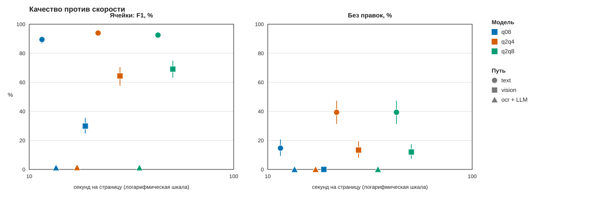
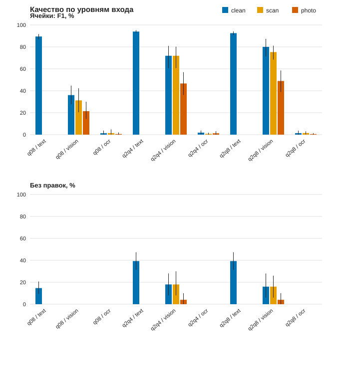

# p12_matrix: матрица «модель × путь × качество входа»

300 синтетических документов сплита test (из 304) и все размеченные реальные. Модели Qwen3.5 0.8B, 2B Q4_K_M, 2B Q8_0 и 4B Q4_K_M (только путь text, с проверкой, что она помещается в VRAM при контексте 8k); пути text, vision, ocr + LLM.

Документов в таблице: **150** из 300 запланированных (общее для всех ячеек готовое начало списка; уровни раздаются по кругу, по ≈50 документов на уровень). Все числа — после постобработки P10, 95% интервалы — кластерный бутстреп по документам (D45). Скорость — секунд на страницу, замер от сети; пик VRAM — по всему GPU, «модель в VRAM» — доля весов и кэша, лежащая на GPU (`/api/ps`).

## Сводная таблица

| Модель | Путь | Док. | Без правок [95% ДИ] | Ячейки F1 | Поля шапки acc | Тип верен | Молча с ошибкой | с/стр [95% ДИ] | Пик VRAM, ГиБ | Модель в VRAM |
|---|---|---|---|---|---|---|---|---|---|---|
| q08 | text | 150 | 14,7% [9,3; 20,7] | 89,4% [86,7; 91,7] | 71,2% [68,4; 73,9] | 46,7% [38,7; 54,0] | 18,0% [12,0; 24,7] | 11,5 [10,8; 12,3] | 2,55 | 100% |
| q08 | vision | 150 | 0,0% [0,0; 0,0] | 29,9% [24,8; 35,5] | 39,3% [35,4; 43,0] | 64,0% [56,0; 71,3] | 0,0% [0,0; 0,0] | 18,8 [17,2; 20,3] | 1,82 | 100% |
| q08 | ocr + LLM | 150 | 0,0% [0,0; 0,0] | 1,1% [0,1; 2,5] | 36,7% [33,0; 40,2] | 40,7% [32,7; 48,0] | 0,0% [0,0; 0,0] | 13,5 [11,5; 15,6] | 1,82 | 100% |
| q2q4 | text | 150 | 39,3% [31,3; 47,3] | 93,9% [92,6; 95,3] | 82,5% [80,5; 84,3] | 76,7% [70,0; 83,3] | 16,7% [10,7; 22,7] | 21,7 [20,2; 23,3] | 2,35 | 100% |
| q2q4 | vision | 150 | 13,3% [8,0; 19,3] | 64,4% [57,6; 70,5] | 65,1% [60,9; 69,1] | 80,7% [74,0; 86,7] | 0,0% [0,0; 0,0] | 27,8 [25,5; 30,2] | 2,41 | 100% |
| q2q4 | ocr + LLM | 150 | 0,0% [0,0; 0,0] | 1,3% [0,6; 2,2] | 45,4% [41,2; 49,9] | 64,0% [56,7; 71,4] | 0,0% [0,0; 0,0] | 17,1 [15,0; 19,7] | 2,41 | 100% |
| q2q8 | text | 150 | 39,3% [31,3; 47,3] | 92,5% [90,7; 94,2] | 82,0% [79,7; 84,1] | 71,3% [64,7; 78,7] | 22,0% [16,0; 28,7] | 42,6 [39,5; 45,9] | 2,50 | 63% |
| q2q8 | vision | 150 | 12,0% [7,3; 17,3] | 69,1% [63,2; 74,8] | 66,6% [62,6; 70,5] | 81,3% [74,7; 87,3] | 0,0% [0,0; 0,0] | 50,4 [46,5; 54,5] | 2,55 | 63% |
| q2q8 | ocr + LLM | 150 | 0,0% [0,0; 0,0] | 1,1% [0,4; 2,0] | 48,1% [43,5; 52,6] | 67,3% [60,0; 74,7] | 0,0% [0,0; 0,0] | 34,6 [29,4; 41,0] | 2,55 | 63% |

## По уровням входа

**Без правок в обязательных полях**

| Модель | Путь | clean | scan | photo |
|---|---|---|---|---|
| q08 | text | 14,7% [9,3; 20,7] (n=150) | — | — |
| q08 | vision | 0,0% [0,0; 0,0] (n=50) | 0,0% [0,0; 0,0] (n=50) | 0,0% [0,0; 0,0] (n=50) |
| q08 | ocr + LLM | 0,0% [0,0; 0,0] (n=50) | 0,0% [0,0; 0,0] (n=50) | 0,0% [0,0; 0,0] (n=50) |
| q2q4 | text | 39,3% [31,3; 47,3] (n=150) | — | — |
| q2q4 | vision | 18,0% [8,0; 28,1] (n=50) | 18,0% [8,0; 30,0] (n=50) | 4,0% [0,0; 10,0] (n=50) |
| q2q4 | ocr + LLM | 0,0% [0,0; 0,0] (n=50) | 0,0% [0,0; 0,0] (n=50) | 0,0% [0,0; 0,0] (n=50) |
| q2q8 | text | 39,3% [31,3; 47,3] (n=150) | — | — |
| q2q8 | vision | 16,0% [6,0; 28,0] (n=50) | 16,0% [6,0; 26,0] (n=50) | 4,0% [0,0; 10,0] (n=50) |
| q2q8 | ocr + LLM | 0,0% [0,0; 0,0] (n=50) | 0,0% [0,0; 0,0] (n=50) | 0,0% [0,0; 0,0] (n=50) |

**Ячейки: F1**

| Модель | Путь | clean | scan | photo |
|---|---|---|---|---|
| q08 | text | 89,4% [86,7; 91,7] (n=150) | — | — |
| q08 | vision | 36,0% [27,7; 44,7] (n=50) | 31,2% [20,4; 42,2] (n=50) | 21,4% [14,4; 30,0] (n=50) |
| q08 | ocr + LLM | 1,3% [0,0; 3,7] (n=50) | 1,4% [0,0; 4,8] (n=50) | 0,6% [0,0; 2,0] (n=50) |
| q2q4 | text | 93,9% [92,6; 95,3] (n=150) | — | — |
| q2q4 | vision | 71,9% [60,5; 80,9] (n=50) | 71,9% [60,6; 80,1] (n=50) | 46,6% [36,1; 56,9] (n=50) |
| q2q4 | ocr + LLM | 1,8% [0,5; 3,7] (n=50) | 0,7% [0,0; 1,7] (n=50) | 1,2% [0,0; 3,1] (n=50) |
| q2q8 | text | 92,5% [90,7; 94,2] (n=150) | — | — |
| q2q8 | vision | 80,0% [71,1; 87,3] (n=50) | 75,3% [68,4; 81,1] (n=50) | 48,9% [38,9; 58,5] (n=50) |
| q2q8 | ocr + LLM | 1,4% [0,0; 3,6] (n=50) | 1,4% [0,3; 3,0] (n=50) | 0,5% [0,0; 1,4] (n=50) |

## Сравнение с лучшей ячейкой (парное, общие документы)

Лучшая по доле «без правок» (при равенстве — по F1 ячеек): **q2q4 / text**. Самая быстрая из тех, что статистически не хуже лучшей (верхняя граница 95% интервала разности ≥ 0 и по «без правок», и по F1 ячеек): **q2q4 / text**.

| Модель | Путь | Общих док. | Δ без правок, п.п. [ДИ] | Макнемар (p) | Δ ячейки F1, п.п. [ДИ] |
|---|---|---|---|---|---|
| q08 | text | 150 | -24,7 [-34,7; -14,7] | < 0,001 | -4,5 [-7,8; -1,9] |
| q08 | vision | 50 | -40,0 [-54,0; -26,0] | < 0,001 | -58,1 [-66,9; -49,4] |
| q08 | ocr + LLM | 50 | -40,0 [-54,0; -26,0] | < 0,001 | -92,8 [-95,6; -89,8] |
| q2q4 | text | лучшая | — | — | — |
| q2q4 | vision | 50 | -22,0 [-38,0; -6,0] | 0,019 | -22,2 [-34,4; -12,4] |
| q2q4 | ocr + LLM | 50 | -40,0 [-54,0; -26,0] | < 0,001 | -92,3 [-95,1; -89,2] |
| q2q8 | text | 150 | +0,0 [-8,0; +7,3] | 0,868 | -1,5 [-2,8; -0,1] |
| q2q8 | vision | 50 | -24,0 [-40,0; -6,0] | 0,017 | -14,1 [-23,3; -6,8] |
| q2q8 | ocr + LLM | 50 | -40,0 [-54,0; -26,0] | < 0,001 | -92,7 [-95,8; -89,3] |

## Пропущено

- **q4q4** (qwen3.5:4b-q4_K_M), пути text: не помещается в VRAM: в памяти 3.62 ГиБ при контексте 8192, в VRAM 48% (нужно ≥ 98%), остальное ушло бы в CPU

## Реальные документы

Размеченных реальных документов в `data/real/labels` нет — в таблице только синтетика. Когда разметка появится (P8), `eval-matrix run` досчитает их, остальное не пересчитывается.
