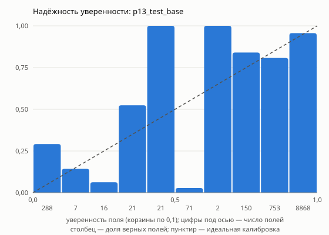
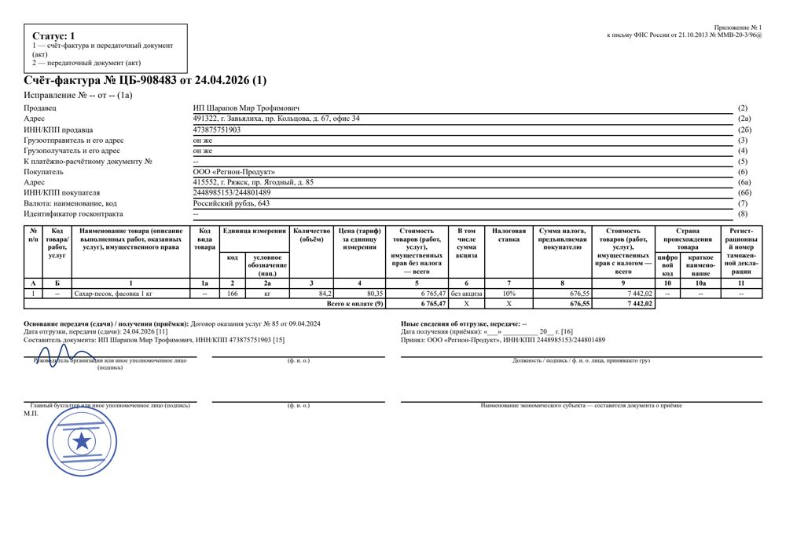
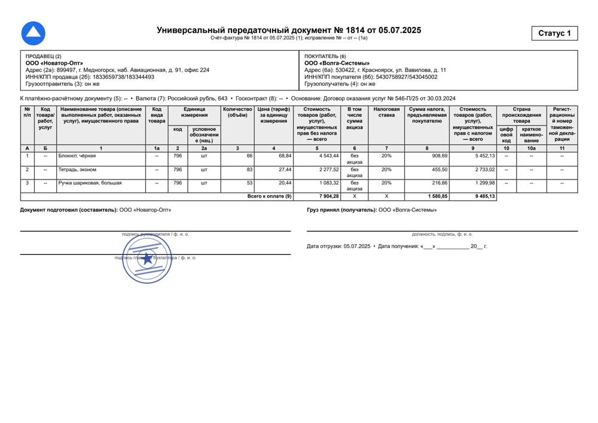
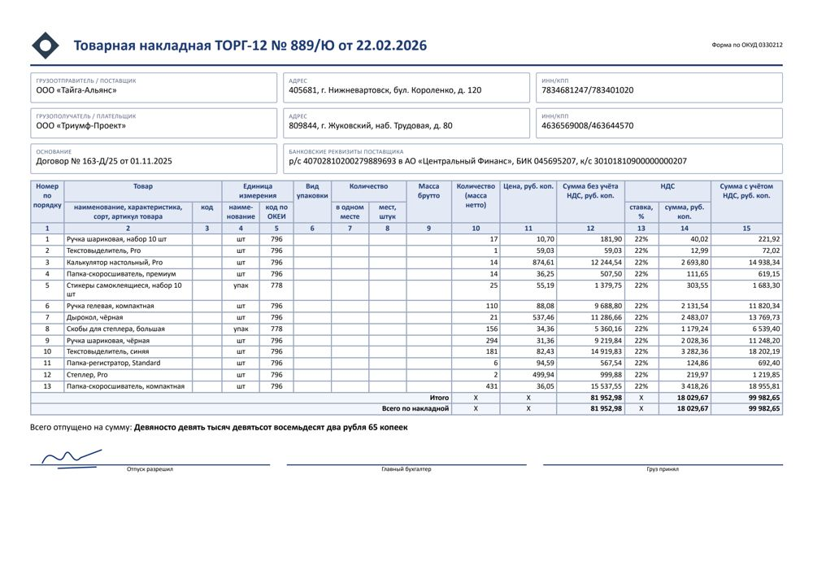
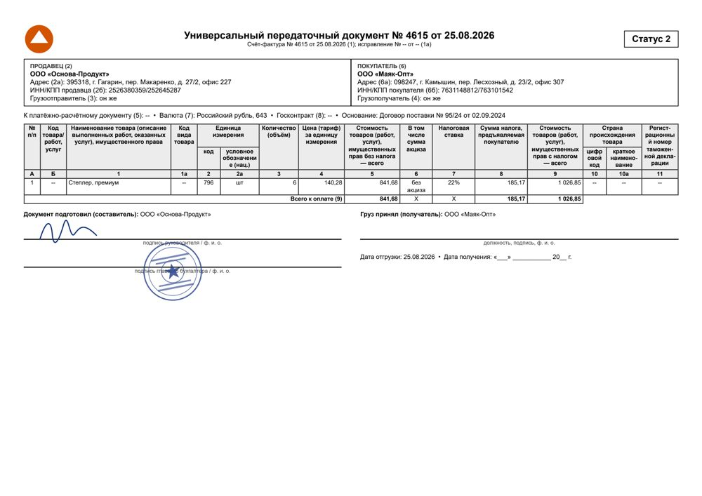
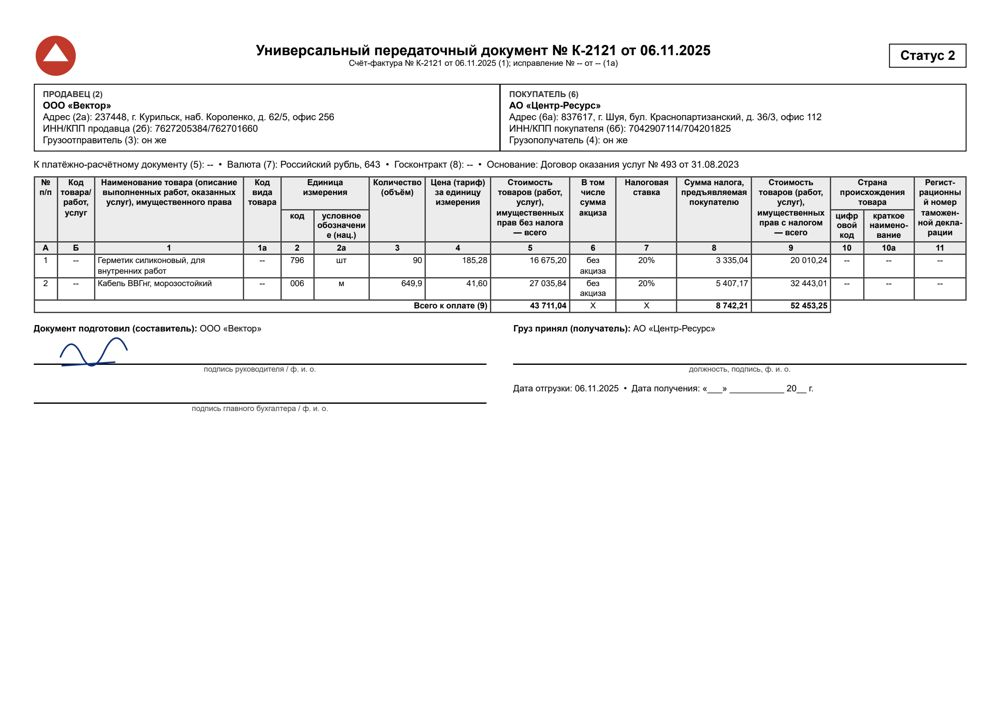

# Оценка: p13_test_base

Финальный замер P13, база: Qwen3.5-2B Q4_K_M, путь text, text_v2, постобработка P10 (как p13_val_base). 154 документа test, не участвовавшие в анализе ошибок.

Запуск: `uv run docai eval --config configs/eval/p13_test_base.yaml` (копия — `config.yaml`). docai 0.1.0.

| Параметр | Значение |
|---|---|
| Модель | `qwen3.5:2b-q4_K_M` |
| Путь извлечения | `text` |
| Промпты | `text_v2`, `vision_v2` |
| Выборка | 154 прогонов, 154 документов, сплит `test`, уровни clean (rotate) |
| Seed | 2026 |
| Интервалы | бутстреп по документам, 2000 повторов, 95% |

## Главное

В скобках — 95-процентный доверительный интервал (бутстреп по документам, D45).

| Метрика | Значение |
|---|---|
| Документов без ошибок в обязательных полях (можно загружать без правок) | 36,4% [28,6; 44,2] |
| Тип документа верен | 74,0% [66,9; 80,5] |
| Документ собран (валидный JSON) | 99,4% [98,1; 100,0] |
| Поля шапки: accuracy | 81,7% [79,5; 83,9] |
| Обязательные поля шапки: accuracy | 86,9% [84,2; 89,3] |
| Выдумки: значение при пустом эталоне | 10,5% [6,4; 15,5] |
| Текстовые поля: ANLS | 93,6% [92,0; 95,1] |
| Текстовые поля: accuracy | 89,6% [87,9; 91,2] |
| Строки: precision (найдена пара) | 98,4% [97,1; 99,4] |
| Строки: recall (найдена пара) | 98,8% [97,3; 99,9] |
| Строки: F1 (найдена пара) | 98,6% [97,6; 99,4] |
| Строки: F1 (строка верна целиком) | 57,7% [47,8; 66,8] |
| Ячейки: precision | 93,5% [91,2; 95,5] |
| Ячейки: recall | 92,4% [90,1; 94,4] |
| Ячейки: F1 | 92,9% [90,9; 94,8] |
| Статус «можно загружать» | 38,3% [31,2; 46,1] |
| Среди «можно загружать» — действительно без ошибок | 62,7% [49,2; 74,2] |
| Молча загружен с ошибкой (доля всех документов) | 14,3% [9,1; 20,1] |
| Документ с ошибкой отправлен на проверку или отклонён | 77,6% [68,7; 85,4] |
| Доля верных среди полей с уверенностью | 91,6% [89,6; 93,3] |
| Средняя уверенность поля | 93,5% [92,0; 94,8] |
| ECE (10 корзин) | 0,040 [0,029; 0,053] |
| MCE (10 корзин) | 0,568 [0,568; 0,840] |
| Brier | 0,060 [0,048; 0,072] |
| Секунд на страницу | 20,2 [18,8; 21,6] |

## Ответ модели до и после постобработки (P10)

Одни и те же документы: парный бутстреп разности «после − до», p — приближённое двустороннее по бутстрепу; для доли документов без правок — ещё тест Макнемара.

| Метрика | До | После | Разность [95% ДИ] | p |
|---|---|---|---|---|
| Документов без ошибок в обязательных полях (можно загружать без правок) | 35,1% | 36,4% | 1,3 п.п. [0,0; 3,2] | 0,288 |
| Поля шапки: accuracy | 80,9% | 81,7% | 0,8 п.п. [0,4; 1,3] | < 0,001 |
| Обязательные поля шапки: accuracy | 86,4% | 86,9% | 0,5 п.п. [0,2; 0,8] | 0,001 |
| Текстовые поля: ANLS | 93,6% | 93,6% | 0,0 п.п. [0,0; 0,0] | 1,000 |
| Строки: F1 (найдена пара) | 98,6% | 98,6% | 0,0 п.п. [0,0; 0,0] | 1,000 |
| Ячейки: F1 | 92,7% | 92,9% | 0,2 п.п. [0,1; 0,4] | < 0,001 |

Макнемар (без правок): только до — 0, только после — 2, p = 0,500 (точный биномиальный).

## По группам: тип документа

| Значение | Документов | Без правок | Тип верен | Шапка acc | ANLS | Строки F1 | Ячейки F1 | Молча с ошибкой | ECE | с/стр |
|---|---|---|---|---|---|---|---|---|---|---|
| act | 19 | 73,7% [52,6; 94,7] | 94,7% [84,2; 100,0] | 89,8% [84,7; 93,6] | 92,3% [85,1; 97,2] | 99,4% [97,8; 100,0] | 87,8% [86,2; 89,2] | 10,5% [0,0; 26,3] | 0,082 [0,069; 0,097] | 22,1 [18,2; 26,1] |
| bill | 32 | 12,5% [3,1; 25,0] | 87,5% [75,0; 96,9] | 80,7% [77,4; 83,7] | 95,6% [93,7; 97,1] | 99,4% [98,4; 100,0] | 91,0% [89,6; 92,5] | 6,2% [0,0; 15,6] | 0,062 [0,043; 0,084] | 23,8 [20,5; 27,5] |
| torg12 | 33 | 45,5% [27,3; 60,6] | 100,0% [100,0; 100,0] | 79,0% [74,7; 83,0] | 95,5% [93,8; 96,7] | 99,7% [99,2; 100,0] | 92,4% [85,2; 97,1] | 0,0% [0,0; 0,0] | 0,072 [0,052; 0,098] | 19,3 [16,7; 22,0] |
| upd | 48 | 14,6% [6,2; 25,0] | 27,1% [14,6; 39,6] | 76,0% [71,0; 80,4] | 89,8% [86,0; 92,9] | 97,1% [94,8; 99,1] | 93,2% [89,3; 96,3] | 35,4% [22,9; 50,0] | 0,054 [0,032; 0,087] | 19,7 [17,3; 22,7] |
| vat_invoice | 22 | 72,7% [54,5; 90,9] | 100,0% [100,0; 100,0] | 95,9% [91,0; 99,7] | 98,8% [97,0; 99,8] | 99,6% [98,9; 100,0] | 99,2% [98,2; 99,7] | 4,5% [0,0; 13,6] | 0,020 [0,013; 0,027] | 16,7 [14,0; 19,4] |

## По группам: уровень качества

| Значение | Документов | Без правок | Тип верен | Шапка acc | ANLS | Строки F1 | Ячейки F1 | Молча с ошибкой | ECE | с/стр |
|---|---|---|---|---|---|---|---|---|---|---|
| clean | 154 | 36,4% [28,6; 44,2] | 74,0% [66,9; 80,5] | 81,7% [79,5; 83,9] | 93,6% [92,0; 95,1] | 98,6% [97,6; 99,4] | 92,9% [90,9; 94,8] | 14,3% [9,1; 20,1] | 0,040 [0,029; 0,053] | 20,2 [18,8; 21,6] |

## По группам: путь извлечения

| Значение | Документов | Без правок | Тип верен | Шапка acc | ANLS | Строки F1 | Ячейки F1 | Молча с ошибкой | ECE | с/стр |
|---|---|---|---|---|---|---|---|---|---|---|
| text | 154 | 36,4% [28,6; 44,2] | 74,0% [66,9; 80,5] | 81,7% [79,5; 83,9] | 93,6% [92,0; 95,1] | 98,6% [97,6; 99,4] | 92,9% [90,9; 94,8] | 14,3% [9,1; 20,1] | 0,040 [0,029; 0,053] | 20,2 [18,8; 21,6] |

Столбцы: «Без правок» — документ без ошибок в обязательных полях; «Шапка acc» — accuracy полей шапки; ANLS — текстовые поля; «Строки F1» — найдена пара строки; «Молча с ошибкой» — статус «можно загружать» у документа с ошибкой; с/стр — секунд на страницу.

## По полям

Accuracy — верных среди непустых эталонных значений (у полей строк ячейка несопоставленной строки считается неверной); precision — верных среди непустых ответов.

| Поле | Название | Эталонных значений | Accuracy | ANLS | Precision |
|---|---|---|---|---|---|
| `doc_type` | Тип документа | 154 | 74,0% [66,9; 80,5] | — | — |
| `number` | Номер документа | 154 | 97,4% [94,8; 99,4] | 97,4% [94,8; 99,4] | — |
| `date` | Дата документа | 154 | 97,4% [94,8; 99,4] | — | — |
| `upd_status` | Статус УПД | 48 | 27,1% [14,8; 39,2] | — | — |
| `seller.name` | Продавец: наименование | 154 | 95,5% [92,2; 98,7] | 96,2% [93,2; 98,8] | — |
| `seller.inn` | Продавец: ИНН | 154 | 90,9% [86,4; 95,5] | — | — |
| `seller.kpp` | Продавец: КПП | 120 | 95,0% [91,0; 98,4] | — | — |
| `seller.address` | Продавец: адрес | 154 | 64,3% [57,1; 72,1] | 91,1% [88,1; 93,8] | — |
| `buyer.name` | Покупатель: наименование | 154 | 97,4% [94,8; 99,4] | 97,4% [94,8; 99,4] | — |
| `buyer.inn` | Покупатель: ИНН | 154 | 90,9% [86,4; 95,5] | — | — |
| `buyer.kpp` | Покупатель: КПП | 125 | 93,6% [89,1; 97,6] | — | — |
| `buyer.address` | Покупатель: адрес | 154 | 61,7% [54,5; 69,5] | 91,7% [89,2; 94,0] | — |
| `seller_bank.bank_name` | Банк продавца | 63 | 88,9% [81,0; 96,2] | 88,9% [81,0; 96,2] | — |
| `seller_bank.bik` | БИК | 63 | 88,9% [81,0; 96,2] | — | — |
| `seller_bank.corr_account` | Корр. счёт | 63 | 30,2% [19,0; 41,4] | — | — |
| `seller_bank.account` | Расчётный счёт | 63 | 31,7% [20,3; 43,1] | — | — |
| `basis.name` | Основание: вид документа | 113 | 32,7% [24,3; 41,4] | 51,6% [43,7; 59,3] | — |
| `basis.number` | Основание: номер | 113 | 75,2% [67,2; 82,7] | 75,2% [67,2; 82,7] | — |
| `basis.date` | Основание: дата | 113 | 74,3% [66,4; 81,8] | — | — |
| `lines[].name` | Строка: наименование | 865 | 98,8% [97,3; 99,9] | 98,8% [97,3; 99,9] | 98,4% [97,1; 99,4] |
| `lines[].unit_name` | Строка: единица измерения | 865 | 95,4% [92,0; 98,2] | 95,6% [92,2; 98,3] | 96,3% [92,9; 98,8] |
| `lines[].unit_code` | Строка: код ОКЕИ | 865 | 70,1% [61,0; 78,0] | — | 80,7% [72,1; 88,2] |
| `lines[].quantity` | Строка: количество | 865 | 96,5% [93,8; 98,6] | — | 96,4% [93,2; 98,7] |
| `lines[].price` | Строка: цена | 865 | 93,3% [88,5; 97,4] | — | 93,2% [87,9; 97,4] |
| `lines[].amount_without_vat` | Строка: сумма без НДС | 865 | 91,8% [87,2; 95,7] | — | 91,4% [86,6; 95,6] |
| `lines[].vat_rate` | Строка: ставка НДС | 865 | 98,8% [97,3; 99,9] | — | 98,8% [97,6; 99,8] |
| `lines[].vat_amount` | Строка: сумма НДС | 780 | 93,2% [88,8; 96,8] | — | 90,5% [85,3; 94,9] |
| `lines[].amount_with_vat` | Строка: сумма с НДС | 865 | 94,0% [89,9; 97,1] | — | 93,6% [89,4; 96,8] |
| `totals.amount_without_vat` | Итого без НДС | 154 | 98,1% [95,5; 100,0] | — | — |
| `totals.vat_amount` | Итого НДС | 139 | 96,4% [93,1; 99,3] | — | — |
| `totals.amount_with_vat` | Всего с НДС | 154 | 96,8% [93,5; 99,4] | — | — |

## Калибровка уверенности

Полей с уверенностью: 10197. ECE 0,040 [0,029; 0,053], MCE 0,568 [0,568; 0,840], Brier 0,060 [0,048; 0,072], AUROC «уверенность отличает верное поле от неверного» 0,782 [0,746; 0,815]. Порог «нужна проверка» — 0,80.

| Уверенность | Полей | Средняя уверенность | Доля верных |
|---|---|---|---|
| 0,0–0,1 | 288 | 0,026 | 29,2% |
| 0,1–0,2 | 7 | 0,121 | 14,3% |
| 0,2–0,3 | 16 | 0,249 | 6,2% |
| 0,3–0,4 | 21 | 0,368 | 52,4% |
| 0,4–0,5 | 21 | 0,432 | 100,0% |
| 0,5–0,6 | 71 | 0,515 | 2,8% |
| 0,6–0,7 | 2 | 0,667 | 100,0% |
| 0,7–0,8 | 150 | 0,754 | 84,0% |
| 0,8–0,9 | 753 | 0,847 | 80,7% |
| 0,9–1,0 | 8868 | 0,983 | 95,6% |

## Производительность

Секунд на страницу (сумма времени / сумма страниц): 20,2 [18,8; 21,6]; медиана по документам 18,1, 90-й процентиль 31,4, максимум 78,0. Документ в среднем 23,3 с, всего 1,00 ч на 178 страниц. Пиковая VRAM (nvidia-smi, весь GPU): максимум 2405 МиБ, медиана 2405 МиБ. Токены: 250616 → 171729.

## Худшие примеры

5 документов с наименьшим F1 по всем значениям (шапка и ячейки). Обозначения: ∅ — пусто; `lines[i↔j]` — строка i эталона сопоставлена со строкой j ответа. Значения показаны после нормализации FIELD_SPEC.

### 01285_upd_clean_200dpi

Тип: upd (ответ: —), уровень clean, путь text, статус reject, F1 0,0%, строк 0 из 1.

| Поле | Эталон | Ответ |
|---|---|---|
| doc_type | upd | ∅ |
| number | цб-908483 | ∅ |
| date | 2026-04-24 | ∅ |
| upd_status | 1 | ∅ |
| seller.name | ип шарапов мир трофимович | ∅ |
| seller.inn | 473875751903 | ∅ |
| seller.address | 491322, г. завьялиха, пр. кольцова, д. 67, офис 34 | ∅ |
| buyer.name | ооо регион-продукт | ∅ |
| buyer.inn | 2448985153 | ∅ |
| buyer.kpp | 244801489 | ∅ |
| buyer.address | 415552, г. ряжск, пр. ягодный, д. 85 | ∅ |
| basis.name | договор оказания услуг | ∅ |
| basis.number | 85 | ∅ |
| basis.date | 2024-04-09 | ∅ |
| totals.amount_without_vat | 6765.47 | ∅ |
| totals.vat_amount | 676.55 | ∅ |
| totals.amount_with_vat | 7442.02 | ∅ |
| lines[0] — строка не найдена | Сахар-песок, фасовка 1 кг | ∅ |

### 01478_upd_clean_200dpi

Тип: upd (ответ: vat_invoice), уровень clean, путь text, статус review, F1 49,1%, строк 7 из 3.

| Поле | Эталон | Ответ |
|---|---|---|
| doc_type | upd | vat_invoice |
| upd_status | 1 | ∅ |
| basis.name | договор оказания услуг | ∅ |
| basis.number | 546-п/25 | ∅ |
| basis.date | 2024-03-30 | ∅ |
| lines[0↔0].quantity | 66 | 1 |
| lines[0↔0].price | 68.84 | 66.00 |
| lines[0↔0].amount_without_vat | 4543.44 | 68.84 |
| lines[0↔0].amount_with_vat | 5452.13 | 5.00 |
| lines[1↔1].quantity | 83 | 1 |
| lines[1↔1].price | 27.44 | 83.00 |
| lines[1↔1].amount_without_vat | 2277.52 | 27.44 |
| lines[1↔1].amount_with_vat | 2733.02 | 2.00 |
| lines[2↔2].quantity | 53 | 1 |
| lines[2↔2].price | 20.44 | 53.00 |
| lines[2↔2].amount_without_vat | 1083.32 | 20.44 |
| lines[2↔2].amount_with_vat | 1299.98 | 1.00 |
| lines[3] — лишняя строка | ∅ | Всего к оплате |
| lines[4] — лишняя строка | ∅ | Всего с НДС |
| lines[5] — лишняя строка | ∅ | Всего с НДС |
| lines[6] — лишняя строка | ∅ | Всего с НДС |

### 02971_torg12_clean_200dpi

Тип: torg12 (ответ: torg12), уровень clean, путь text, статус review, F1 53,8%, строк 13 из 13.

| Поле | Эталон | Ответ |
|---|---|---|
| seller.inn | 7834681247 | 405681 |
| seller.kpp | 783401020 | 7834681247 |
| seller.address | 405681, г. нижневартовск, бул. короленко, д. 120 | г. нижневартовск, бул. короленко, д. 120 |
| buyer.inn | 4636569008 | 809844 |
| buyer.kpp | 463644570 | 4636569008 |
| buyer.address | 809844, г. жуковский, наб. трудовая, д. 80 | г. жуковский, наб. трудовая, д. 80 |
| seller_bank.corr_account | 30101810900000000207 | ∅ |
| seller_bank.account | 40702810200279889693 | 30101810900000000207 |
| basis.name | договор | договор № 163-д/25 |
| totals.amount_without_vat | 81952.98 | 8195298.00 |
| totals.vat_amount | 18029.67 | 1802967.00 |
| totals.amount_with_vat | 99982.65 | 9998265.00 |
| lines[0↔0].price | 10.70 | 1070.00 |
| lines[0↔0].amount_without_vat | 181.90 | 18190.00 |
| lines[0↔0].vat_amount | 40.02 | 40020.00 |
| lines[0↔0].amount_with_vat | 221.92 | 221920.00 |
| lines[1↔1].price | 59.03 | 5903.00 |
| lines[1↔1].amount_without_vat | 59.03 | 5903.00 |
| lines[1↔1].vat_amount | 12.99 | 12996.00 |
| lines[1↔1].amount_with_vat | 72.02 | 72020.00 |
| lines[2↔2].price | 874.61 | 87461.00 |
| lines[2↔2].amount_without_vat | 12244.54 | 1224454.00 |
| lines[2↔2].vat_amount | 2693.80 | 2693802.00 |
| lines[2↔2].amount_with_vat | 14938.34 | 14938340.00 |
| lines[3↔3].price | 36.25 | 3625.00 |
| lines[3↔3].amount_without_vat | 507.50 | 50750.00 |
| lines[3↔3].vat_amount | 111.65 | 111650.00 |
| lines[3↔3].amount_with_vat | 619.15 | 619150.00 |
| lines[4↔4].price | 55.19 | 5519.00 |
| lines[4↔4].amount_without_vat | 1379.75 | 137975.00 |
| … ещё 34 | | |

### 01722_upd_clean_200dpi

Тип: upd (ответ: vat_invoice), уровень clean, путь text, статус review, F1 60,0%, строк 1 из 1.

| Поле | Эталон | Ответ |
|---|---|---|
| doc_type | upd | vat_invoice |
| upd_status | 2 | ∅ |
| basis.name | договор поставки | ∅ |
| basis.number | 95/24 | ∅ |
| basis.date | 2024-09-02 | ∅ |
| totals.amount_without_vat | 841.68 | 140.28 |
| totals.vat_amount | 185.17 | 32.85 |
| totals.amount_with_vat | 1026.85 | 173.13 |
| lines[0↔0].quantity | 6 | 1 |
| lines[0↔0].amount_without_vat | 841.68 | 140.28 |
| lines[0↔0].vat_amount | 185.17 | 32.85 |
| lines[0↔0].amount_with_vat | 1026.85 | 173.13 |

### 02054_upd_clean_200dpi

Тип: upd (ответ: vat_invoice), уровень clean, путь text, статус review, F1 61,8%, строк 2 из 2.

| Поле | Эталон | Ответ |
|---|---|---|
| doc_type | upd | vat_invoice |
| upd_status | 2 | ∅ |
| basis.name | договор оказания услуг | ∅ |
| basis.number | 493 | ∅ |
| basis.date | 2023-08-31 | ∅ |
| lines[1↔1].unit_name | м | -- |
| lines[0] — строка не найдена | Герметик силиконовый, для внутренних работ | ∅ |
| lines[0] — лишняя строка | ∅ | Герметик силиконовый, для внутренних работ |

## Определения

Сравнение полей, сопоставление строк и «можно загружать без правок» — D44; интервалы, парное сравнение и калибровка — D45 (`docs/DECISIONS.md`). Все значения сравниваются после нормализации FIELD_SPEC.
