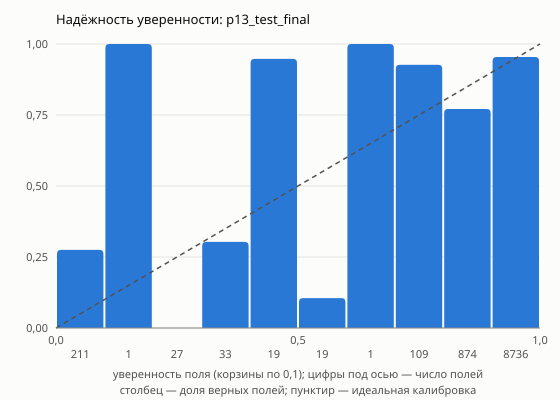
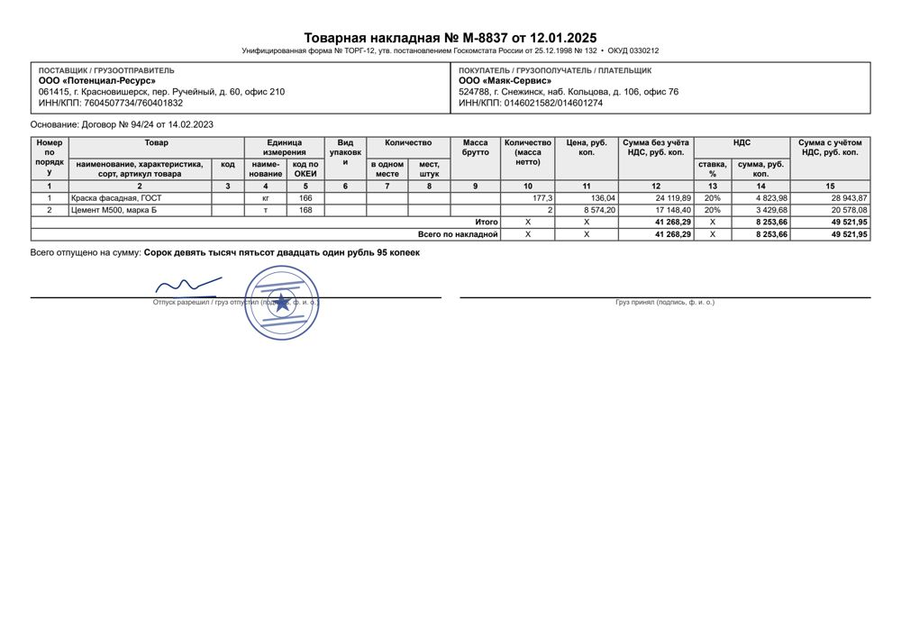
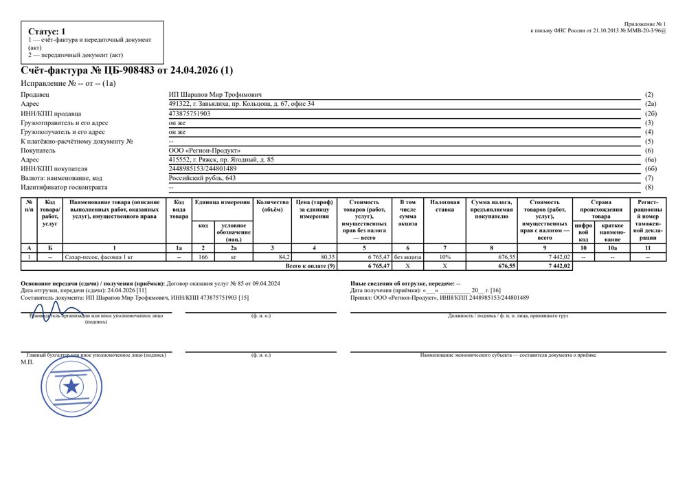
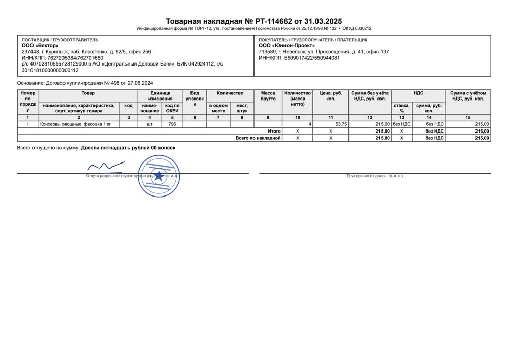
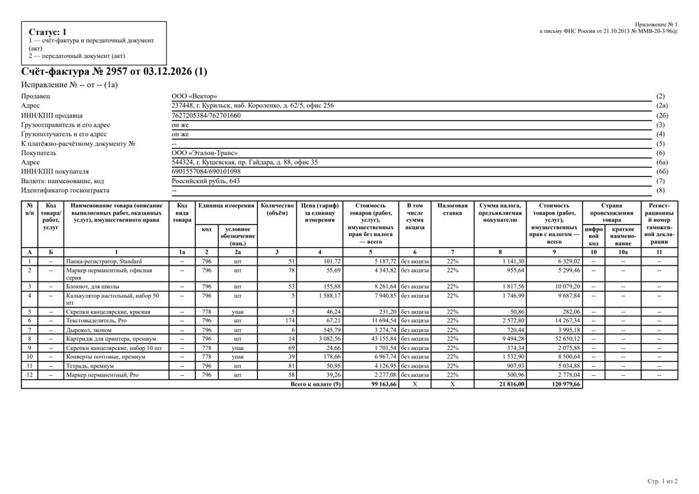
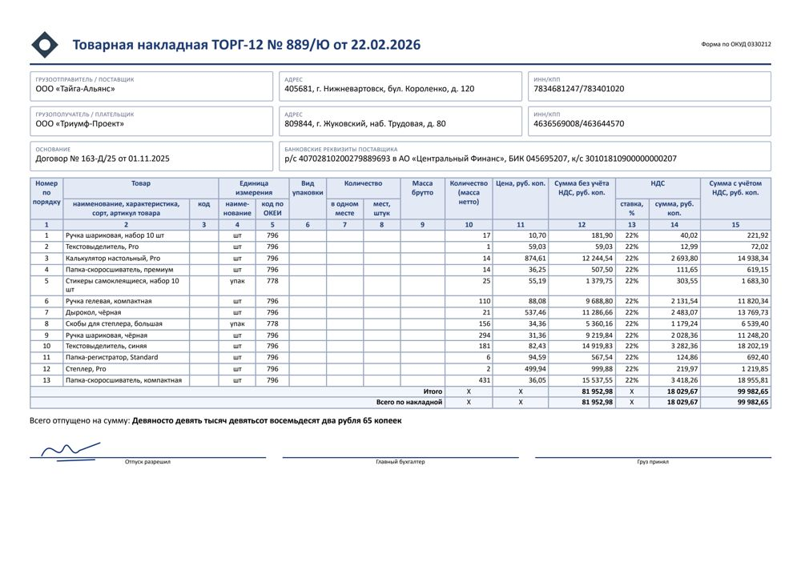

# Оценка: p13_test_final

Финальный замер P13: Qwen3.5-2B Q4_K_M, путь text, промпт text_v3 (E2, D51), тип и статус УПД по заголовку (E1, D50), таблицы grid. 154 документа test, не участвовавшие в анализе.

Запуск: `uv run docai eval --config configs/eval/p13_test_final.yaml` (копия — `config.yaml`). docai 0.1.0.

| Параметр | Значение |
|---|---|
| Модель | `qwen3.5:2b-q4_K_M` |
| Путь извлечения | `text` |
| Промпты | `text_v3`, `vision_v2` |
| Выборка | 154 прогонов, 154 документов, сплит `test`, уровни clean (rotate) |
| Seed | 2026 |
| Интервалы | бутстреп по документам, 2000 повторов, 95% |

## Главное

В скобках — 95-процентный доверительный интервал (бутстреп по документам, D45).

| Метрика | Значение |
|---|---|
| Документов без ошибок в обязательных полях (можно загружать без правок) | 48,7% [41,6; 57,1] |
| Тип документа верен | 96,1% [92,9; 98,7] |
| Документ собран (валидный JSON) | 98,1% [95,5; 100,0] |
| Поля шапки: accuracy | 81,6% [79,0; 84,0] |
| Обязательные поля шапки: accuracy | 90,9% [87,9; 93,7] |
| Выдумки: значение при пустом эталоне | 6,4% [3,5; 9,6] |
| Текстовые поля: ANLS | 89,3% [87,1; 91,2] |
| Текстовые поля: accuracy | 85,9% [83,7; 88,0] |
| Строки: precision (найдена пара) | 99,1% [98,2; 99,8] |
| Строки: recall (найдена пара) | 97,0% [95,0; 98,9] |
| Строки: F1 (найдена пара) | 98,0% [96,8; 99,2] |
| Строки: F1 (строка верна целиком) | 53,4% [44,0; 62,6] |
| Ячейки: precision | 92,9% [90,5; 94,9] |
| Ячейки: recall | 90,7% [88,2; 93,1] |
| Ячейки: F1 | 91,8% [89,5; 93,8] |
| Статус «можно загружать» | 55,8% [48,1; 63,6] |
| Среди «можно загружать» — действительно без ошибок | 76,7% [67,8; 85,6] |
| Молча загружен с ошибкой (доля всех документов) | 13,0% [7,8; 18,2] |
| Документ с ошибкой отправлен на проверку или отклонён | 74,7% [64,7; 84,0] |
| Доля верных среди полей с уверенностью | 91,8% [89,8; 93,4] |
| Средняя уверенность поля | 94,3% [93,0; 95,4] |
| ECE (10 корзин) | 0,041 [0,029; 0,054] |
| MCE (10 корзин) | 0,840 [0,491; 0,840] |
| Brier | 0,061 [0,050; 0,073] |
| Секунд на страницу | 20,1 [18,6; 21,8] |

## Ответ модели до и после постобработки (P10)

Одни и те же документы: парный бутстреп разности «после − до», p — приближённое двустороннее по бутстрепу; для доли документов без правок — ещё тест Макнемара.

| Метрика | До | После | Разность [95% ДИ] | p |
|---|---|---|---|---|
| Документов без ошибок в обязательных полях (можно загружать без правок) | 37,7% | 48,7% | 11,0 п.п. [6,5; 16,2] | < 0,001 |
| Поля шапки: accuracy | 77,7% | 81,6% | 3,8 п.п. [2,9; 4,8] | < 0,001 |
| Обязательные поля шапки: accuracy | 85,0% | 90,9% | 5,9 п.п. [4,5; 7,2] | < 0,001 |
| Текстовые поля: ANLS | 89,3% | 89,3% | 0,0 п.п. [0,0; 0,0] | 1,000 |
| Строки: F1 (найдена пара) | 98,0% | 98,0% | 0,0 п.п. [0,0; 0,0] | 1,000 |
| Ячейки: F1 | 91,5% | 91,8% | 0,3 п.п. [0,1; 0,5] | < 0,001 |

Макнемар (без правок): только до — 0, только после — 17, p < 0,001 (точный биномиальный).

## По группам: тип документа

| Значение | Документов | Без правок | Тип верен | Шапка acc | ANLS | Строки F1 | Ячейки F1 | Молча с ошибкой | ECE | с/стр |
|---|---|---|---|---|---|---|---|---|---|---|
| act | 19 | 52,6% [31,6; 73,7] | 94,7% [84,2; 100,0] | 81,1% [76,0; 86,0] | 88,1% [83,2; 92,2] | 100,0% [100,0; 100,0] | 89,6% [88,9; 90,8] | 15,8% [0,0; 31,6] | 0,097 [0,075; 0,119] | 18,5 [15,0; 22,4] |
| bill | 32 | 56,2% [37,5; 75,0] | 93,8% [84,4; 100,0] | 80,9% [76,5; 85,0] | 92,1% [89,0; 94,7] | 100,0% [100,0; 100,0] | 89,8% [88,4; 91,1] | 15,6% [3,1; 28,1] | 0,079 [0,059; 0,099] | 21,2 [18,3; 24,4] |
| torg12 | 33 | 42,4% [27,3; 60,6] | 93,9% [84,8; 100,0] | 79,2% [70,4; 85,7] | 88,1% [81,2; 92,9] | 98,3% [96,3; 99,7] | 91,5% [83,4; 96,4] | 6,1% [0,0; 15,2] | 0,058 [0,039; 0,084] | 24,5 [20,2; 30,2] |
| upd | 48 | 41,7% [27,1; 56,2] | 97,9% [93,8; 100,0] | 80,2% [75,6; 84,0] | 86,5% [82,8; 90,1] | 95,8% [92,9; 98,7] | 92,2% [87,3; 96,2] | 10,4% [2,1; 20,8] | 0,041 [0,026; 0,063] | 19,1 [16,9; 22,0] |
| vat_invoice | 22 | 59,1% [36,4; 77,3] | 100,0% [100,0; 100,0] | 92,5% [88,9; 95,9] | 95,5% [88,2; 99,5] | 99,6% [98,9; 100,0] | 95,4% [91,3; 98,8] | 22,7% [4,5; 40,9] | 0,045 [0,013; 0,087] | 16,4 [13,9; 19,1] |

## По группам: уровень качества

| Значение | Документов | Без правок | Тип верен | Шапка acc | ANLS | Строки F1 | Ячейки F1 | Молча с ошибкой | ECE | с/стр |
|---|---|---|---|---|---|---|---|---|---|---|
| clean | 154 | 48,7% [41,6; 57,1] | 96,1% [92,9; 98,7] | 81,6% [79,0; 84,0] | 89,3% [87,1; 91,2] | 98,0% [96,8; 99,2] | 91,8% [89,5; 93,8] | 13,0% [7,8; 18,2] | 0,041 [0,029; 0,054] | 20,1 [18,6; 21,8] |

## По группам: путь извлечения

| Значение | Документов | Без правок | Тип верен | Шапка acc | ANLS | Строки F1 | Ячейки F1 | Молча с ошибкой | ECE | с/стр |
|---|---|---|---|---|---|---|---|---|---|---|
| text | 154 | 48,7% [41,6; 57,1] | 96,1% [92,9; 98,7] | 81,6% [79,0; 84,0] | 89,3% [87,1; 91,2] | 98,0% [96,8; 99,2] | 91,8% [89,5; 93,8] | 13,0% [7,8; 18,2] | 0,041 [0,029; 0,054] | 20,1 [18,6; 21,8] |

Столбцы: «Без правок» — документ без ошибок в обязательных полях; «Шапка acc» — accuracy полей шапки; ANLS — текстовые поля; «Строки F1» — найдена пара строки; «Молча с ошибкой» — статус «можно загружать» у документа с ошибкой; с/стр — секунд на страницу.

## По полям

Accuracy — верных среди непустых эталонных значений (у полей строк ячейка несопоставленной строки считается неверной); precision — верных среди непустых ответов.

| Поле | Название | Эталонных значений | Accuracy | ANLS | Precision |
|---|---|---|---|---|---|
| `doc_type` | Тип документа | 154 | 96,1% [92,9; 98,7] | — | — |
| `number` | Номер документа | 154 | 96,1% [92,9; 98,7] | 96,1% [92,9; 98,7] | — |
| `date` | Дата документа | 154 | 96,1% [92,9; 98,7] | — | — |
| `upd_status` | Статус УПД | 48 | 95,8% [89,1; 100,0] | — | — |
| `seller.name` | Продавец: наименование | 154 | 85,7% [79,9; 90,9] | 86,5% [80,9; 91,6] | — |
| `seller.inn` | Продавец: ИНН | 154 | 92,9% [88,3; 96,8] | — | — |
| `seller.kpp` | Продавец: КПП | 120 | 60,0% [51,3; 69,2] | — | — |
| `seller.address` | Продавец: адрес | 154 | 59,7% [51,9; 67,5] | 80,0% [74,6; 85,0] | — |
| `buyer.name` | Покупатель: наименование | 154 | 87,7% [82,5; 92,9] | 88,1% [83,1; 92,9] | — |
| `buyer.inn` | Покупатель: ИНН | 154 | 89,0% [84,4; 93,5] | — | — |
| `buyer.kpp` | Покупатель: КПП | 125 | 91,2% [86,3; 95,8] | — | — |
| `buyer.address` | Покупатель: адрес | 154 | 61,7% [53,9; 69,5] | 84,6% [79,8; 88,7] | — |
| `seller_bank.bank_name` | Банк продавца | 63 | 77,8% [66,7; 87,9] | 81,2% [71,7; 90,4] | — |
| `seller_bank.bik` | БИК | 63 | 84,1% [75,0; 93,0] | — | — |
| `seller_bank.corr_account` | Корр. счёт | 63 | 85,7% [77,0; 94,1] | — | — |
| `seller_bank.account` | Расчётный счёт | 63 | 77,8% [66,7; 87,7] | — | — |
| `basis.name` | Основание: вид документа | 113 | 15,0% [8,8; 21,9] | 34,7% [27,5; 42,1] | — |
| `basis.number` | Основание: номер | 113 | 67,3% [58,6; 75,7] | 67,3% [58,6; 75,7] | — |
| `basis.date` | Основание: дата | 113 | 67,3% [58,6; 75,7] | — | — |
| `lines[].name` | Строка: наименование | 865 | 96,9% [94,8; 98,8] | 96,9% [94,8; 98,8] | 98,9% [98,0; 99,6] |
| `lines[].unit_name` | Строка: единица измерения | 865 | 94,2% [90,6; 97,1] | 94,2% [90,6; 97,1] | 96,4% [93,0; 98,8] |
| `lines[].unit_code` | Строка: код ОКЕИ | 865 | 68,1% [59,5; 75,9] | — | 74,7% [66,1; 82,3] |
| `lines[].quantity` | Строка: количество | 865 | 95,0% [91,5; 97,9] | — | 97,3% [93,9; 99,2] |
| `lines[].price` | Строка: цена | 865 | 93,4% [88,9; 96,8] | — | 95,6% [91,2; 98,7] |
| `lines[].amount_without_vat` | Строка: сумма без НДС | 865 | 91,4% [86,9; 95,4] | — | 93,4% [88,7; 97,0] |
| `lines[].vat_rate` | Строка: ставка НДС | 865 | 94,0% [89,6; 97,6] | — | 96,2% [92,1; 99,3] |
| `lines[].vat_amount` | Строка: сумма НДС | 780 | 90,9% [85,9; 95,5] | — | 87,5% [81,0; 93,5] |
| `lines[].amount_with_vat` | Строка: сумма с НДС | 865 | 92,7% [88,0; 96,5] | — | 94,7% [90,1; 98,2] |
| `totals.amount_without_vat` | Итого без НДС | 154 | 97,4% [94,8; 99,4] | — | — |
| `totals.vat_amount` | Итого НДС | 139 | 96,4% [93,1; 99,3] | — | — |
| `totals.amount_with_vat` | Всего с НДС | 154 | 96,1% [92,9; 98,7] | — | — |

## Калибровка уверенности

Полей с уверенностью: 10030. ECE 0,041 [0,029; 0,054], MCE 0,840 [0,491; 0,840], Brier 0,061 [0,050; 0,073], AUROC «уверенность отличает верное поле от неверного» 0,738 [0,684; 0,786]. Порог «нужна проверка» — 0,80.

| Уверенность | Полей | Средняя уверенность | Доля верных |
|---|---|---|---|
| 0,0–0,1 | 211 | 0,032 | 27,5% |
| 0,1–0,2 | 1 | 0,160 | 100,0% |
| 0,2–0,3 | 27 | 0,244 | 0,0% |
| 0,3–0,4 | 33 | 0,380 | 30,3% |
| 0,4–0,5 | 19 | 0,432 | 94,7% |
| 0,5–0,6 | 19 | 0,515 | 10,5% |
| 0,6–0,7 | 1 | 0,674 | 100,0% |
| 0,7–0,8 | 109 | 0,749 | 92,7% |
| 0,8–0,9 | 874 | 0,844 | 77,1% |
| 0,9–1,0 | 8736 | 0,983 | 95,4% |

## Производительность

Секунд на страницу (сумма времени / сумма страниц): 20,1 [18,6; 21,8]; медиана по документам 17,0, 90-й процентиль 30,2, максимум 80,1. Документ в среднем 23,2 с, всего 0,99 ч на 178 страниц. Пиковая VRAM (nvidia-smi, весь GPU): максимум 2405 МиБ, медиана 2405 МиБ. Токены: 287884 → 182204.

## Сравнение с `p13_test_base`

Общих документов: 154. A — `p13_test_base`, B — `p13_test_final`; парный бутстреп разности B − A.

| Метрика | A | B | B − A [95% ДИ] | p |
|---|---|---|---|---|
| Документов без ошибок в обязательных полях (можно загружать без правок) | 36,4 | 48,7 | 12,3 п.п. [2,6; 21,4] | 0,015 |
| Тип документа верен | 74,0 | 96,1 | 22,1 п.п. [15,6; 29,2] | < 0,001 |
| Документ собран (валидный JSON) | 99,4 | 98,1 | -1,3 п.п. [-3,2; 0,0] | 0,247 |
| Поля шапки: accuracy | 81,7 | 81,6 | -0,1 п.п. [-2,9; 2,4] | 0,960 |
| Обязательные поля шапки: accuracy | 86,9 | 90,9 | 4,0 п.п. [1,2; 6,5] | 0,004 |
| Выдумки: значение при пустом эталоне | 10,5 | 6,4 | -4,1 п.п. [-8,3; 0,0] | 0,071 |
| Текстовые поля: ANLS | 93,6 | 89,3 | -4,3 п.п. [-6,3; -2,4] | < 0,001 |
| Текстовые поля: accuracy | 89,6 | 85,9 | -3,7 п.п. [-5,8; -1,6] | < 0,001 |
| Строки: precision (найдена пара) | 98,4 | 99,1 | 0,7 п.п. [-0,5; 2,0] | 0,298 |
| Строки: recall (найдена пара) | 98,8 | 97,0 | -1,8 п.п. [-3,5; -0,5] | 0,006 |
| Строки: F1 (найдена пара) | 98,6 | 98,0 | -0,6 п.п. [-1,7; 0,5] | 0,284 |
| Строки: F1 (строка верна целиком) | 57,7 | 53,4 | -4,3 п.п. [-9,4; 0,2] | 0,053 |
| Ячейки: precision | 93,5 | 92,9 | -0,5 п.п. [-2,2; 1,3] | 0,510 |
| Ячейки: recall | 92,4 | 90,7 | -1,7 п.п. [-3,5; -0,0] | 0,049 |
| Ячейки: F1 | 92,9 | 91,8 | -1,1 п.п. [-2,6; 0,4] | 0,143 |
| Статус «можно загружать» | 38,3 | 55,8 | 17,5 п.п. [9,1; 26,0] | < 0,001 |
| Среди «можно загружать» — действительно без ошибок | 62,7 | 76,7 | 14,0 п.п. [-1,0; 28,7] | 0,070 |
| Молча загружен с ошибкой (доля всех документов) | 14,3 | 13,0 | -1,3 п.п. [-8,4; 5,8] | 0,778 |
| Документ с ошибкой отправлен на проверку или отклонён | 77,6 | 74,7 | -2,9 п.п. [-13,6; 8,1] | 0,597 |
| Доля верных среди полей с уверенностью | 91,6 | 91,8 | 0,2 п.п. [-1,2; 1,7] | 0,835 |
| Средняя уверенность поля | 93,5 | 94,3 | 0,8 п.п. [0,2; 1,5] | 0,005 |
| ECE (10 корзин) | 0,040 | 0,041 | 0,001 [-0,010; 0,012] | 0,886 |
| MCE (10 корзин) | 0,568 | 0,840 | 0,272 [-0,077; 0,272] | 0,800 |
| Brier | 0,060 | 0,061 | 0,001 [-0,009; 0,012] | 0,829 |
| Секунд на страницу | 20,161 | 20,081 | -0,080 [-1,059; 1,254] | 0,861 |

Макнемар (без правок): только A — 19, только B — 38, p = 0,017 (χ² с поправкой Йейтса).

## Худшие примеры

5 документов с наименьшим F1 по всем значениям (шапка и ячейки). Обозначения: ∅ — пусто; `lines[i↔j]` — строка i эталона сопоставлена со строкой j ответа. Значения показаны после нормализации FIELD_SPEC.

### 00694_torg12_clean_200dpi

Тип: torg12 (ответ: —), уровень clean, путь text, статус reject, F1 0,0%, строк 0 из 2.

| Поле | Эталон | Ответ |
|---|---|---|
| doc_type | torg12 | ∅ |
| number | м-8837 | ∅ |
| date | 2025-01-12 | ∅ |
| seller.name | ооо потенциал-ресурс | ∅ |
| seller.inn | 7604507734 | ∅ |
| seller.kpp | 760401832 | ∅ |
| seller.address | 061415, г. красновишерск, пер. ручейный, д. 60, офис 210 | ∅ |
| buyer.name | ооо маяк-сервис | ∅ |
| buyer.inn | 0146021582 | ∅ |
| buyer.kpp | 014601274 | ∅ |
| buyer.address | 524788, г. снежинск, наб. кольцова, д. 106, офис 76 | ∅ |
| basis.name | договор | ∅ |
| basis.number | 94/24 | ∅ |
| basis.date | 2023-02-14 | ∅ |
| totals.amount_without_vat | 41268.29 | ∅ |
| totals.vat_amount | 8253.66 | ∅ |
| totals.amount_with_vat | 49521.95 | ∅ |
| lines[0] — строка не найдена | Краска фасадная, ГОСТ | ∅ |
| lines[1] — строка не найдена | Цемент М500, марка Б | ∅ |

### 01285_upd_clean_200dpi

Тип: upd (ответ: —), уровень clean, путь text, статус reject, F1 0,0%, строк 0 из 1.

| Поле | Эталон | Ответ |
|---|---|---|
| doc_type | upd | ∅ |
| number | цб-908483 | ∅ |
| date | 2026-04-24 | ∅ |
| upd_status | 1 | ∅ |
| seller.name | ип шарапов мир трофимович | ∅ |
| seller.inn | 473875751903 | ∅ |
| seller.address | 491322, г. завьялиха, пр. кольцова, д. 67, офис 34 | ∅ |
| buyer.name | ооо регион-продукт | ∅ |
| buyer.inn | 2448985153 | ∅ |
| buyer.kpp | 244801489 | ∅ |
| buyer.address | 415552, г. ряжск, пр. ягодный, д. 85 | ∅ |
| basis.name | договор оказания услуг | ∅ |
| basis.number | 85 | ∅ |
| basis.date | 2024-04-09 | ∅ |
| totals.amount_without_vat | 6765.47 | ∅ |
| totals.vat_amount | 676.55 | ∅ |
| totals.amount_with_vat | 7442.02 | ∅ |
| lines[0] — строка не найдена | Сахар-песок, фасовка 1 кг | ∅ |

### 02006_torg12_clean_200dpi

Тип: torg12 (ответ: —), уровень clean, путь text, статус reject, F1 0,0%, строк 0 из 1.

| Поле | Эталон | Ответ |
|---|---|---|
| doc_type | torg12 | ∅ |
| number | рт-114662 | ∅ |
| date | 2025-03-31 | ∅ |
| seller.name | ооо вектор | ∅ |
| seller.inn | 7627205384 | ∅ |
| seller.kpp | 762701660 | ∅ |
| seller.address | 237448, г. курильск, наб. короленко, д. 62/5, офис 256 | ∅ |
| buyer.name | ооо юнион-проект | ∅ |
| buyer.inn | 5509017422 | ∅ |
| buyer.kpp | 550944081 | ∅ |
| buyer.address | 719589, г. невельск, ул. просвещения, д. 41, офис 137 | ∅ |
| seller_bank.bank_name | ао центральный деловой банк | ∅ |
| seller_bank.bik | 042924112 | ∅ |
| seller_bank.corr_account | 30101810600000000112 | ∅ |
| seller_bank.account | 40702810555728129000 | ∅ |
| basis.name | договор купли-продажи | ∅ |
| basis.number | 498 | ∅ |
| basis.date | 2024-06-27 | ∅ |
| totals.amount_without_vat | 215.00 | ∅ |
| totals.amount_with_vat | 215.00 | ∅ |
| lines[0] — строка не найдена | Консервы овощные, фасовка 1 кг | ∅ |

### 00811_upd_clean_200dpi

Тип: upd (ответ: upd), уровень clean, путь text, статус review, F1 47,6%, строк 12 из 12.

| Поле | Эталон | Ответ |
|---|---|---|
| seller.kpp | 762701660 | ∅ |
| basis.name | договор поставки | ∅ |
| basis.number | 832 | ∅ |
| basis.date | 2025-11-15 | ∅ |
| lines[3↔3].quantity | 5 | 1 |
| lines[3↔3].amount_without_vat | 7940.85 | 1588.17 |
| lines[3↔3].vat_amount | 1746.99 | 349.41 |
| lines[3↔3].amount_with_vat | 9687.84 | 1937.58 |
| lines[4↔4].quantity | 5 | 1 |
| lines[4↔4].amount_without_vat | 231.20 | 46.24 |
| lines[4↔4].vat_amount | 50.86 | 10.17 |
| lines[4↔4].amount_with_vat | 282.06 | 56.41 |
| lines[5↔5].quantity | 174 | 1 |
| lines[5↔5].amount_without_vat | 11694.54 | 67.21 |
| lines[5↔5].vat_amount | 2572.80 | 14.79 |
| lines[5↔5].amount_with_vat | 14267.34 | 82.01 |
| lines[6↔6].quantity | 6 | 1 |
| lines[6↔6].amount_without_vat | 3274.74 | 545.79 |
| lines[6↔6].vat_amount | 720.44 | 120.07 |
| lines[6↔6].amount_with_vat | 3995.18 | 665.86 |
| lines[7↔7].quantity | 14 | 1 |
| lines[7↔7].amount_without_vat | 43155.84 | 3082.56 |
| lines[7↔7].vat_amount | 9494.28 | 678.16 |
| lines[7↔7].amount_with_vat | 52650.12 | 3760.72 |
| lines[8↔8].quantity | 69 | 1 |
| lines[8↔8].amount_without_vat | 1701.54 | 24.66 |
| lines[8↔8].vat_amount | 374.34 | 5.43 |
| lines[8↔8].amount_with_vat | 2075.88 | 30.09 |
| lines[9↔9].quantity | 39 | 1 |
| lines[9↔9].amount_without_vat | 6967.74 | 178.66 |
| … ещё 16 | | |

### 02971_torg12_clean_200dpi

Тип: torg12 (ответ: torg12), уровень clean, путь text, статус review, F1 55,3%, строк 13 из 13.

| Поле | Эталон | Ответ |
|---|---|---|
| seller.kpp | 783401020 | ∅ |
| basis.name | договор | договор № 163-д/25 |
| totals.amount_without_vat | 81952.98 | 8195298.00 |
| totals.vat_amount | 18029.67 | 1802967.00 |
| totals.amount_with_vat | 99982.65 | 9998265.00 |
| lines[1↔1].price | 59.03 | 5903.00 |
| lines[1↔1].amount_without_vat | 59.03 | 5903.00 |
| lines[1↔1].vat_amount | 12.99 | 12996.00 |
| lines[1↔1].amount_with_vat | 72.02 | 72020.00 |
| lines[2↔2].price | 874.61 | 87461.00 |
| lines[2↔2].amount_without_vat | 12244.54 | 1224454.00 |
| lines[2↔2].vat_amount | 2693.80 | 2693802.00 |
| lines[2↔2].amount_with_vat | 14938.34 | 14938340.00 |
| lines[3↔3].price | 36.25 | 3625.00 |
| lines[3↔3].amount_without_vat | 507.50 | 50750.00 |
| lines[3↔3].vat_amount | 111.65 | 111650.00 |
| lines[3↔3].amount_with_vat | 619.15 | 619150.00 |
| lines[4↔4].price | 55.19 | 5519.00 |
| lines[4↔4].amount_without_vat | 1379.75 | 137975.00 |
| lines[4↔4].vat_amount | 303.55 | 303545.00 |
| lines[4↔4].amount_with_vat | 1683.30 | 1683300.00 |
| lines[5↔5].price | 88.08 | 8808.00 |
| lines[5↔5].amount_without_vat | 9688.80 | 968880.00 |
| lines[5↔5].vat_amount | 2131.54 | 2131536.00 |
| lines[5↔5].amount_with_vat | 11820.34 | 11820340.00 |
| lines[6↔6].price | 537.46 | 53746.00 |
| lines[6↔6].amount_without_vat | 11286.66 | 1128666.00 |
| lines[6↔6].vat_amount | 2483.07 | 2483045.00 |
| lines[6↔6].amount_with_vat | 13769.73 | 13769730.00 |
| lines[7↔7].price | 34.36 | 3436.00 |
| … ещё 25 | | |

## Определения

Сравнение полей, сопоставление строк и «можно загружать без правок» — D44; интервалы, парное сравнение и калибровка — D45 (`docs/DECISIONS.md`). Все значения сравниваются после нормализации FIELD_SPEC.
