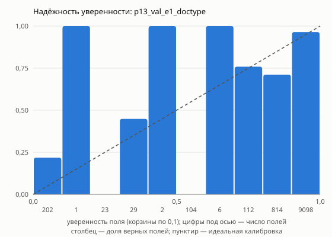
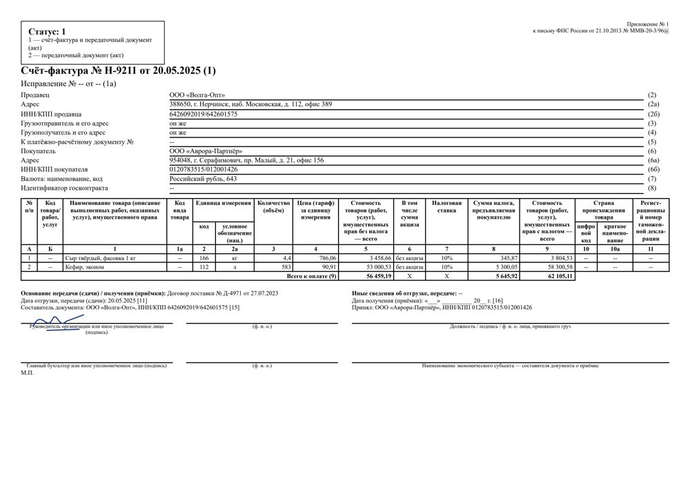
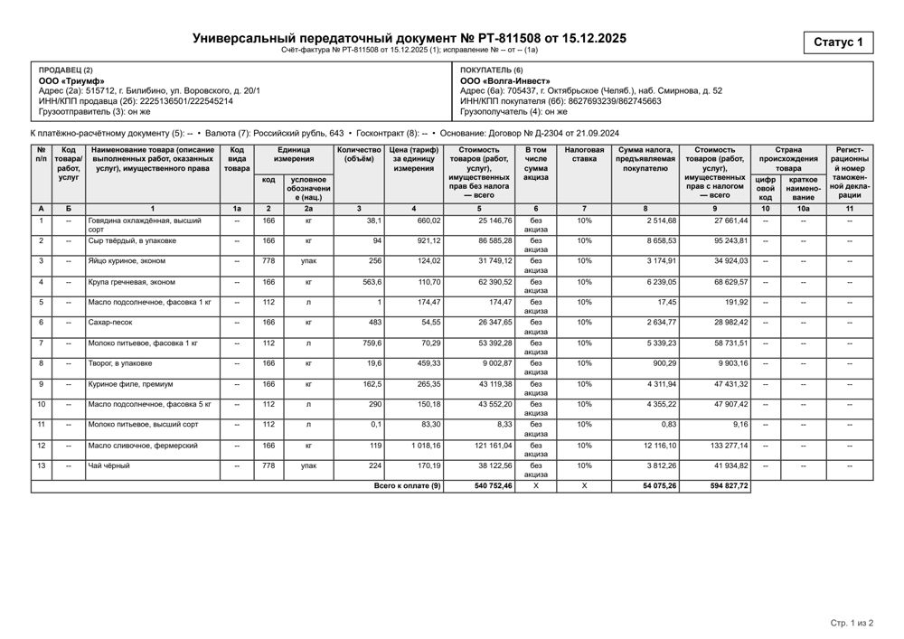
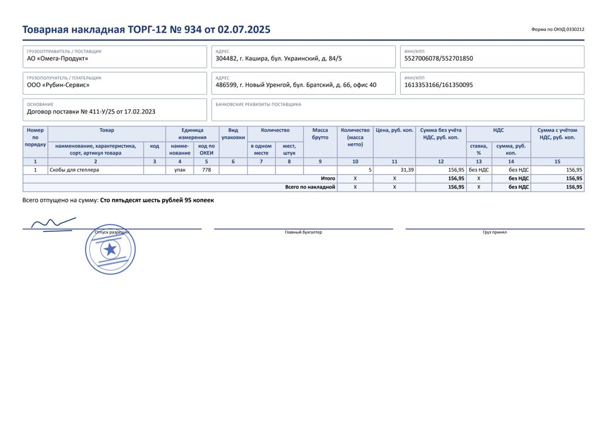
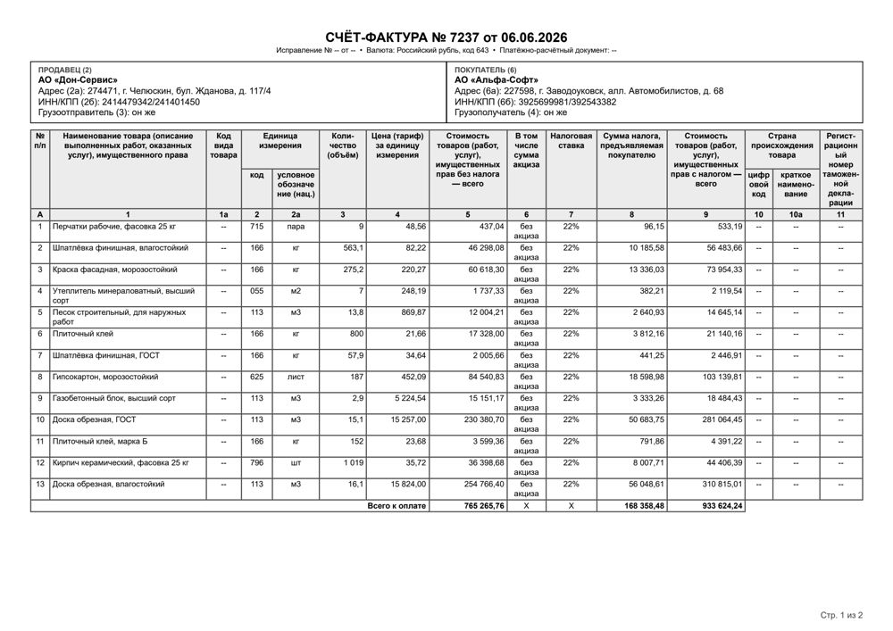
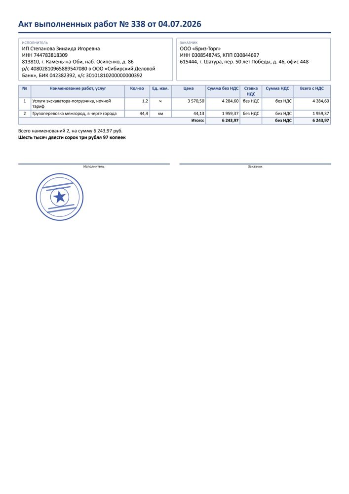

# Оценка: p13_val_e1_doctype

E1: тип документа и статус УПД берутся из заголовка текста, а не из ответа модели. Гипотеза: УПД перестанут читаться как счёт-фактура (в P12 66% УПД), доля без правок вырастет на ≥ 8 п.п. (потолок по анализу ошибок P12 — +13 п.п.). Остальное как у p13_val_base.

Запуск: `uv run docai eval --config configs/eval/p13_val_e1_doctype.yaml` (копия — `config.yaml`). docai 0.1.0.

| Параметр | Значение |
|---|---|
| Модель | `qwen3.5:2b-q4_K_M` |
| Путь извлечения | `text` |
| Промпты | `text_v2`, `vision_v2` |
| Выборка | 150 прогонов, 150 документов, сплит `val`, уровни clean (rotate) |
| Seed | 2026 |
| Интервалы | бутстреп по документам, 2000 повторов, 95% |

## Главное

В скобках — 95-процентный доверительный интервал (бутстреп по документам, D45).

| Метрика | Значение |
|---|---|
| Документов без ошибок в обязательных полях (можно загружать без правок) | 46,7% [38,7; 54,7] |
| Тип документа верен | 98,0% [95,3; 100,0] |
| Документ собран (валидный JSON) | 99,3% [98,0; 100,0] |
| Поля шапки: accuracy | 82,7% [80,5; 84,7] |
| Обязательные поля шапки: accuracy | 88,5% [85,5; 91,1] |
| Выдумки: значение при пустом эталоне | 13,7% [9,1; 19,4] |
| Текстовые поля: ANLS | 92,3% [89,4; 94,4] |
| Текстовые поля: accuracy | 88,5% [85,5; 90,8] |
| Строки: precision (найдена пара) | 97,7% [94,5; 99,5] |
| Строки: recall (найдена пара) | 97,8% [94,3; 100,0] |
| Строки: F1 (найдена пара) | 97,7% [94,4; 99,5] |
| Строки: F1 (строка верна целиком) | 50,4% [40,8; 60,5] |
| Ячейки: precision | 93,4% [89,9; 95,8] |
| Ячейки: recall | 91,4% [88,1; 94,1] |
| Ячейки: F1 | 92,4% [89,1; 94,8] |
| Статус «можно загружать» | 40,7% [32,7; 48,0] |
| Среди «можно загружать» — действительно без ошибок | 88,5% [80,0; 95,7] |
| Молча загружен с ошибкой (доля всех документов) | 4,7% [2,0; 8,0] |
| Документ с ошибкой отправлен на проверку или отклонён | 91,2% [84,5; 96,6] |
| Доля верных среди полей с уверенностью | 91,5% [89,0; 93,3] |
| Средняя уверенность поля | 94,3% [93,3; 95,2] |
| ECE (10 корзин) | 0,037 [0,024; 0,059] |
| MCE (10 корзин) | 0,840 [0,515; 0,840] |
| Brier | 0,056 [0,043; 0,075] |
| Секунд на страницу | 22,7 [21,1; 24,7] |

## Ответ модели до и после постобработки (P10)

Одни и те же документы: парный бутстреп разности «после − до», p — приближённое двустороннее по бутстрепу; для доли документов без правок — ещё тест Макнемара.

| Метрика | До | После | Разность [95% ДИ] | p |
|---|---|---|---|---|
| Документов без ошибок в обязательных полях (можно загружать без правок) | 32,0% | 46,7% | 14,7 п.п. [9,3; 20,7] | < 0,001 |
| Поля шапки: accuracy | 79,8% | 82,7% | 2,9 п.п. [2,1; 3,9] | < 0,001 |
| Обязательные поля шапки: accuracy | 83,9% | 88,5% | 4,6 п.п. [3,4; 5,9] | < 0,001 |
| Текстовые поля: ANLS | 92,3% | 92,3% | 0,0 п.п. [0,0; 0,0] | 1,000 |
| Строки: F1 (найдена пара) | 97,7% | 97,7% | 0,0 п.п. [0,0; 0,0] | 1,000 |
| Ячейки: F1 | 92,2% | 92,4% | 0,2 п.п. [0,0; 0,5] | 0,009 |

Макнемар (без правок): только до — 0, только после — 22, p < 0,001 (точный биномиальный).

## По группам: тип документа

| Значение | Документов | Без правок | Тип верен | Шапка acc | ANLS | Строки F1 | Ячейки F1 | Молча с ошибкой | ECE | с/стр |
|---|---|---|---|---|---|---|---|---|---|---|
| act | 20 | 75,0% [55,0; 90,0] | 100,0% [100,0; 100,0] | 86,8% [82,0; 91,1] | 86,5% [77,2; 94,8] | 100,0% [100,0; 100,0] | 87,0% [83,8; 90,0] | 10,0% [0,0; 25,0] | 0,082 [0,064; 0,103] | 26,9 [20,4; 34,6] |
| bill | 37 | 18,9% [8,1; 32,4] | 94,6% [86,5; 100,0] | 81,7% [78,7; 84,8] | 96,0% [94,4; 97,3] | 99,2% [98,2; 99,8] | 90,5% [89,5; 91,6] | 2,7% [0,0; 8,1] | 0,056 [0,041; 0,071] | 25,7 [21,4; 30,2] |
| torg12 | 29 | 34,5% [17,2; 51,7] | 100,0% [100,0; 100,0] | 77,9% [74,5; 81,4] | 96,4% [95,1; 97,4] | 100,0% [100,0; 100,0] | 98,0% [96,4; 99,1] | 0,0% [0,0; 0,0] | 0,054 [0,042; 0,070] | 21,4 [18,6; 24,4] |
| upd | 45 | 64,4% [51,1; 77,8] | 97,8% [93,3; 100,0] | 82,4% [77,5; 86,7] | 87,9% [80,3; 93,2] | 94,5% [84,0; 99,8] | 93,3% [82,8; 99,0] | 6,7% [0,0; 15,6] | 0,048 [0,020; 0,100] | 22,1 [19,3; 25,7] |
| vat_invoice | 19 | 47,4% [26,3; 68,4] | 100,0% [100,0; 100,0] | 90,9% [83,3; 97,6] | 94,2% [87,6; 99,4] | 96,6% [92,7; 99,5] | 92,3% [85,5; 98,4] | 5,3% [0,0; 15,8] | 0,026 [0,019; 0,041] | 18,4 [15,3; 22,0] |

## По группам: уровень качества

| Значение | Документов | Без правок | Тип верен | Шапка acc | ANLS | Строки F1 | Ячейки F1 | Молча с ошибкой | ECE | с/стр |
|---|---|---|---|---|---|---|---|---|---|---|
| clean | 150 | 46,7% [38,7; 54,7] | 98,0% [95,3; 100,0] | 82,7% [80,5; 84,7] | 92,3% [89,4; 94,4] | 97,7% [94,4; 99,5] | 92,4% [89,1; 94,8] | 4,7% [2,0; 8,0] | 0,037 [0,024; 0,059] | 22,7 [21,1; 24,7] |

## По группам: путь извлечения

| Значение | Документов | Без правок | Тип верен | Шапка acc | ANLS | Строки F1 | Ячейки F1 | Молча с ошибкой | ECE | с/стр |
|---|---|---|---|---|---|---|---|---|---|---|
| text | 150 | 46,7% [38,7; 54,7] | 98,0% [95,3; 100,0] | 82,7% [80,5; 84,7] | 92,3% [89,4; 94,4] | 97,7% [94,4; 99,5] | 92,4% [89,1; 94,8] | 4,7% [2,0; 8,0] | 0,037 [0,024; 0,059] | 22,7 [21,1; 24,7] |

Столбцы: «Без правок» — документ без ошибок в обязательных полях; «Шапка acc» — accuracy полей шапки; ANLS — текстовые поля; «Строки F1» — найдена пара строки; «Молча с ошибкой» — статус «можно загружать» у документа с ошибкой; с/стр — секунд на страницу.

## По полям

Accuracy — верных среди непустых эталонных значений (у полей строк ячейка несопоставленной строки считается неверной); precision — верных среди непустых ответов.

| Поле | Название | Эталонных значений | Accuracy | ANLS | Precision |
|---|---|---|---|---|---|
| `doc_type` | Тип документа | 150 | 98,0% [95,3; 100,0] | — | — |
| `number` | Номер документа | 150 | 98,0% [95,3; 100,0] | 98,0% [95,3; 100,0] | — |
| `date` | Дата документа | 150 | 98,0% [95,3; 100,0] | — | — |
| `upd_status` | Статус УПД | 45 | 93,3% [85,0; 100,0] | — | — |
| `seller.name` | Продавец: наименование | 150 | 94,7% [90,7; 98,0] | 94,7% [90,7; 98,0] | — |
| `seller.inn` | Продавец: ИНН | 150 | 84,7% [78,7; 90,0] | — | — |
| `seller.kpp` | Продавец: КПП | 114 | 91,2% [85,6; 96,2] | — | — |
| `seller.address` | Продавец: адрес | 150 | 65,3% [58,0; 72,7] | 90,8% [87,3; 93,7] | — |
| `buyer.name` | Покупатель: наименование | 150 | 95,3% [92,0; 98,7] | 96,2% [93,1; 98,7] | — |
| `buyer.inn` | Покупатель: ИНН | 150 | 84,7% [78,0; 90,0] | — | — |
| `buyer.kpp` | Покупатель: КПП | 129 | 90,7% [85,3; 95,3] | — | — |
| `buyer.address` | Покупатель: адрес | 150 | 62,0% [54,7; 69,3] | 91,8% [89,2; 94,0] | — |
| `seller_bank.bank_name` | Банк продавца | 72 | 80,6% [70,6; 89,2] | 81,7% [72,3; 89,9] | — |
| `seller_bank.bik` | БИК | 72 | 81,9% [72,6; 90,0] | — | — |
| `seller_bank.corr_account` | Корр. счёт | 72 | 30,6% [20,0; 41,7] | — | — |
| `seller_bank.account` | Расчётный счёт | 72 | 26,4% [16,7; 37,0] | — | — |
| `basis.name` | Основание: вид документа | 112 | 38,4% [29,8; 47,9] | 53,8% [45,5; 62,0] | — |
| `basis.number` | Основание: номер | 112 | 75,0% [66,4; 82,3] | 75,0% [66,4; 82,3] | — |
| `basis.date` | Основание: дата | 112 | 75,0% [66,4; 82,3] | — | — |
| `lines[].name` | Строка: наименование | 894 | 97,8% [94,3; 100,0] | 97,8% [94,3; 100,0] | 97,7% [94,5; 99,5] |
| `lines[].unit_name` | Строка: единица измерения | 894 | 92,3% [85,9; 97,4] | 92,9% [86,9; 97,5] | 93,1% [87,1; 97,8] |
| `lines[].unit_code` | Строка: код ОКЕИ | 894 | 57,3% [46,7; 67,5] | — | 69,1% [57,9; 79,9] |
| `lines[].quantity` | Строка: количество | 894 | 96,5% [92,5; 99,4] | — | 97,0% [93,2; 99,5] |
| `lines[].price` | Строка: цена | 894 | 97,3% [93,8; 99,7] | — | 97,8% [94,4; 99,7] |
| `lines[].amount_without_vat` | Строка: сумма без НДС | 894 | 94,4% [89,7; 98,0] | — | 94,3% [89,8; 97,8] |
| `lines[].vat_rate` | Строка: ставка НДС | 894 | 97,8% [94,3; 100,0] | — | 98,2% [95,1; 99,9] |
| `lines[].vat_amount` | Строка: сумма НДС | 807 | 94,2% [89,2; 97,9] | — | 93,9% [89,1; 97,7] |
| `lines[].amount_with_vat` | Строка: сумма с НДС | 894 | 95,7% [91,3; 99,1] | — | 95,6% [91,5; 98,7] |
| `totals.amount_without_vat` | Итого без НДС | 150 | 99,3% [98,0; 100,0] | — | — |
| `totals.vat_amount` | Итого НДС | 130 | 97,7% [94,7; 100,0] | — | — |
| `totals.amount_with_vat` | Всего с НДС | 150 | 98,7% [96,7; 100,0] | — | — |

## Калибровка уверенности

Полей с уверенностью: 10391. ECE 0,037 [0,024; 0,059], MCE 0,840 [0,515; 0,840], Brier 0,056 [0,043; 0,075], AUROC «уверенность отличает верное поле от неверного» 0,807 [0,770; 0,847]. Порог «нужна проверка» — 0,80.

| Уверенность | Полей | Средняя уверенность | Доля верных |
|---|---|---|---|
| 0,0–0,1 | 202 | 0,022 | 21,8% |
| 0,1–0,2 | 1 | 0,160 | 100,0% |
| 0,2–0,3 | 23 | 0,244 | 0,0% |
| 0,3–0,4 | 29 | 0,369 | 44,8% |
| 0,4–0,5 | 2 | 0,432 | 100,0% |
| 0,5–0,6 | 104 | 0,515 | 0,0% |
| 0,6–0,7 | 6 | 0,669 | 100,0% |
| 0,7–0,8 | 112 | 0,754 | 75,9% |
| 0,8–0,9 | 814 | 0,843 | 71,1% |
| 0,9–1,0 | 9098 | 0,984 | 96,5% |

## Производительность

Секунд на страницу (сумма времени / сумма страниц): 22,7 [21,1; 24,7]; медиана по документам 19,9, 90-й процентиль 37,2, максимум 98,2. Документ в среднем 26,4 с, всего 1,10 ч на 174 страниц. Пиковая VRAM (nvidia-smi, весь GPU): максимум 2405 МиБ, медиана 2403 МиБ. Токены: 244134 → 174596.

## Сравнение с `p13_val_base`

Общих документов: 150. A — `p13_val_base`, B — `p13_val_e1_doctype`; парный бутстреп разности B − A.

| Метрика | A | B | B − A [95% ДИ] | p |
|---|---|---|---|---|
| Документов без ошибок в обязательных полях (можно загружать без правок) | 32,7 | 46,7 | 14,0 п.п. [8,7; 20,0] | < 0,001 |
| Тип документа верен | 75,3 | 98,0 | 22,7 п.п. [16,0; 29,3] | < 0,001 |
| Документ собран (валидный JSON) | 99,3 | 99,3 | 0,0 п.п. [0,0; 0,0] | 1,000 |
| Поля шапки: accuracy | 80,4 | 82,7 | 2,3 п.п. [1,6; 3,0] | < 0,001 |
| Обязательные поля шапки: accuracy | 84,4 | 88,5 | 4,1 п.п. [2,9; 5,3] | < 0,001 |
| Выдумки: значение при пустом эталоне | 13,7 | 13,7 | 0,0 п.п. [0,0; 0,0] | 1,000 |
| Текстовые поля: ANLS | 92,3 | 92,3 | 0,0 п.п. [0,0; 0,0] | 1,000 |
| Текстовые поля: accuracy | 88,5 | 88,5 | 0,0 п.п. [0,0; 0,0] | 1,000 |
| Строки: precision (найдена пара) | 97,7 | 97,7 | 0,0 п.п. [0,0; 0,0] | 1,000 |
| Строки: recall (найдена пара) | 97,8 | 97,8 | 0,0 п.п. [0,0; 0,0] | 1,000 |
| Строки: F1 (найдена пара) | 97,7 | 97,7 | 0,0 п.п. [0,0; 0,0] | 1,000 |
| Строки: F1 (строка верна целиком) | 50,4 | 50,4 | 0,0 п.п. [0,0; 0,0] | 1,000 |
| Ячейки: precision | 93,4 | 93,4 | 0,0 п.п. [0,0; 0,0] | 1,000 |
| Ячейки: recall | 91,4 | 91,4 | 0,0 п.п. [0,0; 0,0] | 1,000 |
| Ячейки: F1 | 92,4 | 92,4 | 0,0 п.п. [0,0; 0,0] | 1,000 |
| Статус «можно загружать» | 42,0 | 40,7 | -1,3 п.п. [-3,3; 0,0] | 0,237 |
| Среди «можно загружать» — действительно без ошибок | 52,4 | 88,5 | 36,1 п.п. [25,0; 48,3] | < 0,001 |
| Молча загружен с ошибкой (доля всех документов) | 20,0 | 4,7 | -15,3 п.п. [-21,3; -10,0] | < 0,001 |
| Документ с ошибкой отправлен на проверку или отклонён | 70,3 | 91,2 | 21,0 п.п. [13,9; 28,8] | < 0,001 |
| Доля верных среди полей с уверенностью | 91,2 | 91,5 | 0,2 п.п. [0,1; 0,4] | < 0,001 |
| Средняя уверенность поля | 94,5 | 94,3 | -0,2 п.п. [-0,4; -0,1] | < 0,001 |
| ECE (10 корзин) | 0,042 | 0,037 | -0,004 [-0,006; -0,003] | < 0,001 |
| MCE (10 корзин) | 0,840 | 0,840 | 0,000 [0,000; 0,000] | 1,000 |
| Brier | 0,059 | 0,056 | -0,003 [-0,004; -0,002] | < 0,001 |
| Секунд на страницу | 22,730 | 22,730 | 0,000 [0,000; 0,000] | 1,000 |

Макнемар (без правок): только A — 0, только B — 21, p < 0,001 (точный биномиальный).

## Худшие примеры

5 документов с наименьшим F1 по всем значениям (шапка и ячейки). Обозначения: ∅ — пусто; `lines[i↔j]` — строка i эталона сопоставлена со строкой j ответа. Значения показаны после нормализации FIELD_SPEC.

### 01492_upd_clean_200dpi

Тип: upd (ответ: —), уровень clean, путь text, статус reject, F1 0,0%, строк 0 из 2.

| Поле | Эталон | Ответ |
|---|---|---|
| doc_type | upd | ∅ |
| number | н-9211 | ∅ |
| date | 2025-05-20 | ∅ |
| upd_status | 1 | ∅ |
| seller.name | ооо волга-опт | ∅ |
| seller.inn | 6426092019 | ∅ |
| seller.kpp | 642601575 | ∅ |
| seller.address | 388650, г. нерчинск, наб. московская, д. 112, офис 389 | ∅ |
| buyer.name | ооо аврора-партнер | ∅ |
| buyer.inn | 0120783515 | ∅ |
| buyer.kpp | 012001426 | ∅ |
| buyer.address | 954048, г. серафимович, пр. малый, д. 21, офис 156 | ∅ |
| basis.name | договор поставки | ∅ |
| basis.number | д-4971 | ∅ |
| basis.date | 2023-07-27 | ∅ |
| totals.amount_without_vat | 56459.19 | ∅ |
| totals.vat_amount | 5645.92 | ∅ |
| totals.amount_with_vat | 62105.11 | ∅ |
| lines[0] — строка не найдена | Сыр твёрдый, фасовка 1 кг | ∅ |
| lines[1] — строка не найдена | Кефир, эконом | ∅ |

### 00130_upd_clean_200dpi

Тип: upd (ответ: upd), уровень clean, путь text, статус review, F1 18,0%, строк 13 из 13.

| Поле | Эталон | Ответ |
|---|---|---|
| basis.name | договор | ∅ |
| basis.number | д-2304 | ∅ |
| basis.date | 2024-09-21 | ∅ |
| lines[0] — строка не найдена | Говядина охлаждённая, высший сорт | ∅ |
| lines[1] — строка не найдена | Сыр твёрдый, в упаковке | ∅ |
| lines[2] — строка не найдена | Яйцо куриное, эконом | ∅ |
| lines[3] — строка не найдена | Крупа гречневая, эконом | ∅ |
| lines[5] — строка не найдена | Сахар-песок | ∅ |
| lines[6] — строка не найдена | Молоко питьевое, фасовка 1 кг | ∅ |
| lines[7] — строка не найдена | Творог, в упаковке | ∅ |
| lines[8] — строка не найдена | Куриное филе, премиум | ∅ |
| lines[9] — строка не найдена | Масло подсолнечное, фасовка 5 кг | ∅ |
| lines[10] — строка не найдена | Молоко питьевое, высший сорт | ∅ |
| lines[11] — строка не найдена | Масло сливочное, фермерский | ∅ |
| lines[12] — строка не найдена | Чай чёрный | ∅ |
| lines[0] — лишняя строка | ∅ | Говядина охлаждённая, высший сорт |
| lines[1] — лишняя строка | ∅ | Сыр твёрдый, в упаковке |
| lines[2] — лишняя строка | ∅ | Яйцо куриное, эконом |
| lines[3] — лишняя строка | ∅ | Крупа гречневая, эконом |
| lines[5] — лишняя строка | ∅ | Сахар-песок |
| lines[6] — лишняя строка | ∅ | Молоко питьевое, фасовка 1 кг |
| lines[7] — лишняя строка | ∅ | Творог, в упаковке |
| lines[8] — лишняя строка | ∅ | Куриное филе, премиум |
| lines[9] — лишняя строка | ∅ | Масло подсолнечное, фасовка 5 кг |
| lines[10] — лишняя строка | ∅ | Молоко питьевое, высший сорт |
| lines[11] — лишняя строка | ∅ | Масло сливочное, фермерский |
| lines[12] — лишняя строка | ∅ | Чай чёрный |

### 02920_torg12_clean_200dpi

Тип: torg12 (ответ: torg12), уровень clean, путь text, статус review, F1 72,0%, строк 1 из 1.

| Поле | Эталон | Ответ |
|---|---|---|
| seller.inn | 5527006078 | 304482 |
| seller.kpp | 552701850 | 5527006078/552701850 |
| seller.address | 304482, г. кашира, бул. украинский, д. 84/5 | г. кашира, бул. украинский, д. 84/5 |
| buyer.kpp | 161350095 | 486599 |
| buyer.address | 486599, г. новый уренгой, бул. братский, д. 66, офис 40 | г. новый уренгой, бул. братский, д. 66, офис 40 |
| basis.name | договор поставки | договор поставки № 411-у/25 |
| totals.vat_amount (в эталоне пусто) | ∅ | 156.95 |
| lines[0↔0].vat_amount | ∅ | 156.95 |

### 00960_vat_invoice_clean_200dpi

Тип: vat_invoice (ответ: vat_invoice), уровень clean, путь text, статус review, F1 72,5%, строк 13 из 13.

| Поле | Эталон | Ответ |
|---|---|---|
| lines[1↔1].amount_without_vat | 46298.08 | 82.22 |
| lines[1↔1].vat_amount | 10185.58 | 18.28 |
| lines[1↔1].amount_with_vat | 56483.66 | 100.50 |
| lines[2↔2].amount_without_vat | 60618.30 | 220.27 |
| lines[2↔2].vat_amount | 13336.03 | 48.46 |
| lines[2↔2].amount_with_vat | 73954.33 | 268.73 |
| lines[3↔3].amount_without_vat | 1737.33 | 248.19 |
| lines[3↔3].vat_amount | 382.21 | 54.60 |
| lines[3↔3].amount_with_vat | 2119.54 | 302.79 |
| lines[4↔4].amount_without_vat | 12004.21 | 869.87 |
| lines[4↔4].vat_amount | 2640.93 | 191.37 |
| lines[4↔4].amount_with_vat | 14645.14 | 1061.24 |
| lines[5↔5].amount_without_vat | 17328.00 | 21.66 |
| lines[5↔5].vat_amount | 3812.16 | 45.65 |
| lines[5↔5].amount_with_vat | 21140.16 | 67.31 |
| lines[6↔6].amount_without_vat | 2005.66 | 34.64 |
| lines[6↔6].vat_amount | 441.25 | 7.82 |
| lines[6↔6].amount_with_vat | 2446.91 | 42.46 |
| lines[7↔7].amount_without_vat | 84540.83 | 452.09 |
| lines[7↔7].vat_amount | 18598.98 | 100.46 |
| lines[7↔7].amount_with_vat | 103139.81 | 552.55 |
| lines[8↔8].amount_without_vat | 15151.17 | 5224.54 |
| lines[8↔8].vat_amount | 3333.26 | 114.92 |
| lines[8↔8].amount_with_vat | 18484.43 | 637.46 |
| lines[9↔9].amount_without_vat | 230380.70 | 15257.00 |
| lines[9↔9].vat_amount | 50683.75 | 335.65 |
| lines[9↔9].amount_with_vat | 281064.45 | 18612.65 |
| lines[10↔10].amount_without_vat | 3599.36 | 23.68 |
| lines[10↔10].vat_amount | 791.86 | 52.09 |
| lines[10↔10].amount_with_vat | 4391.22 | 75.77 |
| … ещё 6 | | |

### 02952_act_clean_200dpi

Тип: act (ответ: act), уровень clean, путь text, статус review, F1 76,7%, строк 2 из 2.

| Поле | Эталон | Ответ |
|---|---|---|
| seller.name | ип степанова зинаида игоревна | ооо бриз-торг |
| seller.address | 813810, г. камень-на-оби, наб. осипенко, д. 86 | 813810, г. камень-на-оби, наб. осипенко, д. 86 615444, г.… |
| buyer.name | ооо бриз-торг | ип степанова зинаида игоревна |
| buyer.kpp | 030844697 | ∅ |
| buyer.address | 615444, г. шатура, пер. 50 лет победы, д. 46, офис 448 | ∅ |
| seller_bank.corr_account | 30101810200000000392 | ∅ |
| seller_bank.account | 40802810965889547080 | 30101810200000000392 |
| seller.kpp (в эталоне пусто) | ∅ | 030844697 |
| lines[0↔0].unit_code | 356 | ∅ |
| lines[1↔1].unit_code | 008 | ∅ |

## Определения

Сравнение полей, сопоставление строк и «можно загружать без правок» — D44; интервалы, парное сравнение и калибровка — D45 (`docs/DECISIONS.md`). Все значения сравниваются после нормализации FIELD_SPEC.
