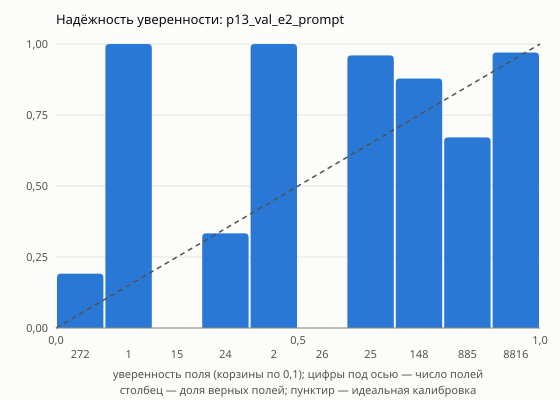
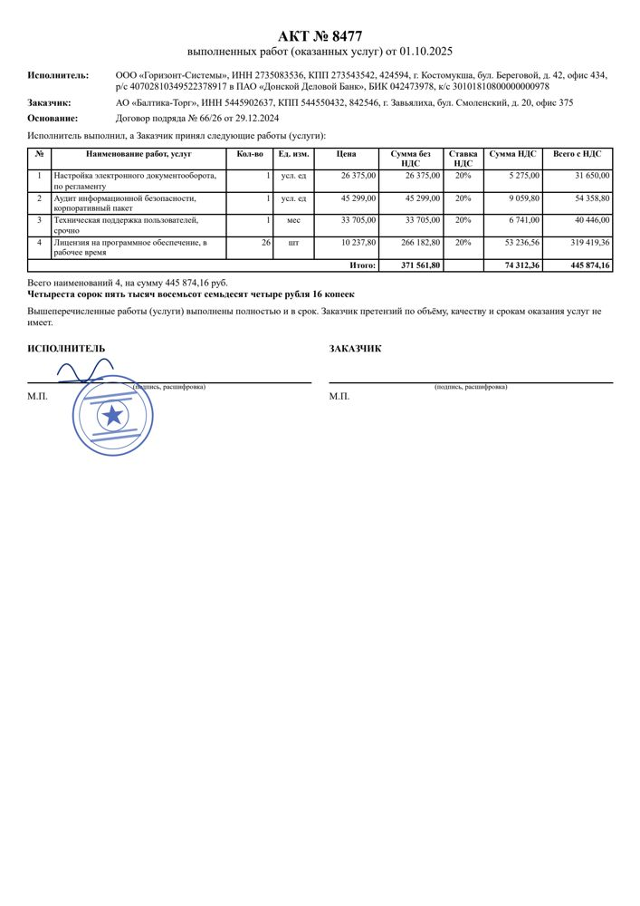
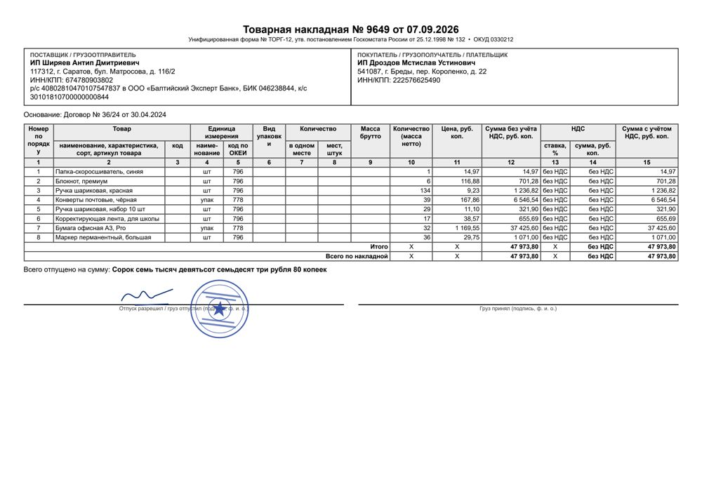
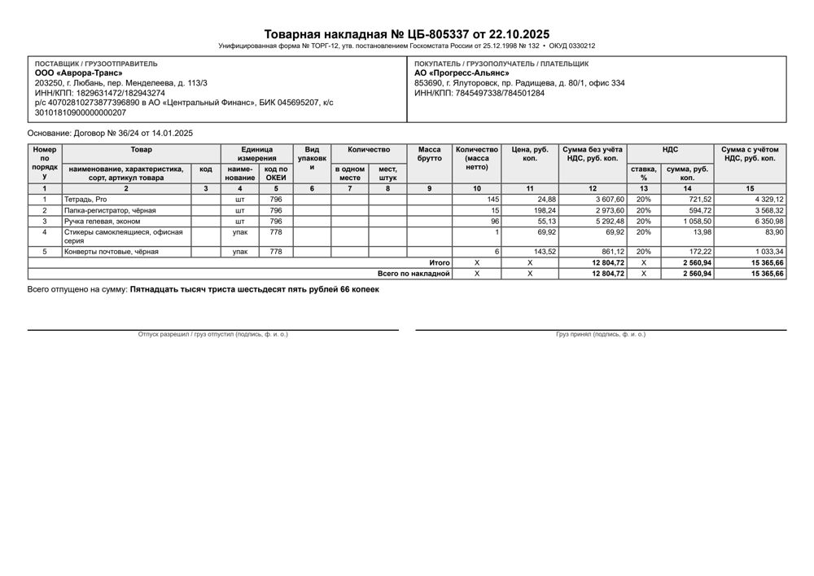
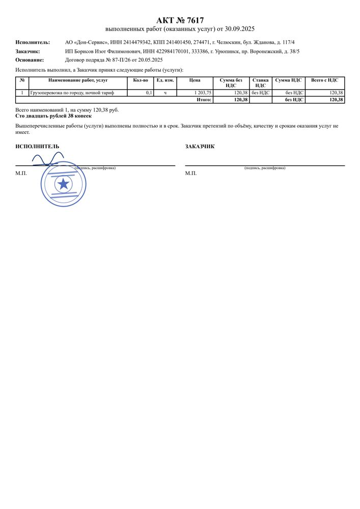
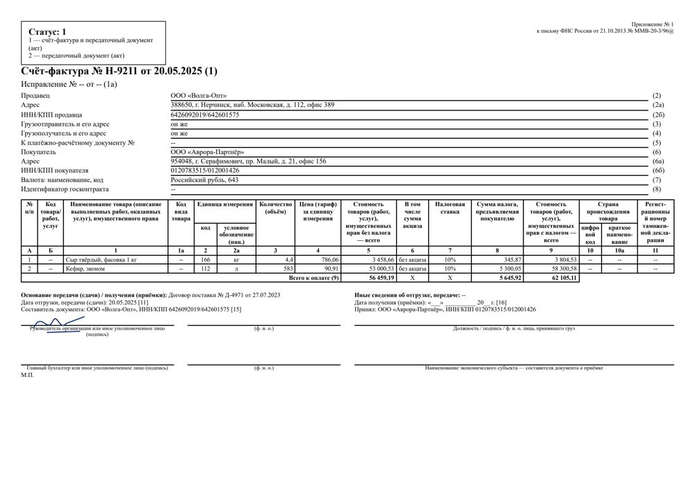

# Оценка: p13_val_e2_prompt

E2: промпт text_v3 поверх E1. Гипотеза: модель перестанет брать почтовый индекс за ИНН и корреспондентский счёт за расчётный; ошибки «соседнее поле», «адрес без индекса» и «поле не найдено» (к/с) сократятся вдвое, доля без правок вырастет на ≥ 8 п.п.

Запуск: `uv run docai eval --config configs/eval/p13_val_e2_prompt.yaml` (копия — `config.yaml`). docai 0.1.0.

| Параметр | Значение |
|---|---|
| Модель | `qwen3.5:2b-q4_K_M` |
| Путь извлечения | `text` |
| Промпты | `text_v3`, `vision_v2` |
| Выборка | 150 прогонов, 150 документов, сплит `val`, уровни clean (rotate) |
| Seed | 2026 |
| Интервалы | бутстреп по документам, 2000 повторов, 95% |

## Главное

В скобках — 95-процентный доверительный интервал (бутстреп по документам, D45).

| Метрика | Значение |
|---|---|
| Документов без ошибок в обязательных полях (можно загружать без правок) | 58,7% [50,7; 66,0] |
| Тип документа верен | 96,7% [93,3; 99,3] |
| Документ собран (валидный JSON) | 98,0% [95,3; 100,0] |
| Поля шапки: accuracy | 82,8% [79,8; 85,4] |
| Обязательные поля шапки: accuracy | 92,2% [89,4; 94,8] |
| Выдумки: значение при пустом эталоне | 8,4% [4,4; 13,0] |
| Текстовые поля: ANLS | 89,9% [86,8; 92,4] |
| Текстовые поля: accuracy | 87,3% [84,1; 89,9] |
| Строки: precision (найдена пара) | 99,2% [98,4; 99,8] |
| Строки: recall (найдена пара) | 97,0% [94,0; 99,2] |
| Строки: F1 (найдена пара) | 98,1% [96,5; 99,3] |
| Строки: F1 (строка верна целиком) | 46,7% [36,7; 56,6] |
| Ячейки: precision | 92,4% [90,3; 94,3] |
| Ячейки: recall | 89,6% [86,5; 92,3] |
| Ячейки: F1 | 91,0% [88,8; 93,1] |
| Статус «можно загружать» | 60,7% [52,7; 68,7] |
| Среди «можно загружать» — действительно без ошибок | 85,7% [78,0; 92,0] |
| Молча загружен с ошибкой (доля всех документов) | 8,7% [4,7; 13,3] |
| Документ с ошибкой отправлен на проверку или отклонён | 79,0% [68,7; 88,1] |
| Доля верных среди полей с уверенностью | 91,7% [90,1; 93,2] |
| Средняя уверенность поля | 93,8% [92,1; 95,2] |
| ECE (10 корзин) | 0,035 [0,026; 0,046] |
| MCE (10 корзин) | 0,840 [0,515; 0,840] |
| Brier | 0,053 [0,046; 0,062] |
| Секунд на страницу | 21,0 [19,1; 23,3] |

## Ответ модели до и после постобработки (P10)

Одни и те же документы: парный бутстреп разности «после − до», p — приближённое двустороннее по бутстрепу; для доли документов без правок — ещё тест Макнемара.

| Метрика | До | После | Разность [95% ДИ] | p |
|---|---|---|---|---|
| Документов без ошибок в обязательных полях (можно загружать без правок) | 41,3% | 58,7% | 17,3 п.п. [11,3; 23,3] | < 0,001 |
| Поля шапки: accuracy | 79,4% | 82,8% | 3,4 п.п. [2,5; 4,3] | < 0,001 |
| Обязательные поля шапки: accuracy | 86,9% | 92,2% | 5,3 п.п. [4,1; 6,6] | < 0,001 |
| Текстовые поля: ANLS | 89,9% | 89,9% | 0,0 п.п. [0,0; 0,0] | 1,000 |
| Строки: F1 (найдена пара) | 98,1% | 98,1% | 0,0 п.п. [0,0; 0,0] | 1,000 |
| Ячейки: F1 | 90,7% | 91,0% | 0,3 п.п. [0,1; 0,6] | < 0,001 |

Макнемар (без правок): только до — 0, только после — 26, p < 0,001 (χ² с поправкой Йейтса).

## По группам: тип документа

| Значение | Документов | Без правок | Тип верен | Шапка acc | ANLS | Строки F1 | Ячейки F1 | Молча с ошибкой | ECE | с/стр |
|---|---|---|---|---|---|---|---|---|---|---|
| act | 20 | 60,0% [40,0; 80,0] | 95,0% [85,0; 100,0] | 78,7% [67,1; 86,8] | 82,2% [69,6; 90,9] | 97,4% [91,3; 100,0] | 86,0% [80,8; 89,1] | 20,0% [5,0; 40,0] | 0,093 [0,079; 0,116] | 30,0 [21,2; 40,4] |
| bill | 37 | 67,6% [51,4; 83,8] | 94,6% [86,5; 100,0] | 85,4% [81,3; 89,1] | 93,8% [91,7; 95,6] | 100,0% [100,0; 100,0] | 89,8% [89,2; 90,6] | 8,1% [0,0; 18,9] | 0,070 [0,060; 0,079] | 23,9 [20,0; 28,2] |
| torg12 | 29 | 41,4% [24,1; 58,6] | 93,1% [82,8; 100,0] | 78,1% [68,5; 86,0] | 85,1% [73,6; 93,7] | 95,0% [87,5; 100,0] | 84,5% [75,4; 92,7] | 0,0% [0,0; 0,0] | 0,056 [0,035; 0,081] | 24,0 [19,2; 30,0] |
| upd | 45 | 68,9% [55,6; 82,2] | 100,0% [100,0; 100,0] | 83,4% [81,3; 85,7] | 90,3% [87,4; 92,7] | 99,0% [97,3; 100,0] | 96,7% [93,8; 98,9] | 6,7% [0,0; 15,6] | 0,026 [0,019; 0,042] | 16,7 [15,3; 18,2] |
| vat_invoice | 19 | 42,1% [21,1; 63,2] | 100,0% [100,0; 100,0] | 88,9% [83,8; 93,4] | 95,9% [90,3; 99,7] | 97,0% [93,1; 100,0] | 94,0% [87,7; 99,5] | 15,8% [0,0; 31,6] | 0,029 [0,021; 0,040] | 16,0 [13,2; 19,3] |

## По группам: уровень качества

| Значение | Документов | Без правок | Тип верен | Шапка acc | ANLS | Строки F1 | Ячейки F1 | Молча с ошибкой | ECE | с/стр |
|---|---|---|---|---|---|---|---|---|---|---|
| clean | 150 | 58,7% [50,7; 66,0] | 96,7% [93,3; 99,3] | 82,8% [79,8; 85,4] | 89,9% [86,8; 92,4] | 98,1% [96,5; 99,3] | 91,0% [88,8; 93,1] | 8,7% [4,7; 13,3] | 0,035 [0,026; 0,046] | 21,0 [19,1; 23,3] |

## По группам: путь извлечения

| Значение | Документов | Без правок | Тип верен | Шапка acc | ANLS | Строки F1 | Ячейки F1 | Молча с ошибкой | ECE | с/стр |
|---|---|---|---|---|---|---|---|---|---|---|
| text | 150 | 58,7% [50,7; 66,0] | 96,7% [93,3; 99,3] | 82,8% [79,8; 85,4] | 89,9% [86,8; 92,4] | 98,1% [96,5; 99,3] | 91,0% [88,8; 93,1] | 8,7% [4,7; 13,3] | 0,035 [0,026; 0,046] | 21,0 [19,1; 23,3] |

Столбцы: «Без правок» — документ без ошибок в обязательных полях; «Шапка acc» — accuracy полей шапки; ANLS — текстовые поля; «Строки F1» — найдена пара строки; «Молча с ошибкой» — статус «можно загружать» у документа с ошибкой; с/стр — секунд на страницу.

## По полям

Accuracy — верных среди непустых эталонных значений (у полей строк ячейка несопоставленной строки считается неверной); precision — верных среди непустых ответов.

| Поле | Название | Эталонных значений | Accuracy | ANLS | Precision |
|---|---|---|---|---|---|
| `doc_type` | Тип документа | 150 | 96,7% [93,3; 99,3] | — | — |
| `number` | Номер документа | 150 | 96,7% [93,3; 99,3] | 96,7% [93,3; 99,3] | — |
| `date` | Дата документа | 150 | 96,7% [93,3; 99,3] | — | — |
| `upd_status` | Статус УПД | 45 | 95,6% [88,6; 100,0] | — | — |
| `seller.name` | Продавец: наименование | 150 | 89,3% [84,0; 94,0] | 89,9% [84,7; 94,6] | — |
| `seller.inn` | Продавец: ИНН | 150 | 91,3% [86,7; 95,3] | — | — |
| `seller.kpp` | Продавец: КПП | 114 | 60,5% [51,8; 69,4] | — | — |
| `seller.address` | Продавец: адрес | 150 | 63,3% [56,0; 70,7] | 78,1% [72,2; 84,0] | — |
| `buyer.name` | Покупатель: наименование | 150 | 90,0% [84,7; 94,7] | 90,8% [86,0; 95,2] | — |
| `buyer.inn` | Покупатель: ИНН | 150 | 88,7% [83,3; 93,3] | — | — |
| `buyer.kpp` | Покупатель: КПП | 129 | 91,5% [86,4; 96,1] | — | — |
| `buyer.address` | Покупатель: адрес | 150 | 68,7% [61,3; 76,0] | 87,9% [83,8; 91,7] | — |
| `seller_bank.bank_name` | Банк продавца | 72 | 86,1% [77,6; 93,8] | 86,1% [77,6; 93,8] | — |
| `seller_bank.bik` | БИК | 72 | 86,1% [77,6; 93,8] | — | — |
| `seller_bank.corr_account` | Корр. счёт | 72 | 86,1% [77,6; 93,8] | — | — |
| `seller_bank.account` | Расчётный счёт | 72 | 80,6% [70,8; 89,2] | — | — |
| `basis.name` | Основание: вид документа | 112 | 13,4% [7,8; 19,8] | 32,9% [25,8; 40,8] | — |
| `basis.number` | Основание: номер | 112 | 67,9% [58,2; 76,4] | 67,9% [58,2; 76,4] | — |
| `basis.date` | Основание: дата | 112 | 68,8% [59,8; 77,1] | — | — |
| `lines[].name` | Строка: наименование | 894 | 97,0% [94,0; 99,2] | 97,0% [94,0; 99,2] | 99,2% [98,4; 99,8] |
| `lines[].unit_name` | Строка: единица измерения | 894 | 94,1% [89,0; 98,0] | 94,1% [89,0; 98,0] | 96,4% [91,8; 99,4] |
| `lines[].unit_code` | Строка: код ОКЕИ | 894 | 57,9% [47,9; 68,0] | — | 64,3% [53,4; 74,6] |
| `lines[].quantity` | Строка: количество | 894 | 95,7% [92,7; 98,1] | — | 98,2% [96,9; 99,1] |
| `lines[].price` | Строка: цена | 894 | 95,5% [92,1; 98,3] | — | 97,9% [95,8; 99,4] |
| `lines[].amount_without_vat` | Строка: сумма без НДС | 894 | 90,9% [85,2; 95,6] | — | 93,0% [87,8; 97,2] |
| `lines[].vat_rate` | Строка: ставка НДС | 894 | 97,0% [94,0; 99,2] | — | 99,3% [98,5; 99,9] |
| `lines[].vat_amount` | Строка: сумма НДС | 807 | 88,4% [81,0; 94,5] | — | 89,0% [81,7; 95,0] |
| `lines[].amount_with_vat` | Строка: сумма с НДС | 894 | 90,0% [83,4; 95,5] | — | 92,1% [85,8; 97,2] |
| `totals.amount_without_vat` | Итого без НДС | 150 | 96,7% [93,3; 99,3] | — | — |
| `totals.vat_amount` | Итого НДС | 130 | 96,9% [93,6; 99,3] | — | — |
| `totals.amount_with_vat` | Всего с НДС | 150 | 96,0% [92,7; 98,7] | — | — |

## Калибровка уверенности

Полей с уверенностью: 10214. ECE 0,035 [0,026; 0,046], MCE 0,840 [0,515; 0,840], Brier 0,053 [0,046; 0,062], AUROC «уверенность отличает верное поле от неверного» 0,827 [0,787; 0,860]. Порог «нужна проверка» — 0,80.

| Уверенность | Полей | Средняя уверенность | Доля верных |
|---|---|---|---|
| 0,0–0,1 | 272 | 0,023 | 19,1% |
| 0,1–0,2 | 1 | 0,160 | 100,0% |
| 0,2–0,3 | 15 | 0,244 | 0,0% |
| 0,3–0,4 | 24 | 0,375 | 33,3% |
| 0,4–0,5 | 2 | 0,432 | 100,0% |
| 0,5–0,6 | 26 | 0,515 | 0,0% |
| 0,6–0,7 | 25 | 0,673 | 96,0% |
| 0,7–0,8 | 148 | 0,767 | 87,8% |
| 0,8–0,9 | 885 | 0,840 | 67,1% |
| 0,9–1,0 | 8816 | 0,984 | 97,0% |

## Производительность

Секунд на страницу (сумма времени / сумма страниц): 21,0 [19,1; 23,3]; медиана по документам 17,0, 90-й процентиль 34,5, максимум 88,2. Документ в среднем 24,4 с, всего 1,01 ч на 174 страниц. Пиковая VRAM (nvidia-smi, весь GPU): максимум 2405 МиБ, медиана 2405 МиБ. Токены: 280434 → 185472.

## Сравнение с `p13_val_e1_doctype`

Общих документов: 150. A — `p13_val_e1_doctype`, B — `p13_val_e2_prompt`; парный бутстреп разности B − A.

| Метрика | A | B | B − A [95% ДИ] | p |
|---|---|---|---|---|
| Документов без ошибок в обязательных полях (можно загружать без правок) | 46,7 | 58,7 | 12,0 п.п. [4,0; 20,7] | 0,005 |
| Тип документа верен | 98,0 | 96,7 | -1,3 п.п. [-4,0; 1,3] | 0,467 |
| Документ собран (валидный JSON) | 99,3 | 98,0 | -1,3 п.п. [-4,0; 1,3] | 0,467 |
| Поля шапки: accuracy | 82,7 | 82,8 | 0,1 п.п. [-2,9; 3,0] | 0,946 |
| Обязательные поля шапки: accuracy | 88,5 | 92,2 | 3,7 п.п. [0,6; 7,0] | 0,018 |
| Выдумки: значение при пустом эталоне | 13,7 | 8,4 | -5,3 п.п. [-9,9; -1,5] | 0,005 |
| Текстовые поля: ANLS | 92,3 | 89,9 | -2,3 п.п. [-5,5; 0,7] | 0,136 |
| Текстовые поля: accuracy | 88,5 | 87,3 | -1,2 п.п. [-4,2; 1,8] | 0,465 |
| Строки: precision (найдена пара) | 97,7 | 99,2 | 1,5 п.п. [-0,5; 4,7] | 0,228 |
| Строки: recall (найдена пара) | 97,8 | 97,0 | -0,8 п.п. [-4,1; 3,1] | 0,654 |
| Строки: F1 (найдена пара) | 97,7 | 98,1 | 0,4 п.п. [-2,0; 3,7] | 0,900 |
| Строки: F1 (строка верна целиком) | 50,4 | 46,7 | -3,7 п.п. [-9,7; 2,0] | 0,212 |
| Ячейки: precision | 93,4 | 92,4 | -1,0 п.п. [-3,8; 2,3] | 0,477 |
| Ячейки: recall | 91,4 | 89,6 | -1,8 п.п. [-5,4; 1,8] | 0,328 |
| Ячейки: F1 | 92,4 | 91,0 | -1,4 п.п. [-4,2; 1,9] | 0,374 |
| Статус «можно загружать» | 40,7 | 60,7 | 20,0 п.п. [13,3; 26,7] | < 0,001 |
| Среди «можно загружать» — действительно без ошибок | 88,5 | 85,7 | -2,8 п.п. [-9,9; 3,9] | 0,430 |
| Молча загружен с ошибкой (доля всех документов) | 4,7 | 8,7 | 4,0 п.п. [0,7; 8,0] | 0,034 |
| Документ с ошибкой отправлен на проверку или отклонён | 91,2 | 79,0 | -12,2 п.п. [-20,7; -4,3] | 0,001 |
| Доля верных среди полей с уверенностью | 91,5 | 91,7 | 0,2 п.п. [-2,0; 2,7] | 0,899 |
| Средняя уверенность поля | 94,3 | 93,8 | -0,5 п.п. [-1,9; 0,6] | 0,432 |
| ECE (10 корзин) | 0,037 | 0,035 | -0,002 [-0,020; 0,009] | 0,735 |
| MCE (10 корзин) | 0,840 | 0,840 | 0,000 [0,000; 0,000] | 1,000 |
| Brier | 0,056 | 0,053 | -0,003 [-0,019; 0,009] | 0,744 |
| Секунд на страницу | 22,730 | 20,991 | -1,739 [-3,375; -0,138] | 0,035 |

Макнемар (без правок): только A — 12, только B — 30, p = 0,009 (χ² с поправкой Йейтса).

## Худшие примеры

5 документов с наименьшим F1 по всем значениям (шапка и ячейки). Обозначения: ∅ — пусто; `lines[i↔j]` — строка i эталона сопоставлена со строкой j ответа. Значения показаны после нормализации FIELD_SPEC.

### 00592_act_clean_200dpi

Тип: act (ответ: —), уровень clean, путь text, статус reject, F1 0,0%, строк 0 из 4.

| Поле | Эталон | Ответ |
|---|---|---|
| doc_type | act | ∅ |
| number | 8477 | ∅ |
| date | 2025-10-01 | ∅ |
| seller.name | ооо горизонт-системы | ∅ |
| seller.inn | 2735083536 | ∅ |
| seller.kpp | 273543542 | ∅ |
| seller.address | 424594, г. костомукша, бул. береговой, д. 42, офис 434 | ∅ |
| buyer.name | ао балтика-торг | ∅ |
| buyer.inn | 5445902637 | ∅ |
| buyer.kpp | 544550432 | ∅ |
| buyer.address | 842546, г. завьялиха, бул. смоленский, д. 20, офис 375 | ∅ |
| seller_bank.bank_name | пао донской деловой банк | ∅ |
| seller_bank.bik | 042473978 | ∅ |
| seller_bank.corr_account | 30101810800000000978 | ∅ |
| seller_bank.account | 40702810349522378917 | ∅ |
| basis.name | договор подряда | ∅ |
| basis.number | 66/26 | ∅ |
| basis.date | 2024-12-29 | ∅ |
| totals.amount_without_vat | 371561.80 | ∅ |
| totals.vat_amount | 74312.36 | ∅ |
| totals.amount_with_vat | 445874.16 | ∅ |
| lines[0] — строка не найдена | Настройка электронного документооборота, по регламенту | ∅ |
| lines[1] — строка не найдена | Аудит информационной безопасности, корпоративный пакет | ∅ |
| lines[2] — строка не найдена | Техническая поддержка пользователей, срочно | ∅ |
| lines[3] — строка не найдена | Лицензия на программное обеспечение, в рабочее время | ∅ |

### 02337_torg12_clean_200dpi

Тип: torg12 (ответ: —), уровень clean, путь text, статус reject, F1 0,0%, строк 0 из 8.

| Поле | Эталон | Ответ |
|---|---|---|
| doc_type | torg12 | ∅ |
| number | 9649 | ∅ |
| date | 2026-09-07 | ∅ |
| seller.name | ип ширяев антип дмитриевич | ∅ |
| seller.inn | 674780903802 | ∅ |
| seller.address | 117312, г. саратов, бул. матросова, д. 116/2 | ∅ |
| buyer.name | ип дроздов мстислав устинович | ∅ |
| buyer.inn | 222576625490 | ∅ |
| buyer.address | 541087, г. бреды, пер. короленко, д. 22 | ∅ |
| seller_bank.bank_name | ооо балтийский эксперт банк | ∅ |
| seller_bank.bik | 046238844 | ∅ |
| seller_bank.corr_account | 30101810700000000844 | ∅ |
| seller_bank.account | 40802810470107547837 | ∅ |
| basis.name | договор | ∅ |
| basis.number | 36/24 | ∅ |
| basis.date | 2024-04-30 | ∅ |
| totals.amount_without_vat | 47973.80 | ∅ |
| totals.amount_with_vat | 47973.80 | ∅ |
| lines[0] — строка не найдена | Папка-скоросшиватель, синяя | ∅ |
| lines[1] — строка не найдена | Блокнот, премиум | ∅ |
| lines[2] — строка не найдена | Ручка шариковая, красная | ∅ |
| lines[3] — строка не найдена | Конверты почтовые, чёрная | ∅ |
| lines[4] — строка не найдена | Ручка шариковая, набор 10 шт | ∅ |
| lines[5] — строка не найдена | Корректирующая лента, для школы | ∅ |
| lines[6] — строка не найдена | Бумага офисная А3, Pro | ∅ |
| lines[7] — строка не найдена | Маркер перманентный, большая | ∅ |

### 02555_torg12_clean_200dpi

Тип: torg12 (ответ: —), уровень clean, путь text, статус reject, F1 0,0%, строк 0 из 5.

| Поле | Эталон | Ответ |
|---|---|---|
| doc_type | torg12 | ∅ |
| number | цб-805337 | ∅ |
| date | 2025-10-22 | ∅ |
| seller.name | ооо аврора-транс | ∅ |
| seller.inn | 1829631472 | ∅ |
| seller.kpp | 182943274 | ∅ |
| seller.address | 203250, г. любань, пер. менделеева, д. 113/3 | ∅ |
| buyer.name | ао прогресс-альянс | ∅ |
| buyer.inn | 7845497338 | ∅ |
| buyer.kpp | 784501284 | ∅ |
| buyer.address | 853690, г. ялуторовск, пр. радищева, д. 80/1, офис 334 | ∅ |
| seller_bank.bank_name | ао центральный финанс | ∅ |
| seller_bank.bik | 045695207 | ∅ |
| seller_bank.corr_account | 30101810900000000207 | ∅ |
| seller_bank.account | 40702810273877396890 | ∅ |
| basis.name | договор | ∅ |
| basis.number | 36/24 | ∅ |
| basis.date | 2025-01-14 | ∅ |
| totals.amount_without_vat | 12804.72 | ∅ |
| totals.vat_amount | 2560.94 | ∅ |
| totals.amount_with_vat | 15365.66 | ∅ |
| lines[0] — строка не найдена | Тетрадь, Pro | ∅ |
| lines[1] — строка не найдена | Папка-регистратор, чёрная | ∅ |
| lines[2] — строка не найдена | Ручка гелевая, эконом | ∅ |
| lines[3] — строка не найдена | Стикеры самоклеящиеся, офисная серия | ∅ |
| lines[4] — строка не найдена | Конверты почтовые, чёрная | ∅ |

### 00643_act_clean_200dpi

Тип: act (ответ: act), уровень clean, путь text, статус review, F1 40,8%, строк 1 из 1.

| Поле | Эталон | Ответ |
|---|---|---|
| seller.address | 274471, г. челюскин, бул. жданова, д. 117/4 | г. челюскин, бул. жданова, д. 117/4 |
| buyer.address | 333386, г. урюпинск, пр. воронежский, д. 38/5 | г. урюпинск, пр. воронежский, д. 38/5 |
| basis.name | договор подряда | договор подряда № 87-п/26 |
| totals.amount_without_vat | 120.38 | 120.00 |
| totals.amount_with_vat | 120.38 | 120.00 |
| buyer.kpp (в эталоне пусто) | ∅ | 333386 |
| totals.vat_amount (в эталоне пусто) | ∅ | 0.00 |
| lines[0] — строка не найдена | Грузоперевозка по городу, ночной тариф | ∅ |
| lines[0] — лишняя строка | ∅ | Грузоперевозка по городу, ночной тариф |

### 01492_upd_clean_200dpi

Тип: upd (ответ: upd), уровень clean, путь text, статус review, F1 51,9%, строк 3 из 2.

| Поле | Эталон | Ответ |
|---|---|---|
| basis.name | договор поставки | ∅ |
| basis.number | д-4971 | ∅ |
| basis.date | 2023-07-27 | ∅ |
| lines[1↔1].unit_name | л | -- |
| lines[1↔1].quantity | 583 | 1 |
| lines[1↔1].price | 90.91 | 583.00 |
| lines[1↔1].amount_without_vat | 53000.53 | 90.91 |
| lines[0] — строка не найдена | Сыр твёрдый, фасовка 1 кг | ∅ |
| lines[0] — лишняя строка | ∅ | Сыр твёрдый, фасовка 1 кг |
| lines[2] — лишняя строка | ∅ | Всего к оплате (9) |

## Определения

Сравнение полей, сопоставление строк и «можно загружать без правок» — D44; интервалы, парное сравнение и калибровка — D45 (`docs/DECISIONS.md`). Все значения сравниваются после нормализации FIELD_SPEC.
