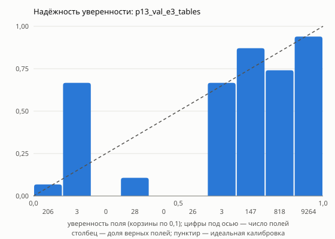
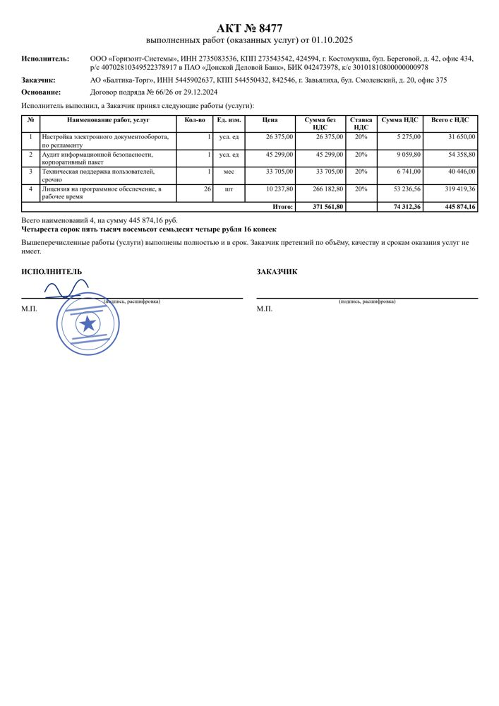
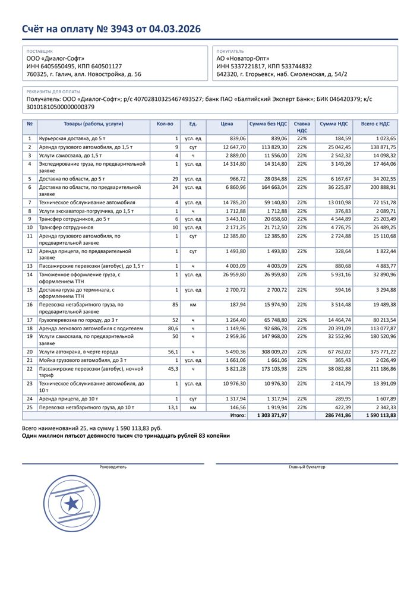
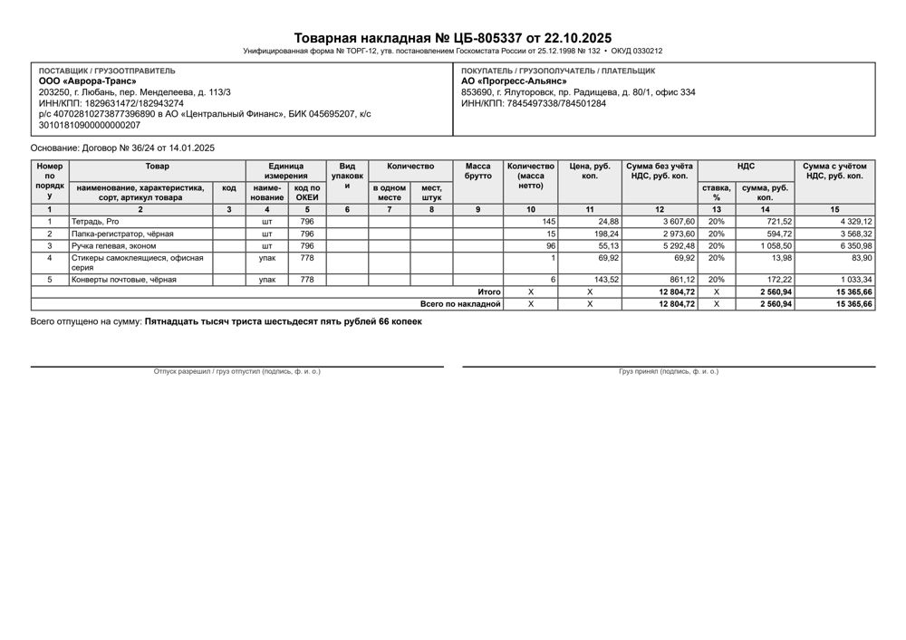
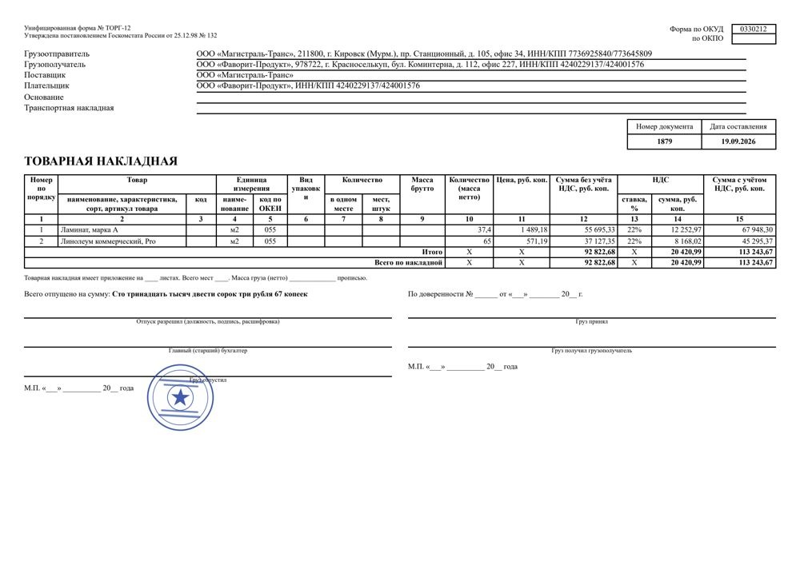
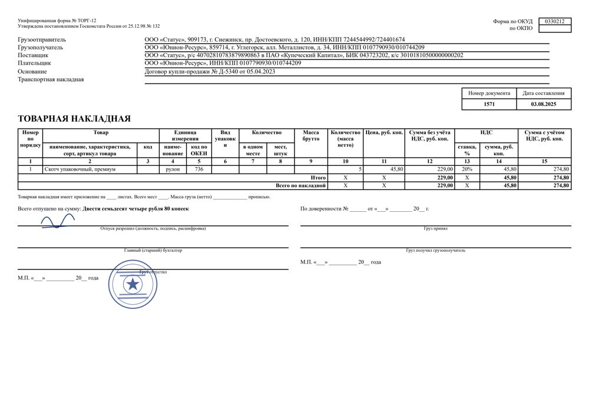

# Оценка: p13_val_e3_tables

E3: таблица позиций построчно «графа: значение» (двухэтажная шапка склеена, строка номеров граф и пустые ячейки убраны) поверх E1 + E2. Гипотеза: исчезнет сдвиг граф в УПД и актах, F1 ячеек вырастет, доля без правок — на ≥ 4 п.п.; промпт станет длиннее.

Запуск: `uv run docai eval --config configs/eval/p13_val_e3_tables.yaml` (копия — `config.yaml`). docai 0.1.0.

| Параметр | Значение |
|---|---|
| Модель | `qwen3.5:2b-q4_K_M` |
| Путь извлечения | `text` |
| Промпты | `text_v3`, `vision_v2` |
| Выборка | 150 прогонов, 150 документов, сплит `val`, уровни clean (rotate) |
| Seed | 2026 |
| Интервалы | бутстреп по документам, 2000 повторов, 95% |

## Главное

В скобках — 95-процентный доверительный интервал (бутстреп по документам, D45).

| Метрика | Значение |
|---|---|
| Документов без ошибок в обязательных полях (можно загружать без правок) | 39,3% [31,3; 46,7] |
| Тип документа верен | 96,7% [93,3; 99,3] |
| Документ собран (валидный JSON) | 98,0% [95,3; 100,0] |
| Поля шапки: accuracy | 83,4% [80,5; 85,9] |
| Обязательные поля шапки: accuracy | 92,5% [89,5; 95,1] |
| Выдумки: значение при пустом эталоне | 12,6% [7,0; 19,1] |
| Текстовые поля: ANLS | 87,1% [82,2; 90,7] |
| Текстовые поля: accuracy | 84,2% [79,4; 88,0] |
| Строки: precision (найдена пара) | 93,4% [91,4; 95,2] |
| Строки: recall (найдена пара) | 96,2% [90,1; 100,0] |
| Строки: F1 (найдена пара) | 94,8% [91,5; 97,0] |
| Строки: F1 (строка верна целиком) | 53,0% [42,8; 62,9] |
| Ячейки: precision | 92,2% [90,4; 93,8] |
| Ячейки: recall | 90,6% [84,5; 94,7] |
| Ячейки: F1 | 91,4% [87,9; 93,9] |
| Статус «можно загружать» | 44,7% [36,7; 52,7] |
| Среди «можно загружать» — действительно без ошибок | 76,1% [65,1; 85,7] |
| Молча загружен с ошибкой (доля всех документов) | 10,7% [6,0; 16,0] |
| Документ с ошибкой отправлен на проверку или отклонён | 82,4% [74,3; 89,8] |
| Доля верных среди полей с уверенностью | 90,1% [88,5; 91,7] |
| Средняя уверенность поля | 94,7% [94,1; 95,3] |
| ECE (10 корзин) | 0,053 [0,040; 0,067] |
| MCE (10 корзин) | 0,515 [0,515; 0,840] |
| Brier | 0,071 [0,060; 0,084] |
| Секунд на страницу | 22,2 [20,1; 24,5] |

## Ответ модели до и после постобработки (P10)

Одни и те же документы: парный бутстреп разности «после − до», p — приближённое двустороннее по бутстрепу; для доли документов без правок — ещё тест Макнемара.

| Метрика | До | После | Разность [95% ДИ] | p |
|---|---|---|---|---|
| Документов без ошибок в обязательных полях (можно загружать без правок) | 29,3% | 39,3% | 10,0 п.п. [5,3; 14,7] | < 0,001 |
| Поля шапки: accuracy | 80,4% | 83,4% | 3,0 п.п. [2,2; 4,0] | < 0,001 |
| Обязательные поля шапки: accuracy | 87,6% | 92,5% | 4,9 п.п. [3,6; 6,2] | < 0,001 |
| Текстовые поля: ANLS | 87,1% | 87,1% | 0,0 п.п. [0,0; 0,0] | 1,000 |
| Строки: F1 (найдена пара) | 94,8% | 94,8% | 0,0 п.п. [0,0; 0,0] | 1,000 |
| Ячейки: F1 | 90,9% | 91,4% | 0,5 п.п. [0,2; 0,8] | < 0,001 |

Макнемар (без правок): только до — 0, только после — 15, p < 0,001 (точный биномиальный).

## По группам: тип документа

| Значение | Документов | Без правок | Тип верен | Шапка acc | ANLS | Строки F1 | Ячейки F1 | Молча с ошибкой | ECE | с/стр |
|---|---|---|---|---|---|---|---|---|---|---|
| act | 20 | 25,0% [10,0; 45,0] | 95,0% [85,0; 100,0] | 77,9% [66,8; 85,3] | 85,9% [74,4; 92,5] | 95,4% [88,9; 98,4] | 87,2% [81,9; 90,1] | 20,0% [5,0; 40,0] | 0,094 [0,070; 0,127] | 26,3 [19,4; 34,3] |
| bill | 37 | 43,2% [27,0; 59,5] | 91,9% [83,8; 100,0] | 84,0% [78,3; 88,8] | 79,6% [65,9; 90,5] | 93,7% [81,8; 99,8] | 82,0% [71,1; 88,9] | 24,3% [10,8; 37,8] | 0,086 [0,066; 0,108] | 24,6 [20,5; 29,2] |
| torg12 | 29 | 34,5% [20,7; 51,7] | 96,6% [89,7; 100,0] | 82,1% [74,4; 87,4] | 86,5% [78,0; 92,6] | 91,0% [84,2; 95,4] | 93,0% [87,0; 96,8] | 3,4% [0,0; 10,3] | 0,091 [0,056; 0,134] | 24,4 [20,7; 29,3] |
| upd | 45 | 42,2% [26,7; 55,6] | 100,0% [100,0; 100,0] | 83,9% [81,7; 86,3] | 90,5% [87,4; 93,1] | 96,0% [94,4; 97,3] | 96,5% [94,6; 98,0] | 4,4% [0,0; 11,1] | 0,050 [0,033; 0,071] | 17,8 [16,3; 19,3] |
| vat_invoice | 19 | 47,4% [26,3; 68,4] | 100,0% [100,0; 100,0] | 91,3% [86,3; 95,7] | 97,1% [93,0; 99,6] | 98,2% [96,1; 99,5] | 98,6% [96,9; 99,6] | 0,0% [0,0; 0,0] | 0,026 [0,019; 0,047] | 22,5 [14,5; 32,4] |

## По группам: уровень качества

| Значение | Документов | Без правок | Тип верен | Шапка acc | ANLS | Строки F1 | Ячейки F1 | Молча с ошибкой | ECE | с/стр |
|---|---|---|---|---|---|---|---|---|---|---|
| clean | 150 | 39,3% [31,3; 46,7] | 96,7% [93,3; 99,3] | 83,4% [80,5; 85,9] | 87,1% [82,2; 90,7] | 94,8% [91,5; 97,0] | 91,4% [87,9; 93,9] | 10,7% [6,0; 16,0] | 0,053 [0,040; 0,067] | 22,2 [20,1; 24,5] |

## По группам: путь извлечения

| Значение | Документов | Без правок | Тип верен | Шапка acc | ANLS | Строки F1 | Ячейки F1 | Молча с ошибкой | ECE | с/стр |
|---|---|---|---|---|---|---|---|---|---|---|
| text | 150 | 39,3% [31,3; 46,7] | 96,7% [93,3; 99,3] | 83,4% [80,5; 85,9] | 87,1% [82,2; 90,7] | 94,8% [91,5; 97,0] | 91,4% [87,9; 93,9] | 10,7% [6,0; 16,0] | 0,053 [0,040; 0,067] | 22,2 [20,1; 24,5] |

Столбцы: «Без правок» — документ без ошибок в обязательных полях; «Шапка acc» — accuracy полей шапки; ANLS — текстовые поля; «Строки F1» — найдена пара строки; «Молча с ошибкой» — статус «можно загружать» у документа с ошибкой; с/стр — секунд на страницу.

## По полям

Accuracy — верных среди непустых эталонных значений (у полей строк ячейка несопоставленной строки считается неверной); precision — верных среди непустых ответов.

| Поле | Название | Эталонных значений | Accuracy | ANLS | Precision |
|---|---|---|---|---|---|
| `doc_type` | Тип документа | 150 | 96,7% [93,3; 99,3] | — | — |
| `number` | Номер документа | 150 | 94,7% [90,7; 98,0] | 94,7% [90,7; 98,0] | — |
| `date` | Дата документа | 150 | 96,0% [92,7; 98,7] | — | — |
| `upd_status` | Статус УПД | 45 | 95,6% [88,6; 100,0] | — | — |
| `seller.name` | Продавец: наименование | 150 | 88,7% [83,3; 93,3] | 89,3% [84,0; 93,9] | — |
| `seller.inn` | Продавец: ИНН | 150 | 92,0% [87,3; 96,0] | — | — |
| `seller.kpp` | Продавец: КПП | 114 | 61,4% [52,2; 70,4] | — | — |
| `seller.address` | Продавец: адрес | 150 | 65,3% [58,0; 72,7] | 79,0% [73,1; 85,1] | — |
| `buyer.name` | Покупатель: наименование | 150 | 89,3% [84,0; 94,0] | 91,0% [86,2; 95,1] | — |
| `buyer.inn` | Покупатель: ИНН | 150 | 89,3% [84,0; 94,0] | — | — |
| `buyer.kpp` | Покупатель: КПП | 129 | 90,7% [85,3; 95,5] | — | — |
| `buyer.address` | Покупатель: адрес | 150 | 69,3% [61,3; 76,0] | 87,7% [83,3; 91,4] | — |
| `seller_bank.bank_name` | Банк продавца | 72 | 87,5% [79,5; 94,8] | 87,5% [79,5; 94,8] | — |
| `seller_bank.bik` | БИК | 72 | 87,5% [79,5; 94,8] | — | — |
| `seller_bank.corr_account` | Корр. счёт | 72 | 87,5% [79,5; 94,8] | — | — |
| `seller_bank.account` | Расчётный счёт | 72 | 81,9% [72,7; 90,5] | — | — |
| `basis.name` | Основание: вид документа | 112 | 12,5% [6,8; 19,0] | 30,0% [23,0; 37,7] | — |
| `basis.number` | Основание: номер | 112 | 72,3% [63,7; 80,2] | 72,3% [63,7; 80,2] | — |
| `basis.date` | Основание: дата | 112 | 72,3% [63,7; 80,2] | — | — |
| `lines[].name` | Строка: наименование | 894 | 90,4% [83,2; 96,0] | 91,6% [84,7; 96,9] | 87,7% [83,2; 91,5] |
| `lines[].unit_name` | Строка: единица измерения | 894 | 90,5% [83,4; 95,9] | 90,5% [83,4; 95,9] | 92,5% [87,7; 96,2] |
| `lines[].unit_code` | Строка: код ОКЕИ | 894 | 60,2% [49,9; 70,4] | — | 71,9% [60,7; 81,9] |
| `lines[].quantity` | Строка: количество | 894 | 96,2% [90,1; 100,0] | — | 99,2% [98,5; 99,7] |
| `lines[].price` | Строка: цена | 894 | 96,2% [90,1; 100,0] | — | 99,2% [98,5; 99,7] |
| `lines[].amount_without_vat` | Строка: сумма без НДС | 894 | 96,2% [90,1; 100,0] | — | 93,4% [91,4; 95,2] |
| `lines[].vat_rate` | Строка: ставка НДС | 894 | 94,6% [88,3; 99,3] | — | 97,4% [94,3; 99,3] |
| `lines[].vat_amount` | Строка: сумма НДС | 807 | 95,7% [89,0; 99,9] | — | 92,1% [88,4; 95,1] |
| `lines[].amount_with_vat` | Строка: сумма с НДС | 894 | 96,2% [90,1; 100,0] | — | 93,4% [91,4; 95,2] |
| `totals.amount_without_vat` | Итого без НДС | 150 | 98,0% [95,3; 100,0] | — | — |
| `totals.vat_amount` | Итого НДС | 130 | 96,9% [93,7; 99,3] | — | — |
| `totals.amount_with_vat` | Всего с НДС | 150 | 98,0% [95,3; 100,0] | — | — |

## Калибровка уверенности

Полей с уверенностью: 10495. ECE 0,053 [0,040; 0,067], MCE 0,515 [0,515; 0,840], Brier 0,071 [0,060; 0,084], AUROC «уверенность отличает верное поле от неверного» 0,732 [0,695; 0,772]. Порог «нужна проверка» — 0,80.

| Уверенность | Полей | Средняя уверенность | Доля верных |
|---|---|---|---|
| 0,0–0,1 | 206 | 0,004 | 6,8% |
| 0,1–0,2 | 3 | 0,165 | 66,7% |
| 0,2–0,3 | 0 | — | —% |
| 0,3–0,4 | 28 | 0,392 | 10,7% |
| 0,4–0,5 | 0 | — | —% |
| 0,5–0,6 | 26 | 0,515 | 0,0% |
| 0,6–0,7 | 3 | 0,674 | 66,7% |
| 0,7–0,8 | 147 | 0,729 | 87,1% |
| 0,8–0,9 | 818 | 0,844 | 74,1% |
| 0,9–1,0 | 9264 | 0,984 | 94,0% |

## Производительность

Секунд на страницу (сумма времени / сумма страниц): 22,2 [20,1; 24,5]; медиана по документам 18,3, 90-й процентиль 36,9, максимум 81,4. Документ в среднем 25,7 с, всего 1,07 ч на 174 страниц. Пиковая VRAM (nvidia-smi, весь GPU): максимум 2412 МиБ, медиана 2405 МиБ. Токены: 328781 → 197408.

## Сравнение с `p13_val_e2_prompt`

Общих документов: 150. A — `p13_val_e2_prompt`, B — `p13_val_e3_tables`; парный бутстреп разности B − A.

| Метрика | A | B | B − A [95% ДИ] | p |
|---|---|---|---|---|
| Документов без ошибок в обязательных полях (можно загружать без правок) | 58,7 | 39,3 | -19,3 п.п. [-28,7; -10,0] | < 0,001 |
| Тип документа верен | 96,7 | 96,7 | 0,0 п.п. [-2,0; 2,0] | 1,000 |
| Документ собран (валидный JSON) | 98,0 | 98,0 | 0,0 п.п. [-2,0; 2,0] | 1,000 |
| Поля шапки: accuracy | 82,8 | 83,4 | 0,6 п.п. [-1,5; 2,7] | 0,550 |
| Обязательные поля шапки: accuracy | 92,2 | 92,5 | 0,3 п.п. [-2,0; 2,2] | 0,844 |
| Выдумки: значение при пустом эталоне | 8,4 | 12,6 | 4,2 п.п. [0,0; 9,8] | 0,075 |
| Текстовые поля: ANLS | 89,9 | 87,1 | -2,8 п.п. [-8,1; 1,4] | 0,217 |
| Текстовые поля: accuracy | 87,3 | 84,2 | -3,1 п.п. [-8,4; 1,3] | 0,190 |
| Строки: precision (найдена пара) | 99,2 | 93,4 | -5,8 п.п. [-7,8; -4,0] | < 0,001 |
| Строки: recall (найдена пара) | 97,0 | 96,2 | -0,8 п.п. [-7,4; 4,0] | 0,908 |
| Строки: F1 (найдена пара) | 98,1 | 94,8 | -3,3 п.п. [-6,9; -0,6] | 0,010 |
| Строки: F1 (строка верна целиком) | 46,7 | 53,0 | 6,3 п.п. [-1,1; 13,8] | 0,096 |
| Ячейки: precision | 92,4 | 92,2 | -0,3 п.п. [-2,6; 2,3] | 0,834 |
| Ячейки: recall | 89,6 | 90,6 | 1,0 п.п. [-5,5; 5,9] | 0,662 |
| Ячейки: F1 | 91,0 | 91,4 | 0,4 п.п. [-3,4; 3,8] | 0,803 |
| Статус «можно загружать» | 60,7 | 44,7 | -16,0 п.п. [-24,0; -8,0] | < 0,001 |
| Среди «можно загружать» — действительно без ошибок | 85,7 | 76,1 | -9,6 п.п. [-19,7; 0,1] | 0,056 |
| Молча загружен с ошибкой (доля всех документов) | 8,7 | 10,7 | 2,0 п.п. [-3,3; 7,3] | 0,516 |
| Документ с ошибкой отправлен на проверку или отклонён | 79,0 | 82,4 | 3,4 п.п. [-6,7; 13,4] | 0,522 |
| Доля верных среди полей с уверенностью | 91,7 | 90,1 | -1,5 п.п. [-3,6; 0,6] | 0,167 |
| Средняя уверенность поля | 93,8 | 94,7 | 0,9 п.п. [-0,6; 2,6] | 0,248 |
| ECE (10 корзин) | 0,035 | 0,053 | 0,018 [0,005; 0,030] | 0,005 |
| MCE (10 корзин) | 0,840 | 0,515 | -0,325 [-0,325; 0,272] | 0,781 |
| Brier | 0,053 | 0,071 | 0,018 [0,006; 0,029] | 0,002 |
| Секунд на страницу | 20,991 | 22,160 | 1,169 [-0,161; 2,713] | 0,092 |

Макнемар (без правок): только A — 43, только B — 14, p < 0,001 (χ² с поправкой Йейтса).

## Худшие примеры

5 документов с наименьшим F1 по всем значениям (шапка и ячейки). Обозначения: ∅ — пусто; `lines[i↔j]` — строка i эталона сопоставлена со строкой j ответа. Значения показаны после нормализации FIELD_SPEC.

### 00592_act_clean_200dpi

Тип: act (ответ: —), уровень clean, путь text, статус reject, F1 0,0%, строк 0 из 4.

| Поле | Эталон | Ответ |
|---|---|---|
| doc_type | act | ∅ |
| number | 8477 | ∅ |
| date | 2025-10-01 | ∅ |
| seller.name | ооо горизонт-системы | ∅ |
| seller.inn | 2735083536 | ∅ |
| seller.kpp | 273543542 | ∅ |
| seller.address | 424594, г. костомукша, бул. береговой, д. 42, офис 434 | ∅ |
| buyer.name | ао балтика-торг | ∅ |
| buyer.inn | 5445902637 | ∅ |
| buyer.kpp | 544550432 | ∅ |
| buyer.address | 842546, г. завьялиха, бул. смоленский, д. 20, офис 375 | ∅ |
| seller_bank.bank_name | пао донской деловой банк | ∅ |
| seller_bank.bik | 042473978 | ∅ |
| seller_bank.corr_account | 30101810800000000978 | ∅ |
| seller_bank.account | 40702810349522378917 | ∅ |
| basis.name | договор подряда | ∅ |
| basis.number | 66/26 | ∅ |
| basis.date | 2024-12-29 | ∅ |
| totals.amount_without_vat | 371561.80 | ∅ |
| totals.vat_amount | 74312.36 | ∅ |
| totals.amount_with_vat | 445874.16 | ∅ |
| lines[0] — строка не найдена | Настройка электронного документооборота, по регламенту | ∅ |
| lines[1] — строка не найдена | Аудит информационной безопасности, корпоративный пакет | ∅ |
| lines[2] — строка не найдена | Техническая поддержка пользователей, срочно | ∅ |
| lines[3] — строка не найдена | Лицензия на программное обеспечение, в рабочее время | ∅ |

### 01543_bill_clean_200dpi

Тип: bill (ответ: —), уровень clean, путь text, статус reject, F1 0,0%, строк 0 из 25.

| Поле | Эталон | Ответ |
|---|---|---|
| doc_type | bill | ∅ |
| number | 3943 | ∅ |
| date | 2026-03-04 | ∅ |
| seller.name | ооо диалог-софт | ∅ |
| seller.inn | 6405650495 | ∅ |
| seller.kpp | 640501127 | ∅ |
| seller.address | 760325, г. галич, алл. новостройка, д. 56 | ∅ |
| buyer.name | ао новатор-опт | ∅ |
| buyer.inn | 5337221817 | ∅ |
| buyer.kpp | 533744832 | ∅ |
| buyer.address | 642320, г. егорьевск, наб. смоленская, д. 54/2 | ∅ |
| seller_bank.bank_name | пао балтийский эксперт банк | ∅ |
| seller_bank.bik | 046420379 | ∅ |
| seller_bank.corr_account | 30101810500000000379 | ∅ |
| seller_bank.account | 40702810325467493527 | ∅ |
| totals.amount_without_vat | 1303371.97 | ∅ |
| totals.vat_amount | 286741.86 | ∅ |
| totals.amount_with_vat | 1590113.83 | ∅ |
| lines[0] — строка не найдена | Курьерская доставка, до 5 т | ∅ |
| lines[1] — строка не найдена | Аренда грузового автомобиля, до 1,5 т | ∅ |
| lines[2] — строка не найдена | Услуги самосвала, до 1,5 т | ∅ |
| lines[3] — строка не найдена | Экспедирование груза, по предварительной заявке | ∅ |
| lines[4] — строка не найдена | Доставка по области, до 5 т | ∅ |
| lines[5] — строка не найдена | Доставка по области, по предварительной заявке | ∅ |
| lines[6] — строка не найдена | Техническое обслуживание автомобиля | ∅ |
| lines[7] — строка не найдена | Услуги экскаватора-погрузчика, до 1,5 т | ∅ |
| lines[8] — строка не найдена | Трансфер сотрудников, до 5 т | ∅ |
| lines[9] — строка не найдена | Трансфер сотрудников | ∅ |
| lines[10] — строка не найдена | Аренда грузового автомобиля, по предварительной заявке | ∅ |
| lines[11] — строка не найдена | Аренда прицепа, по предварительной заявке | ∅ |
| … ещё 13 | | |

### 02555_torg12_clean_200dpi

Тип: torg12 (ответ: —), уровень clean, путь text, статус reject, F1 0,0%, строк 0 из 5.

| Поле | Эталон | Ответ |
|---|---|---|
| doc_type | torg12 | ∅ |
| number | цб-805337 | ∅ |
| date | 2025-10-22 | ∅ |
| seller.name | ооо аврора-транс | ∅ |
| seller.inn | 1829631472 | ∅ |
| seller.kpp | 182943274 | ∅ |
| seller.address | 203250, г. любань, пер. менделеева, д. 113/3 | ∅ |
| buyer.name | ао прогресс-альянс | ∅ |
| buyer.inn | 7845497338 | ∅ |
| buyer.kpp | 784501284 | ∅ |
| buyer.address | 853690, г. ялуторовск, пр. радищева, д. 80/1, офис 334 | ∅ |
| seller_bank.bank_name | ао центральный финанс | ∅ |
| seller_bank.bik | 045695207 | ∅ |
| seller_bank.corr_account | 30101810900000000207 | ∅ |
| seller_bank.account | 40702810273877396890 | ∅ |
| basis.name | договор | ∅ |
| basis.number | 36/24 | ∅ |
| basis.date | 2025-01-14 | ∅ |
| totals.amount_without_vat | 12804.72 | ∅ |
| totals.vat_amount | 2560.94 | ∅ |
| totals.amount_with_vat | 15365.66 | ∅ |
| lines[0] — строка не найдена | Тетрадь, Pro | ∅ |
| lines[1] — строка не найдена | Папка-регистратор, чёрная | ∅ |
| lines[2] — строка не найдена | Ручка гелевая, эконом | ∅ |
| lines[3] — строка не найдена | Стикеры самоклеящиеся, офисная серия | ∅ |
| lines[4] — строка не найдена | Конверты почтовые, чёрная | ∅ |

### 02451_torg12_clean_200dpi

Тип: torg12 (ответ: torg12), уровень clean, путь text, статус review, F1 67,6%, строк 4 из 2.

| Поле | Эталон | Ответ |
|---|---|---|
| seller.kpp | 773645809 | ∅ |
| seller.address | 211800, г. кировск (мурм.), пр. станционный, д. 105, офис 34 | 211800, г. кировск (мурм.), пр. станционный, д. 105, офис… |
| buyer.address | 978722, г. красноселькуп, бул. коминтерна, д. 112, офис 227 | 978722, г. красноселькуп, бул. коминтерна, д. 112, офис 2… |
| basis.name (в эталоне пусто) | ∅ | транспортная накладная |
| lines[0↔0].name | ламинат, марка а | товарная накладная |
| lines[0↔0].unit_name | м2 | товар / наименование, характеристика, сорт, артикул товара |
| lines[1↔1].name | линолеум коммерческий, pro | товарная накладная |
| lines[1↔1].unit_name | м2 | товар / наименование, характеристика, сорт, артикул товара |
| lines[2] — лишняя строка | ∅ | Итого |
| lines[3] — лишняя строка | ∅ | Всего по накладной |

### 01913_torg12_clean_200dpi

Тип: torg12 (ответ: torg12), уровень clean, путь text, статус review, F1 69,6%, строк 3 из 1.

| Поле | Эталон | Ответ |
|---|---|---|
| seller.kpp | 724401674 | ∅ |
| seller.address | 909173, г. снежинск, пр. достоевского, д. 120 | 909173, г. снежинск, пр. достоевского, д. 120, инн/кпп 72… |
| buyer.address | 859714, г. углегорск, алл. металлистов, д. 34 | 859714, г. углегорск, алл. металлистов, д. 34, инн/кпп 01… |
| basis.name | договор купли-продажи | договор купли-продажи № д-5340 от 05.04.2023 |
| lines[0↔0].name | скотч упаковочный, премиум | товар / наименование, характеристика, сорт, артикул товара |
| lines[0↔0].unit_name | рулон | скотч упаковочный, премиум |
| lines[1] — лишняя строка | ∅ | Итого |
| lines[2] — лишняя строка | ∅ | Всего по накладной |

## Определения

Сравнение полей, сопоставление строк и «можно загружать без правок» — D44; интервалы, парное сравнение и калибровка — D45 (`docs/DECISIONS.md`). Все значения сравниваются после нормализации FIELD_SPEC.
