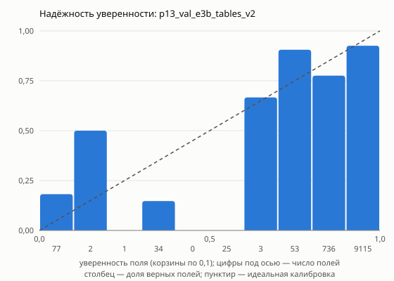
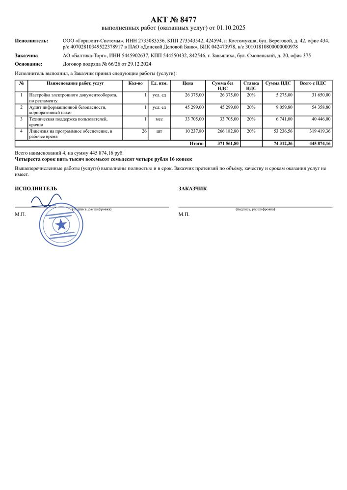
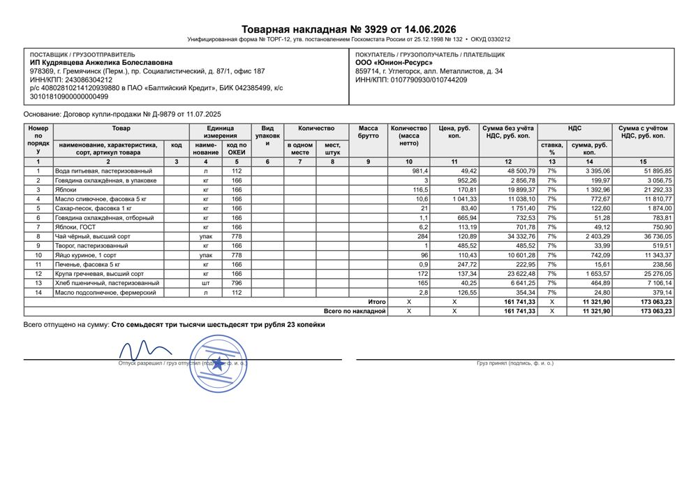
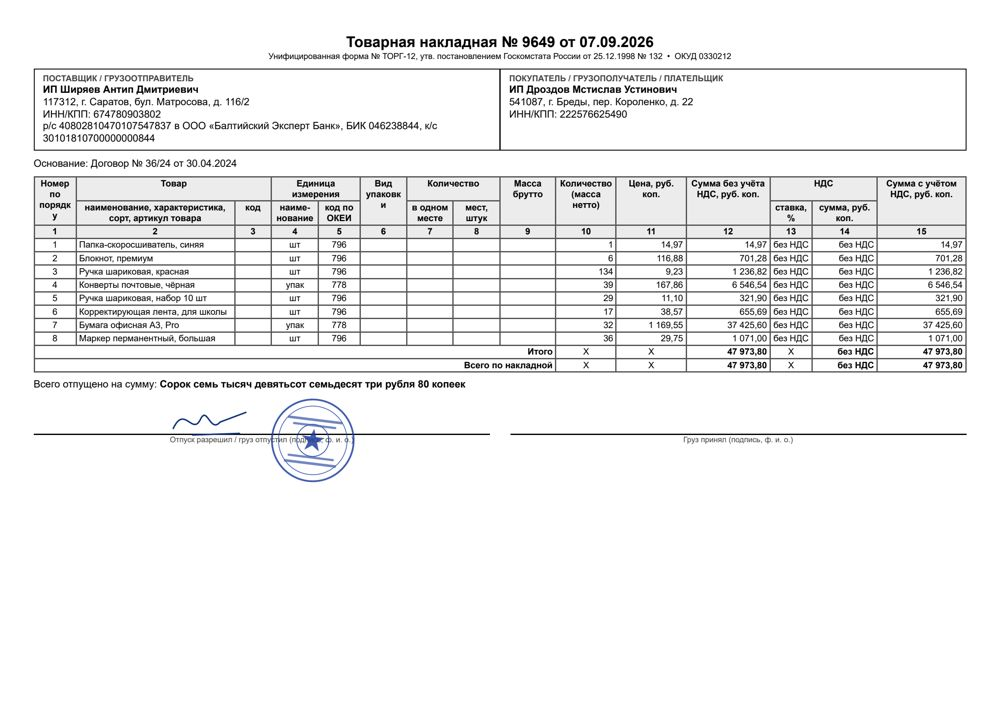
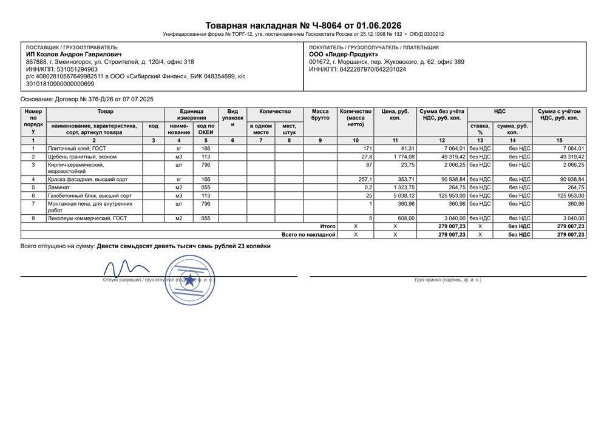
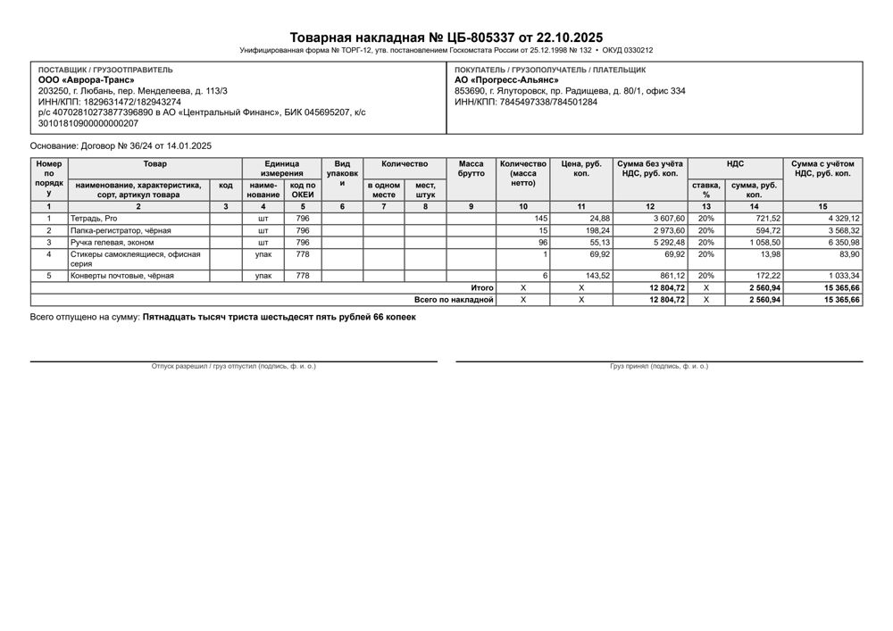

# Оценка: p13_val_e3b_tables_v2

E3b: таблица позиций построчно «графа: значение», итоговые строки помечены отдельно, поверх E1 + E2. Гипотеза: сдвиг граф исчезнет, как в E3 (там 69 → 0 блокирующих), без лишних строк; доля без правок вырастет на ≥ 4 п.п. относительно E2.

Запуск: `uv run docai eval --config configs/eval/p13_val_e3b_tables_v2.yaml` (копия — `config.yaml`). docai 0.1.0.

| Параметр | Значение |
|---|---|
| Модель | `qwen3.5:2b-q4_K_M` |
| Путь извлечения | `text` |
| Промпты | `text_v3`, `vision_v2` |
| Выборка | 150 прогонов, 150 документов, сплит `val`, уровни clean (rotate) |
| Seed | 2026 |
| Интервалы | бутстреп по документам, 2000 повторов, 95% |

## Главное

В скобках — 95-процентный доверительный интервал (бутстреп по документам, D45).

| Метрика | Значение |
|---|---|
| Документов без ошибок в обязательных полях (можно загружать без правок) | 43,3% [35,3; 51,3] |
| Тип документа верен | 95,3% [91,3; 98,7] |
| Документ собран (валидный JSON) | 96,7% [93,3; 99,3] |
| Поля шапки: accuracy | 82,5% [78,8; 85,5] |
| Обязательные поля шапки: accuracy | 92,2% [89,0; 95,1] |
| Выдумки: значение при пустом эталоне | 13,7% [8,1; 19,8] |
| Текстовые поля: ANLS | 82,5% [77,2; 86,9] |
| Текстовые поля: accuracy | 75,0% [69,7; 79,8] |
| Строки: precision (найдена пара) | 97,2% [95,2; 98,8] |
| Строки: recall (найдена пара) | 94,4% [89,1; 98,4] |
| Строки: F1 (найдена пара) | 95,8% [92,6; 98,2] |
| Строки: F1 (строка верна целиком) | 46,0% [35,4; 56,4] |
| Ячейки: precision | 91,0% [87,8; 93,5] |
| Ячейки: recall | 86,2% [80,9; 90,6] |
| Ячейки: F1 | 88,5% [84,6; 91,7] |
| Статус «можно загружать» | 64,7% [56,7; 72,7] |
| Среди «можно загружать» — действительно без ошибок | 61,9% [52,3; 71,1] |
| Молча загружен с ошибкой (доля всех документов) | 24,7% [18,0; 31,3] |
| Документ с ошибкой отправлен на проверку или отклонён | 56,5% [45,9; 67,1] |
| Доля верных среди полей с уверенностью | 90,4% [87,9; 92,4] |
| Средняя уверенность поля | 96,2% [95,8; 96,7] |
| ECE (10 корзин) | 0,063 [0,047; 0,084] |
| MCE (10 корзин) | 0,515 [0,515; 0,840] |
| Brier | 0,082 [0,065; 0,101] |
| Секунд на страницу | 23,3 [21,0; 26,1] |

## Ответ модели до и после постобработки (P10)

Одни и те же документы: парный бутстреп разности «после − до», p — приближённое двустороннее по бутстрепу; для доли документов без правок — ещё тест Макнемара.

| Метрика | До | После | Разность [95% ДИ] | p |
|---|---|---|---|---|
| Документов без ошибок в обязательных полях (можно загружать без правок) | 27,3% | 43,3% | 16,0 п.п. [10,7; 22,0] | < 0,001 |
| Поля шапки: accuracy | 79,5% | 82,5% | 3,0 п.п. [2,1; 3,9] | < 0,001 |
| Обязательные поля шапки: accuracy | 87,5% | 92,2% | 4,7 п.п. [3,5; 6,0] | < 0,001 |
| Текстовые поля: ANLS | 82,5% | 82,5% | 0,0 п.п. [0,0; 0,0] | 1,000 |
| Строки: F1 (найдена пара) | 95,8% | 95,8% | 0,0 п.п. [0,0; 0,0] | 1,000 |
| Ячейки: F1 | 88,1% | 88,5% | 0,4 п.п. [0,2; 0,6] | < 0,001 |

Макнемар (без правок): только до — 0, только после — 24, p < 0,001 (точный биномиальный).

## По группам: тип документа

| Значение | Документов | Без правок | Тип верен | Шапка acc | ANLS | Строки F1 | Ячейки F1 | Молча с ошибкой | ECE | с/стр |
|---|---|---|---|---|---|---|---|---|---|---|
| act | 20 | 55,0% [34,9; 75,0] | 95,0% [85,0; 100,0] | 77,9% [67,4; 85,5] | 85,7% [74,3; 92,2] | 98,3% [93,1; 100,0] | 88,8% [84,2; 91,7] | 20,0% [5,0; 40,0] | 0,075 [0,053; 0,096] | 29,9 [21,4; 40,1] |
| bill | 37 | 2,7% [0,0; 8,1] | 94,6% [86,5; 100,0] | 86,4% [82,3; 90,1] | 75,7% [65,0; 84,0] | 96,3% [89,6; 100,0] | 76,2% [69,2; 80,8] | 64,9% [48,6; 81,1] | 0,153 [0,120; 0,193] | 26,1 [21,5; 30,9] |
| torg12 | 29 | 27,6% [13,8; 44,8] | 86,2% [72,4; 96,6] | 73,8% [61,2; 84,2] | 65,7% [50,0; 80,6] | 84,6% [69,0; 94,8] | 81,7% [66,6; 91,7] | 17,2% [3,4; 31,0] | 0,087 [0,051; 0,131] | 28,7 [22,0; 36,5] |
| upd | 45 | 71,1% [57,8; 84,4] | 100,0% [100,0; 100,0] | 84,4% [82,2; 86,7] | 91,7% [89,8; 93,5] | 98,4% [97,3; 99,3] | 98,0% [96,2; 99,2] | 6,7% [0,0; 15,6] | 0,033 [0,019; 0,053] | 18,0 [16,5; 19,8] |
| vat_invoice | 19 | 68,4% [47,4; 89,5] | 100,0% [100,0; 100,0] | 89,7% [84,5; 94,0] | 96,7% [92,6; 99,8] | 99,6% [98,6; 100,0] | 98,0% [95,8; 99,5] | 5,3% [0,0; 15,8] | 0,037 [0,019; 0,063] | 19,8 [14,1; 28,0] |

## По группам: уровень качества

| Значение | Документов | Без правок | Тип верен | Шапка acc | ANLS | Строки F1 | Ячейки F1 | Молча с ошибкой | ECE | с/стр |
|---|---|---|---|---|---|---|---|---|---|---|
| clean | 150 | 43,3% [35,3; 51,3] | 95,3% [91,3; 98,7] | 82,5% [78,8; 85,5] | 82,5% [77,2; 86,9] | 95,8% [92,6; 98,2] | 88,5% [84,6; 91,7] | 24,7% [18,0; 31,3] | 0,063 [0,047; 0,084] | 23,3 [21,0; 26,1] |

## По группам: путь извлечения

| Значение | Документов | Без правок | Тип верен | Шапка acc | ANLS | Строки F1 | Ячейки F1 | Молча с ошибкой | ECE | с/стр |
|---|---|---|---|---|---|---|---|---|---|---|
| text | 150 | 43,3% [35,3; 51,3] | 95,3% [91,3; 98,7] | 82,5% [78,8; 85,5] | 82,5% [77,2; 86,9] | 95,8% [92,6; 98,2] | 88,5% [84,6; 91,7] | 24,7% [18,0; 31,3] | 0,063 [0,047; 0,084] | 23,3 [21,0; 26,1] |

Столбцы: «Без правок» — документ без ошибок в обязательных полях; «Шапка acc» — accuracy полей шапки; ANLS — текстовые поля; «Строки F1» — найдена пара строки; «Молча с ошибкой» — статус «можно загружать» у документа с ошибкой; с/стр — секунд на страницу.

## По полям

Accuracy — верных среди непустых эталонных значений (у полей строк ячейка несопоставленной строки считается неверной); precision — верных среди непустых ответов.

| Поле | Название | Эталонных значений | Accuracy | ANLS | Precision |
|---|---|---|---|---|---|
| `doc_type` | Тип документа | 150 | 95,3% [91,3; 98,7] | — | — |
| `number` | Номер документа | 150 | 95,3% [91,3; 98,7] | 95,3% [91,3; 98,7] | — |
| `date` | Дата документа | 150 | 95,3% [91,3; 98,7] | — | — |
| `upd_status` | Статус УПД | 45 | 95,6% [88,6; 100,0] | — | — |
| `seller.name` | Продавец: наименование | 150 | 86,0% [80,0; 91,3] | 87,2% [81,8; 92,3] | — |
| `seller.inn` | Продавец: ИНН | 150 | 91,3% [86,0; 96,0] | — | — |
| `seller.kpp` | Продавец: КПП | 114 | 58,8% [49,6; 67,8] | — | — |
| `seller.address` | Продавец: адрес | 150 | 64,7% [57,3; 72,0] | 78,1% [71,9; 84,1] | — |
| `buyer.name` | Покупатель: наименование | 150 | 86,7% [80,7; 92,0] | 88,9% [83,6; 93,6] | — |
| `buyer.inn` | Покупатель: ИНН | 150 | 89,3% [84,0; 94,0] | — | — |
| `buyer.kpp` | Покупатель: КПП | 129 | 90,7% [85,2; 95,3] | — | — |
| `buyer.address` | Покупатель: адрес | 150 | 68,7% [61,3; 76,0] | 87,2% [82,6; 91,3] | — |
| `seller_bank.bank_name` | Банк продавца | 72 | 87,5% [79,2; 94,4] | 87,5% [79,2; 94,4] | — |
| `seller_bank.bik` | БИК | 72 | 87,5% [79,2; 94,4] | — | — |
| `seller_bank.corr_account` | Корр. счёт | 72 | 87,5% [79,2; 94,4] | — | — |
| `seller_bank.account` | Расчётный счёт | 72 | 84,7% [75,8; 92,6] | — | — |
| `basis.name` | Основание: вид документа | 112 | 12,5% [7,1; 19,1] | 30,6% [23,7; 38,1] | — |
| `basis.number` | Основание: номер | 112 | 68,8% [59,5; 77,0] | 68,8% [59,5; 77,0] | — |
| `basis.date` | Основание: дата | 112 | 68,8% [59,5; 77,0] | — | — |
| `lines[].name` | Строка: наименование | 894 | 63,6% [53,1; 73,3] | 79,0% [70,5; 86,2] | 65,6% [55,1; 74,9] |
| `lines[].unit_name` | Строка: единица измерения | 894 | 89,6% [82,3; 95,7] | 89,6% [82,3; 95,7] | 93,9% [87,9; 98,1] |
| `lines[].unit_code` | Строка: код ОКЕИ | 894 | 56,7% [45,9; 67,0] | — | 75,8% [64,0; 86,5] |
| `lines[].quantity` | Строка: количество | 894 | 94,4% [89,1; 98,4] | — | 98,9% [97,1; 100,0] |
| `lines[].price` | Строка: цена | 894 | 94,4% [89,1; 98,4] | — | 98,9% [97,1; 100,0] |
| `lines[].amount_without_vat` | Строка: сумма без НДС | 894 | 94,4% [89,1; 98,4] | — | 97,2% [95,2; 98,8] |
| `lines[].vat_rate` | Строка: ставка НДС | 894 | 93,2% [87,8; 97,8] | — | 96,6% [93,3; 99,0] |
| `lines[].vat_amount` | Строка: сумма НДС | 807 | 95,7% [91,0; 99,3] | — | 91,4% [86,9; 95,3] |
| `lines[].amount_with_vat` | Строка: сумма с НДС | 894 | 94,4% [89,1; 98,4] | — | 97,2% [95,2; 98,8] |
| `totals.amount_without_vat` | Итого без НДС | 150 | 96,7% [93,3; 99,3] | — | — |
| `totals.vat_amount` | Итого НДС | 130 | 96,9% [93,6; 99,2] | — | — |
| `totals.amount_with_vat` | Всего с НДС | 150 | 96,7% [93,3; 99,3] | — | — |

## Калибровка уверенности

Полей с уверенностью: 10046. ECE 0,063 [0,047; 0,084], MCE 0,515 [0,515; 0,840], Brier 0,082 [0,065; 0,101], AUROC «уверенность отличает верное поле от неверного» 0,603 [0,562; 0,643]. Порог «нужна проверка» — 0,80.

| Уверенность | Полей | Средняя уверенность | Доля верных |
|---|---|---|---|
| 0,0–0,1 | 77 | 0,015 | 18,2% |
| 0,1–0,2 | 2 | 0,168 | 50,0% |
| 0,2–0,3 | 1 | 0,244 | 0,0% |
| 0,3–0,4 | 34 | 0,390 | 14,7% |
| 0,4–0,5 | 0 | — | —% |
| 0,5–0,6 | 25 | 0,515 | 0,0% |
| 0,6–0,7 | 3 | 0,674 | 66,7% |
| 0,7–0,8 | 53 | 0,732 | 90,6% |
| 0,8–0,9 | 736 | 0,847 | 77,6% |
| 0,9–1,0 | 9115 | 0,985 | 92,6% |

## Производительность

Секунд на страницу (сумма времени / сумма страниц): 23,3 [21,0; 26,1]; медиана по документам 18,1, 90-й процентиль 39,9, максимум 88,7. Документ в среднем 27,1 с, всего 1,13 ч на 174 страниц. Пиковая VRAM (nvidia-smi, весь GPU): максимум 2405 МиБ, медиана 2405 МиБ. Токены: 319521 → 197532.

## Сравнение с `p13_val_e2_prompt`

Общих документов: 150. A — `p13_val_e2_prompt`, B — `p13_val_e3b_tables_v2`; парный бутстреп разности B − A.

| Метрика | A | B | B − A [95% ДИ] | p |
|---|---|---|---|---|
| Документов без ошибок в обязательных полях (можно загружать без правок) | 58,7 | 43,3 | -15,3 п.п. [-24,7; -5,3] | 0,003 |
| Тип документа верен | 96,7 | 95,3 | -1,3 п.п. [-3,3; 0,0] | 0,262 |
| Документ собран (валидный JSON) | 98,0 | 96,7 | -1,3 п.п. [-3,3; 0,0] | 0,262 |
| Поля шапки: accuracy | 82,8 | 82,5 | -0,3 п.п. [-2,7; 1,4] | 0,817 |
| Обязательные поля шапки: accuracy | 92,2 | 92,2 | 0,0 п.п. [-2,2; 1,7] | 0,983 |
| Выдумки: значение при пустом эталоне | 8,4 | 13,7 | 5,3 п.п. [0,6; 11,6] | 0,028 |
| Текстовые поля: ANLS | 89,9 | 82,5 | -7,5 п.п. [-12,7; -3,1] | < 0,001 |
| Текстовые поля: accuracy | 87,3 | 75,0 | -12,2 п.п. [-17,7; -7,2] | < 0,001 |
| Строки: precision (найдена пара) | 99,2 | 97,2 | -2,0 п.п. [-4,1; -0,2] | 0,025 |
| Строки: recall (найдена пара) | 97,0 | 94,4 | -2,6 п.п. [-7,2; 1,1] | 0,226 |
| Строки: F1 (найдена пара) | 98,1 | 95,8 | -2,3 п.п. [-5,3; 0,0] | 0,061 |
| Строки: F1 (строка верна целиком) | 46,7 | 46,0 | -0,7 п.п. [-7,3; 5,8] | 0,814 |
| Ячейки: precision | 92,4 | 91,0 | -1,5 п.п. [-4,5; 1,4] | 0,328 |
| Ячейки: recall | 89,6 | 86,2 | -3,5 п.п. [-8,1; 0,5] | 0,105 |
| Ячейки: F1 | 91,0 | 88,5 | -2,5 п.п. [-6,0; 0,5] | 0,103 |
| Статус «можно загружать» | 60,7 | 64,7 | 4,0 п.п. [-3,3; 12,0] | 0,335 |
| Среди «можно загружать» — действительно без ошибок | 85,7 | 61,9 | -23,9 п.п. [-33,6; -13,7] | < 0,001 |
| Молча загружен с ошибкой (доля всех документов) | 8,7 | 24,7 | 16,0 п.п. [9,3; 22,7] | < 0,001 |
| Документ с ошибкой отправлен на проверку или отклонён | 79,0 | 56,5 | -22,6 п.п. [-34,3; -10,9] | < 0,001 |
| Доля верных среди полей с уверенностью | 91,7 | 90,4 | -1,3 п.п. [-3,6; 0,9] | 0,262 |
| Средняя уверенность поля | 93,8 | 96,2 | 2,4 п.п. [1,1; 4,1] | < 0,001 |
| ECE (10 корзин) | 0,035 | 0,063 | 0,028 [0,013; 0,045] | < 0,001 |
| MCE (10 корзин) | 0,840 | 0,515 | -0,325 [-0,325; 0,106] | 0,644 |
| Brier | 0,053 | 0,082 | 0,028 [0,013; 0,047] | < 0,001 |
| Секунд на страницу | 20,991 | 23,336 | 2,344 [1,328; 3,568] | < 0,001 |

Макнемар (без правок): только A — 40, только B — 17, p = 0,004 (χ² с поправкой Йейтса).

## Худшие примеры

5 документов с наименьшим F1 по всем значениям (шапка и ячейки). Обозначения: ∅ — пусто; `lines[i↔j]` — строка i эталона сопоставлена со строкой j ответа. Значения показаны после нормализации FIELD_SPEC.

### 00592_act_clean_200dpi

Тип: act (ответ: —), уровень clean, путь text, статус reject, F1 0,0%, строк 0 из 4.

| Поле | Эталон | Ответ |
|---|---|---|
| doc_type | act | ∅ |
| number | 8477 | ∅ |
| date | 2025-10-01 | ∅ |
| seller.name | ооо горизонт-системы | ∅ |
| seller.inn | 2735083536 | ∅ |
| seller.kpp | 273543542 | ∅ |
| seller.address | 424594, г. костомукша, бул. береговой, д. 42, офис 434 | ∅ |
| buyer.name | ао балтика-торг | ∅ |
| buyer.inn | 5445902637 | ∅ |
| buyer.kpp | 544550432 | ∅ |
| buyer.address | 842546, г. завьялиха, бул. смоленский, д. 20, офис 375 | ∅ |
| seller_bank.bank_name | пао донской деловой банк | ∅ |
| seller_bank.bik | 042473978 | ∅ |
| seller_bank.corr_account | 30101810800000000978 | ∅ |
| seller_bank.account | 40702810349522378917 | ∅ |
| basis.name | договор подряда | ∅ |
| basis.number | 66/26 | ∅ |
| basis.date | 2024-12-29 | ∅ |
| totals.amount_without_vat | 371561.80 | ∅ |
| totals.vat_amount | 74312.36 | ∅ |
| totals.amount_with_vat | 445874.16 | ∅ |
| lines[0] — строка не найдена | Настройка электронного документооборота, по регламенту | ∅ |
| lines[1] — строка не найдена | Аудит информационной безопасности, корпоративный пакет | ∅ |
| lines[2] — строка не найдена | Техническая поддержка пользователей, срочно | ∅ |
| lines[3] — строка не найдена | Лицензия на программное обеспечение, в рабочее время | ∅ |

### 01767_torg12_clean_200dpi

Тип: torg12 (ответ: —), уровень clean, путь text, статус reject, F1 0,0%, строк 0 из 14.

| Поле | Эталон | Ответ |
|---|---|---|
| doc_type | torg12 | ∅ |
| number | 3929 | ∅ |
| date | 2026-06-14 | ∅ |
| seller.name | ип кудрявцева анжелика болеславовна | ∅ |
| seller.inn | 243086304212 | ∅ |
| seller.address | 978369, г. гремячинск (перм.), пр. социалистический, д. 8… | ∅ |
| buyer.name | ооо юнион-ресурс | ∅ |
| buyer.inn | 0107790930 | ∅ |
| buyer.kpp | 010744209 | ∅ |
| buyer.address | 859714, г. углегорск, алл. металлистов, д. 34 | ∅ |
| seller_bank.bank_name | пао балтийский кредит | ∅ |
| seller_bank.bik | 042385499 | ∅ |
| seller_bank.corr_account | 30101810900000000499 | ∅ |
| seller_bank.account | 40802810214120939880 | ∅ |
| basis.name | договор купли-продажи | ∅ |
| basis.number | д-9879 | ∅ |
| basis.date | 2025-07-11 | ∅ |
| totals.amount_without_vat | 161741.33 | ∅ |
| totals.vat_amount | 11321.90 | ∅ |
| totals.amount_with_vat | 173063.23 | ∅ |
| lines[0] — строка не найдена | Вода питьевая, пастеризованный | ∅ |
| lines[1] — строка не найдена | Говядина охлаждённая, в упаковке | ∅ |
| lines[2] — строка не найдена | Яблоки | ∅ |
| lines[3] — строка не найдена | Масло сливочное, фасовка 5 кг | ∅ |
| lines[4] — строка не найдена | Сахар-песок, фасовка 1 кг | ∅ |
| lines[5] — строка не найдена | Говядина охлаждённая, отборный | ∅ |
| lines[6] — строка не найдена | Яблоки, ГОСТ | ∅ |
| lines[7] — строка не найдена | Чай чёрный, высший сорт | ∅ |
| lines[8] — строка не найдена | Творог, пастеризованный | ∅ |
| lines[9] — строка не найдена | Яйцо куриное, 1 сорт | ∅ |
| … ещё 4 | | |

### 02337_torg12_clean_200dpi

Тип: torg12 (ответ: —), уровень clean, путь text, статус reject, F1 0,0%, строк 0 из 8.

| Поле | Эталон | Ответ |
|---|---|---|
| doc_type | torg12 | ∅ |
| number | 9649 | ∅ |
| date | 2026-09-07 | ∅ |
| seller.name | ип ширяев антип дмитриевич | ∅ |
| seller.inn | 674780903802 | ∅ |
| seller.address | 117312, г. саратов, бул. матросова, д. 116/2 | ∅ |
| buyer.name | ип дроздов мстислав устинович | ∅ |
| buyer.inn | 222576625490 | ∅ |
| buyer.address | 541087, г. бреды, пер. короленко, д. 22 | ∅ |
| seller_bank.bank_name | ооо балтийский эксперт банк | ∅ |
| seller_bank.bik | 046238844 | ∅ |
| seller_bank.corr_account | 30101810700000000844 | ∅ |
| seller_bank.account | 40802810470107547837 | ∅ |
| basis.name | договор | ∅ |
| basis.number | 36/24 | ∅ |
| basis.date | 2024-04-30 | ∅ |
| totals.amount_without_vat | 47973.80 | ∅ |
| totals.amount_with_vat | 47973.80 | ∅ |
| lines[0] — строка не найдена | Папка-скоросшиватель, синяя | ∅ |
| lines[1] — строка не найдена | Блокнот, премиум | ∅ |
| lines[2] — строка не найдена | Ручка шариковая, красная | ∅ |
| lines[3] — строка не найдена | Конверты почтовые, чёрная | ∅ |
| lines[4] — строка не найдена | Ручка шариковая, набор 10 шт | ∅ |
| lines[5] — строка не найдена | Корректирующая лента, для школы | ∅ |
| lines[6] — строка не найдена | Бумага офисная А3, Pro | ∅ |
| lines[7] — строка не найдена | Маркер перманентный, большая | ∅ |

### 02379_torg12_clean_200dpi

Тип: torg12 (ответ: —), уровень clean, путь text, статус reject, F1 0,0%, строк 0 из 8.

| Поле | Эталон | Ответ |
|---|---|---|
| doc_type | torg12 | ∅ |
| number | ч-8064 | ∅ |
| date | 2026-06-01 | ∅ |
| seller.name | ип козлов андрон гаврилович | ∅ |
| seller.inn | 531051294963 | ∅ |
| seller.address | 867888, г. змеиногорск, ул. строителей, д. 120/4, офис 318 | ∅ |
| buyer.name | ооо лидер-продукт | ∅ |
| buyer.inn | 6422287970 | ∅ |
| buyer.kpp | 642201024 | ∅ |
| buyer.address | 001672, г. моршанск, пер. жуковского, д. 62, офис 389 | ∅ |
| seller_bank.bank_name | ооо сибирский финанс | ∅ |
| seller_bank.bik | 048354699 | ∅ |
| seller_bank.corr_account | 30101810900000000699 | ∅ |
| seller_bank.account | 40802810567649982511 | ∅ |
| basis.name | договор | ∅ |
| basis.number | 376-д/26 | ∅ |
| basis.date | 2025-07-07 | ∅ |
| totals.amount_without_vat | 279007.23 | ∅ |
| totals.amount_with_vat | 279007.23 | ∅ |
| lines[0] — строка не найдена | Плиточный клей, ГОСТ | ∅ |
| lines[1] — строка не найдена | Щебень гранитный, эконом | ∅ |
| lines[2] — строка не найдена | Кирпич керамический, морозостойкий | ∅ |
| lines[3] — строка не найдена | Краска фасадная, высший сорт | ∅ |
| lines[4] — строка не найдена | Ламинат | ∅ |
| lines[5] — строка не найдена | Газобетонный блок, высший сорт | ∅ |
| lines[6] — строка не найдена | Монтажная пена, для внутренних работ | ∅ |
| lines[7] — строка не найдена | Линолеум коммерческий, ГОСТ | ∅ |

### 02555_torg12_clean_200dpi

Тип: torg12 (ответ: —), уровень clean, путь text, статус reject, F1 0,0%, строк 0 из 5.

| Поле | Эталон | Ответ |
|---|---|---|
| doc_type | torg12 | ∅ |
| number | цб-805337 | ∅ |
| date | 2025-10-22 | ∅ |
| seller.name | ооо аврора-транс | ∅ |
| seller.inn | 1829631472 | ∅ |
| seller.kpp | 182943274 | ∅ |
| seller.address | 203250, г. любань, пер. менделеева, д. 113/3 | ∅ |
| buyer.name | ао прогресс-альянс | ∅ |
| buyer.inn | 7845497338 | ∅ |
| buyer.kpp | 784501284 | ∅ |
| buyer.address | 853690, г. ялуторовск, пр. радищева, д. 80/1, офис 334 | ∅ |
| seller_bank.bank_name | ао центральный финанс | ∅ |
| seller_bank.bik | 045695207 | ∅ |
| seller_bank.corr_account | 30101810900000000207 | ∅ |
| seller_bank.account | 40702810273877396890 | ∅ |
| basis.name | договор | ∅ |
| basis.number | 36/24 | ∅ |
| basis.date | 2025-01-14 | ∅ |
| totals.amount_without_vat | 12804.72 | ∅ |
| totals.vat_amount | 2560.94 | ∅ |
| totals.amount_with_vat | 15365.66 | ∅ |
| lines[0] — строка не найдена | Тетрадь, Pro | ∅ |
| lines[1] — строка не найдена | Папка-регистратор, чёрная | ∅ |
| lines[2] — строка не найдена | Ручка гелевая, эконом | ∅ |
| lines[3] — строка не найдена | Стикеры самоклеящиеся, офисная серия | ∅ |
| lines[4] — строка не найдена | Конверты почтовые, чёрная | ∅ |

## Определения

Сравнение полей, сопоставление строк и «можно загружать без правок» — D44; интервалы, парное сравнение и калибровка — D45 (`docs/DECISIONS.md`). Все значения сравниваются после нормализации FIELD_SPEC.
